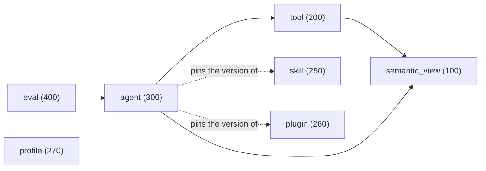
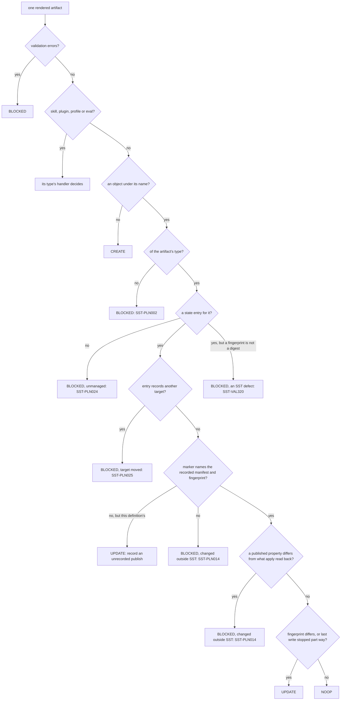
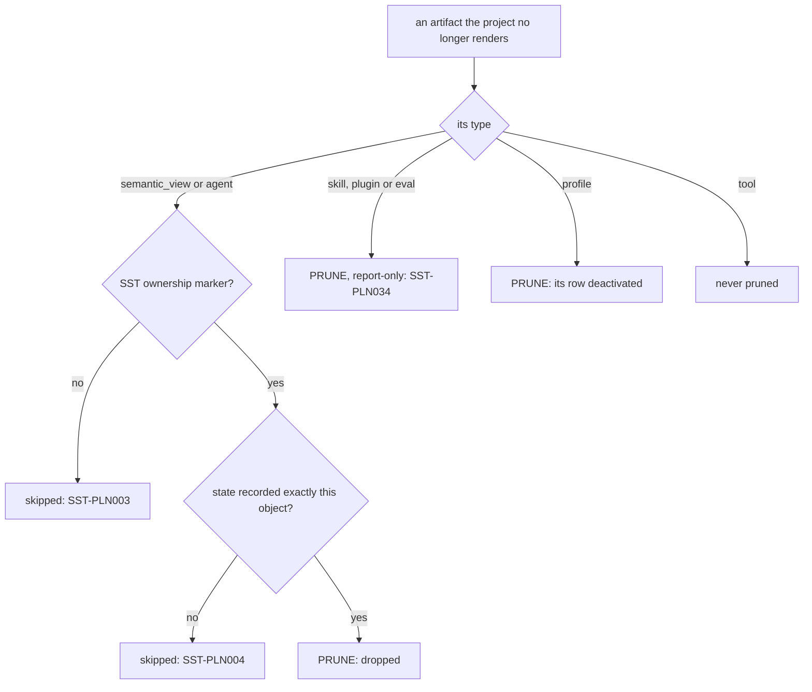

# Concepts

The ideas every other page assumes: what SST publishes, how authored pieces find
each other, and what each command does with them.

## Artifacts

An **artifact** is one thing SST publishes and tracks. There are seven types:

| Type | Authored as | Publishes |
|---|---|---|
| `semantic_view` | a `semantic_view:` file, or a `semantic_views:` list entry | a semantic view |
| `tool` | a `tool:` file, or a `tools:` list entry, that writes no `relations:` | a Cortex Search service, procedure, function, or stage |
| `skill` | a `SKILL.md` folder | a version of a skill-type Cortex Extension |
| `plugin` | `plugin.yml` | a version of a plugin-type Cortex Extension |
| `profile` | `profile.yml` | a CoCo Desktop profile: stage trees and one registry row |
| `agent` | `agent.yml` | a Cortex Agent |
| `eval` | the dataset and config files an agent's `evals:` names | an evaluation table, dataset, and run configuration |

Every command works on the same set, in the same order: an artifact is always
published after the artifacts it depends on, so a view exists before the agent
that queries it. The [artifact reference](reference/artifacts.md) lists each
type's position, dependencies, and how it is updated.

Each type and the types it may depend on, with an arrow pointing at the
dependency and each type's position in brackets; a dotted arrow is a dependency
whose published version an agent's specification pins:



Drawn from: [registry.py](../snowflake_semantic_tools/domain/model/registry.py).

`sst plan` orders its changes so that each follows every change it depends on,
then by position, then by key, and `apply` starts a change only once everything
it depends on has finished. Prunes run first, highest position first, so an
agent is dropped before the view it queried. A dependency cycle stops the plan
(`SST-PLN005`). An agent that pins a skill or plugin version is written only
when the plan also covers that skill or plugin, which proves the version exists
or publishes it first; one left out by `--select` or `--exclude` blocks the agent
(`SST-PLN030`).

Drawn from: [order.py](../snowflake_semantic_tools/domain/plan/order.py), [prune.py](../snowflake_semantic_tools/domain/plan/prune.py).

### Identity and versions

An artifact is identified by its **key**, `<type>:<name>`, such as
`semantic_view:jaffle_sales` or `agent:jaffle_analytics_agent`; an eval takes
its agent's name. The key never names a database or schema: the target being
built decides where the object lands, so the same key is a different object in
each target.

How a change reaches Snowflake depends on the type:

- a **semantic view** is replaced, with `COPY GRANTS`;
- a **tool** is replaced, except a stage, which is only ever created when
  absent;
- a **skill** or **plugin** gets a new extension version, whose alias is the
  version prefix and a digest of the bundle, so a published version is never
  rewritten;
- a **profile** uploads its trees under content-addressed prefixes, then
  switches its registry row to them;
- an **agent** is created once, from a specification staged on the
  `apply.agent_spec_stage` stage, which is only ever created when absent; each
  change to its specification adds a version;
- an **eval** publishes a new table and dataset when its questions change,
  keeping the old ones, and re-stages its configuration when that changes.

## Members

A semantic view is assembled from **members** that are authored separately:

- **facts, dimensions, and time dimensions** come from dbt column metadata
  (`config.meta.sst.column_type`);
- **metrics, relationships, filters, and verified queries** are YAML files,
  usually one per member under `metric:`, `relationship:`, `filter:` or
  `verified_query:`, or entries of a `snowflake_metrics:`,
  `snowflake_relationships:`, `snowflake_filters:` or `snowflake_verified_queries:`
  list;
- **custom instructions** are `custom_instruction:` files, or entries of a
  `snowflake_custom_instructions:` list.

A single-item file is read exactly as a one-item list, so either shape attaches
the same way; [Semantic views](guides/semantic-views.md#file-shapes) lists them.

A member is not published on its own; it reaches Snowflake inside every view it
attaches to. Members have keys too: `metric:order_count`, or
`fact:orders.order_total` for a column of a model.

## Association: how members find views

Metrics, relationships, filters, and verified queries attach by **table
membership**: a member joins every semantic view whose `tables:` include all of
the member's tables. A view need not list its metrics; adding a metric over
`orders` adds it to every view that has `orders`. A view that should expose less
narrows what attached, with `columns:`, `metrics:`, or `relationships:`, or their
`exclude_` counterparts.

A member's tables are the models its templates name with `{{ ref() }}`: a
metric's or filter's expression, or a verified query's SQL. A member never
writes `tables:`. A derived metric names no column: its tables come from the
metrics it references. Some consequences:

- A member whose tables no view covers attaches nowhere, and validation warns
  about it (`SST-MEM005`) instead of dropping it silently.
- A member that names no table, and is not a derived metric, is an error
  (`SST-MEM002`), since it could attach to no view.

Custom instructions are the exception: a view names the ones it wants with
`{{ custom_instructions('<name>') }}`.

## References

Authored files never contain a hardcoded database or schema. They name things,
and SST resolves the name for the target being built:

| Reference | Resolves to | Where it is accepted |
|---|---|---|
| `{{ ref('orders') }}` | the dbt model's relation | a view's `tables:`, relationship endpoints, verified query SQL |
| `{{ ref('orders', 'order_id') }}` | a column of that model | expressions, relationship conditions, a view's `columns:`, a non-additive dimension's `ref:`, a defined tool member's columns |
| `{{ source('raw', 'orders') }}` | a dbt source's relation, a table without columns | a view's `tables:` |
| `{{ metric('order_count') }}` | another metric's expression | metric expressions, verified query SQL, a view's `metrics:` |
| `{{ var('name') }}` | a value from `vars:` in `sst_config.yml` | metric and filter expressions, verified query SQL |
| `{{ custom_instructions('name') }}` | a custom instruction block | a view's `custom_instructions:` |
| `{{ filter('name') }}`, `{{ verified_query('name') }}` | that member's name | custom instruction text |
| `{{ relationship('name') }}` | a relationship | a view's `relationships:`, a metric's `using_relationships:`, custom instruction text |
| `{{ tag('name') }}` | a tag from `tags:` in `sst_config.yml` | the `name` of a view's or an agent's `config.tags` entry |
| `{{ semantic_view('name') }}`, `{{ agent('name') }}` | the published object | agent specs |
| `{{ tool('name') }}` | a tool member | agent specs, and the opening of a stage path |
| `{{ skill('name') }}`, `{{ plugin('name') }}` | a skill or plugin this project publishes, pinned to its current version | agent skill sources, plugin and profile members, a command's `skill:` |
| `{{ command('path') }}`, `{{ mcp_server('name') }}`, `{{ hook('name') }}` | a command, MCP config or hook the project holds | profile members |
| `{{ extension('name') }}` | an extension another project publishes, from `extensions:` | agent skill sources |
| `{{ eval_dataset('name') }}`, `{{ eval_config('name') }}` | the dataset or config file of that `name:` in the agent's `evals/` folder | an agent's `evals:` |
| `{{ eval_metric('name') }}` | a custom judge metric | eval configs |
| `{{ file('path') }}` | the contents of a file, relative to the file that names it | agent instructions, a verified query's `sql:`, a tool member's `body:`, a hook's `script:` |

A reference that does not resolve is an error, and so is a bare name where a
call belongs (`SST-REF050`). SST's `ref()` resolves against the dbt manifest, so
it names models and their columns exactly as dbt does.
[References](guides/references.md) lists every field that takes a call, and the
fields that stay literal.

## Targets

`--target` selects a target from `profiles.yml`, else `$SST_TARGET`, else the
profile's default target, and that target decides where everything lands.
Configuration writes locations relative to it:

```yaml
semantic_views:
  +database: "{{ target.database }}"
  +schema: "{{ target.schema }}"
```

Keys that start with `+` set a default for everything below them. In every
artifact block -- `semantic_views:`, `tools:`, `agents:`, `evals:`, `skills:`,
`plugins:` and `profiles:` -- an unprefixed key names a folder below that
type's directory (for views, below `semantic_views/` in the semantic models
directory), and its `+` keys apply to what is in that folder (`SST-CFG041` when
the folder does not exist). An artifact's own `config:` block overrides every
route; [Precedence](guides/configuration.md#precedence) gives the whole chain.

```yaml
semantic_views:
  +schema: "{{ target.schema }}"
  finance:
    +schema: FINANCE_SEMANTIC
```

`--defer-target` (or `defer.target`) resolves dbt models to another target's
relations while still publishing to `--target`.

## The pipeline

```text
compile  ->  validate  ->  plan  ->  apply  ->  test
```

- **`compile`** renders every artifact and writes the SST manifest to
  `target/sst/manifest.json`. It is offline, and an error stops it before it
  writes anything (`SST-MAN008`), unless `--partial` is given. `--emit-ddl <dir>`
  also writes each artifact's rendered payload, and `--emit-agent-spec <dir>`
  each agent's specification.
- **`validate`** compiles, then adds the checks compile does not run: the
  dependency-cycle check, `--strict`, and, when asked for, the connected checks.
  It writes nothing.
- **`plan`** compiles and validates, reads what is live in Snowflake, and saves
  the changes to `target/sst/plan.json`. It never writes to Snowflake, and it
  exits `2` when there are changes.
- **`apply`** plans again and executes the changes, after asking unless `--yes`
  is given. With `--plan <file>`, it executes that saved plan only if it was
  made for the same target, from the manifest the project compiles to now,
  against the same live state, with the same changes.
- **`test`** runs the golden suite offline, comparing rendered output with
  committed goldens, and, once a manifest exists, the smoke suite against
  deployed objects and the eval suite against agents. See
  [testing live](guides/testing-live.md) and [evals](guides/evals.md).

The **manifest** is the record of one compile: every artifact with its key,
fingerprint, publish target, dependencies, members, and source files. It holds
everything that compiled even under `--select`, and its `manifest_id` is a
digest of its content, so an edited manifest is detected.

`validate`, `plan`, and `apply` all run the same validation, so a project that
fails `validate` cannot be applied. `--no-validate` skips it on `plan` and
`apply`, for a tree `sst validate` already passed; compile errors still stop the
run.

## State and ownership

`apply` records every artifact it publishes -- its fingerprint, the object it
was published to, and the manifest and commit it came from -- in a state table,
`SST_STATE` in the target's database and schema by default (`state:` in
`sst_config.yml` moves it). A copy is cached locally in
`target/sst/state.<target>.json`. The next `plan` compares the project against
that record and against what is live.

Each artifact is compared with its own entry. Its fingerprint covers everything
its rendered form carries, including what it resolves from its dependencies,
such as the skill version an agent pins or the columns a search tool exposes. So
an artifact is updated only when its own render changed, however much else the
project changed. An apply narrowed by `--select` records only what it selected,
and the next full plan finds the rest unchanged. A semantic view an agent names
as a tool is referenced by name, so editing the view republishes the view and
not the agent.

### Concurrent applies and the run lock

Only one run that writes to a target -- `apply`, the eval suite of `sst test`, or
`sst drop` -- runs against it at a time. Before it writes anything, the run
takes the target's row in a lock table beside the state table (`SST_STATE_LOCK`
for the default `SST_STATE`), recording its run id, the role and machine it runs
as, and when the lock expires. Every operation on the lock table runs as one
transaction whose first statement writes the table's mutex row, so it waits for
any other such transaction to end before it reads the lock; of any number of
runs that race for it exactly one proceeds, and the others stop with
`SST-APL011` naming the holder. The winner is issued the next *generation*, a
fencing token it presents to extend or release the lock and to write state. A
long run extends its lock every five minutes, on a connection of its own, and
releases it when it ends, however it ends: Ctrl-C, `SIGTERM`, and `SIGHUP` all
end it as an interrupt, after `apply` records what finished (exit 130). Only a
process that cannot run its cleanup, killed by `SIGKILL` or with its machine
lost, leaves its lock behind. Expiry is judged by Snowflake's
clock. A lock left behind by a run that was killed expires 30 minutes after it
was last extended; `--break-stale-lock` takes over an expired lock
(`SST-APL010`), and never a live one. A run also keeps a lock file beside its
local state cache, which guards that checkout only; when another run's lock file
refuses a run, `SST-APL011` names the file and when it goes stale.

A run that may only read and write SST's tables can use them: the lock, state,
and eval tables are created, or given a column an older release lacked, only
when they need it. `plan` reports a missing CREATE TABLE privilege on the state
schema (`SST-PLN008`) only when a state or lock table does not exist yet.

Once it holds the lock, a run reads the target's state again, and refuses the
plan (`SST-APL012`) if another run changed it since the plan read it. If the run
loses its lock while it runs, it starts no further statement and writes no state
(`SST-APL011`): the run that took the lock over owns the target's state.

The heartbeat alone would find a lost lock only at its next beat, up to five
minutes late, and a run paused past its lock's expiry -- a laptop asleep, a
frozen CI runner -- may find another run holding it when it resumes. So a run
reads its lock row again before each change starts, and before every write
statement of a change, on the session that runs it: a publish of several
statements, such as an agent's, stops at the first one after the takeover. No
clock decides that a read may be skipped, since a monotonic clock stands still
while the machine sleeps. One window remains: between the read and the one
statement it guards, a few milliseconds, another run may take the lock, and
that statement still runs. The next plan reports what it overwrote as changed
out of band (`SST-PLN014`).

If Snowflake ends a session the run is using -- the network drops, the session
is aborted or expires -- the run opens one fresh connection to record in state
the changes that finished and to release its lock, so the target is not left
locked, and reports `SST-APL103`, naming what finished; run `sst plan` to see
what is left.

A run writes state once, after its changes: in one transaction that first checks
it still holds the lock with its token, one `MERGE` per entry it changed and one
`DELETE` per entry it retired, then it stamps the manifest it applied on the
target's rows. Entries the run did not touch are left exactly as they were.

**State and lock table type.** Both tables are standard tables, a choice made in
one place in the connector. From Snowflake's documented semantics:

| | Standard table | Hybrid table |
|---|---|---|
| Primary key | declared, not enforced | required and enforced |
| Concurrent `MERGE`/`UPDATE`/`DELETE` | serialised by a table lock | row-level locks |
| Availability | every account | not every account or region |

A standard table cannot enforce the lock row's key, and `SELECT ... FOR UPDATE`
is for hybrid tables only, so SST relies on neither: its lock transactions
serialise on the table lock that an `UPDATE` of the mutex row takes and holds
until `COMMIT`, and each then reads what the previous one committed.

**Contention is per lock table, not per target.** Every lock transaction writes
the same mutex row, so a claim, extend, release or state write for one target
waits for any such transaction for another target that shares the lock table.
Measured on a standard table, the wait does not depend on the mutex: an `UPDATE`
of one existing row waits for an uncommitted `UPDATE` of a different row until
that transaction commits (an `INSERT` does not wait). Each transaction is only a
few bound statements, committed as soon as they finish, so the wait is short; a
state write lasts longer the more entries the run changed.

A hybrid table would reject a second insert outright and let state writes to
different targets proceed without waiting on each other, at the cost of
availability: Snowflake also refuses to create one in a transient database or
schema. How a hybrid table behaves under SST's write pattern has not yet been
measured.

### Ownership, grants, and prune

SST changes only objects it published. An object that already exists under an
artifact's name, and that state records no entry for, is **unmanaged**: the plan
blocks that artifact (`SST-PLN024`, an error) and leaves the object alone; SST
has no command to take such an object over, so drop it by hand or rename the
artifact. SST never grants new access: access to published
objects is managed outside SST. When it replaces an object, it keeps the
explicit grants the object already held -- with `COPY GRANTS` for a semantic
view, procedure, or function, and by re-issuing them for a Cortex Search
service -- and verifies them afterwards. `plan` warns of the grants a replace
would drop (`SST-PLN013`).

`--prune` extends a plan to managed artifacts whose source was deleted. What
happens depends on the type: semantic views and agents are dropped, and
profiles are deactivated. Skills, plugins, and evals are **report-only**: the
plan lists them (`SST-PLN034`, an info diagnostic), but they are never removed,
because an agent elsewhere may still pin a version, or a run or baseline may
still reference an evaluation. A report-only prune never makes `--strict` fail.
Tools are never pruned. `apply --prune` needs `--yes`, and records that the
source is gone; until it has, `plan` exits 2, because that apply still changes
the state table. The plan keeps listing report-only objects until they are
removed by hand.

`--partial` lets `compile`, `plan`, and `apply` go ahead with every artifact
that has no errors and depends on nothing that does. An error on a tool
member's reference, such as a relation missing for the target, counts against
that tool. An artifact the plan blocks against the target -- changed out of band
(`SST-PLN014`), unmanaged (`SST-PLN024`), or recorded at another target
(`SST-PLN025`) -- is left out the same way, and so is everything that depends on
it. Each artifact left out is listed (`SST-PLN032`); what is live for it stays
as it is, and its state record is untouched. The command still exits 1 while
errors remain, and an error that names no artifact, such as a configuration
error, still stops the run, with the warning `SST-PLN033` saying why. A saved
partial plan applies only with `--partial`, and `--partial` cannot be combined
with `--prune`, because an artifact left out for errors would look deleted.

### How plan decides each change

`plan` gives every artifact one action -- `create`, `update`, `noop`, `prune`, or
`blocked` -- and a reason, which the plan prints and saves in `plan.json`. A
blocked artifact writes nothing, and stays in the plan so that it is reported.
The first question that applies decides; skills, plugins, profiles, and evals
are made of several resources, so each type's own handler compares those:



Drawn from: [classify.py](../snowflake_semantic_tools/domain/plan/classify.py), [action.py](../snowflake_semantic_tools/domain/model/lifecycle/action.py).

An object edited outside SST so that its marker no longer matches what state
recorded is never overwritten: the plan blocks it, with the warning `SST-PLN014`, until
the object SST wrote is restored or the object is removed. An object whose
marker names the very definition being planned is updated instead: an apply
published it and was stopped before it recorded it, so publishing it again
records it.

A marker only proves which definition SST wrote, and most hand edits keep the
comment it lives in: every `ALTER` that does not set the comment, and a
`CREATE OR REPLACE` from the object's own `GET_DDL`. So once a write is
verified, apply reads back the properties SST published that the marker does
not prove, and records a digest of them in state; every plan reads them again
and blocks an object whose marker is as recorded but whose properties are not
(`SST-PLN014`, naming what changed):

| Object | What plan compares | Read with |
|---|---|---|
| Agent | the specification its newest committed version holds | `SHOW VERSIONS IN AGENT`, which plan reads anyway |
| Cortex search service | `TARGET_LAG` and `WAREHOUSE` | `SHOW CORTEX SEARCH SERVICES`, which plan reads anyway |
| Function | `SECURE` | `SHOW FUNCTIONS`, which plan reads anyway |
| Procedure | `SECURE`, `EXECUTE AS` and the body | `SHOW PROCEDURES`, and one `DESCRIBE PROCEDURE` each |
| Semantic view | its whole definition | one `GET_DDL` each |

`plan.drift_check: basic` skips the `DESCRIBE PROCEDURE` and `GET_DDL` reads,
so it compares only what the listings show; `full`, the default, compares
everything above. A read that fails is the warning `SST-PLN103`, and the
object's other properties are still compared. An entry written before SST
recorded digests, such as one from an earlier release, is never taken for
drift: the first apply after it records what plan saw, and the plans after
that compare. An agent whose alias or default version moved onto a version
that holds SST's own specification is not blocked but rolled forward
(`SST-PLN102`). Anything else about an object -- its grants, its tags, or a
property SST does not publish -- is not compared.

With `--prune`, the plan then looks at what SST published and the project no
longer renders:



Drawn from: [prune.py](../snowflake_semantic_tools/domain/plan/prune.py), [composite.py](../snowflake_semantic_tools/app/lifecycle/composite.py), [profiles.py](../snowflake_semantic_tools/app/lifecycle/profiles.py).

Then blocking spreads: a write whose dependency the project compiles, the plan
leaves out, and Snowflake lacks is blocked (`SST-PLN038`), and so, last, is
every change that depends, however indirectly, on a blocked one. A plan
narrowed by `--select` still observes the types of everything the selected
artifacts depend on, so `--select agent:<name>` sees the views and tools that
exist and plans the agent alone. A pinned skill or plugin version is a separate
check: a write that pins a version the plan leaves out is blocked with
`SST-PLN030` whether or not it exists, so select the pinned artifact too. `sst plan` exits 1 when any change is
blocked or an error is reported, 2 when apply would write or still has state to
record, and 0 otherwise; `--no-detailed-exitcode` turns 2 into 0.

Drawn from: [changeset.py](../snowflake_semantic_tools/domain/plan/changeset.py), [plan_output.py](../snowflake_semantic_tools/cli/plan_output.py).

## Diagnostics

Every problem SST reports is a **diagnostic** with a stable code, such as
`SST-VAL405`:

- an **error** blocks the command;
- a **warning** does not, unless `--strict` or `validation.strict: true`
  promotes it;
- an **info** never blocks.

A warning held in the **baseline** file (`.sst/baseline.json`, written by
`sst baseline add`) is counted rather than shown, and never blocks, even under
`--strict`, until the baseline expires. `--no-baseline` ignores it for one run.

Some errors stop other checks from running on the same artifact, so fixing one
error can reveal the next. The [error code reference](reference/error-codes.md)
describes every code and its fix.

## Terms used in the code

The engine's docstrings and diagnostics use a few words in one sense each:

- **key**: an artifact's or member's identity, written `<type>:<name>`, such as
  `semantic_view:jaffle_menu` or `metric:order_count`. Keys are stored in the
  state table and the manifest, and `--select` matches them.
- **subject**: the key a diagnostic is about. `--partial` and the error reports
  use it to tell which artifact an error belongs to.
- **origin**: the file, line, and column a diagnostic points at.
- **fingerprint**: a SHA-256 digest of what an artifact renders. `plan` compares
  it with the fingerprint recorded in state to decide whether an object changed.
- **poisoned**: a member or view that has an error is poisoned. It is still
  checked, so every error is reported at once, but it is not attached to views
  or built; this is why fixing one error can reveal the next.
- **ownership marker**: the `[sst:<manifest id>:<fingerprint>]` tag SST writes at
  the end of an object's comment, after its description, which `plan` reads to
  prove that SST published it. A marker anywhere in the comment is read.
