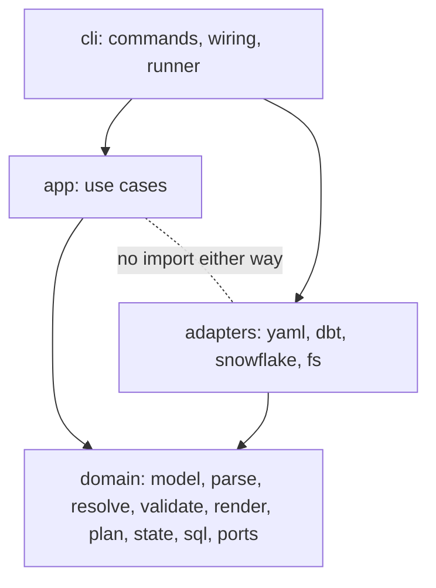
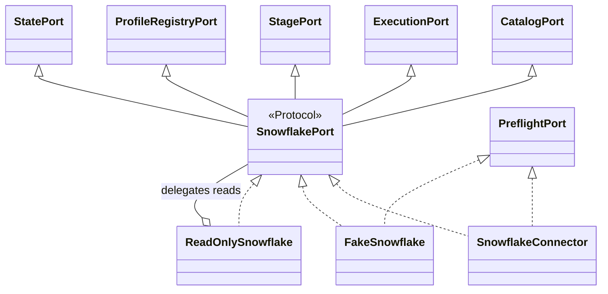
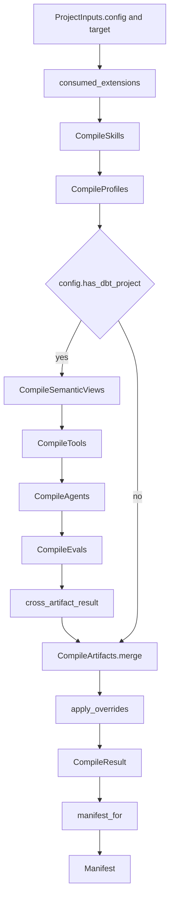
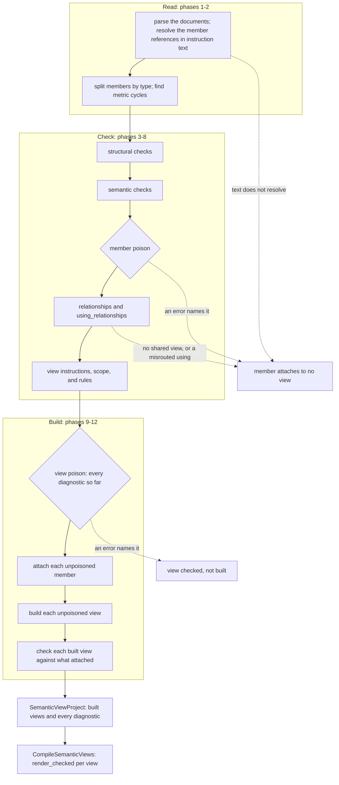
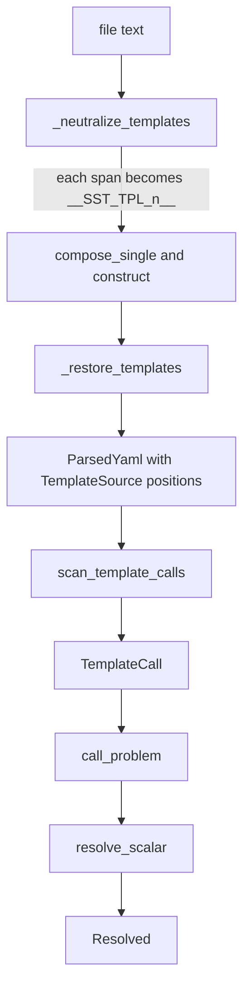
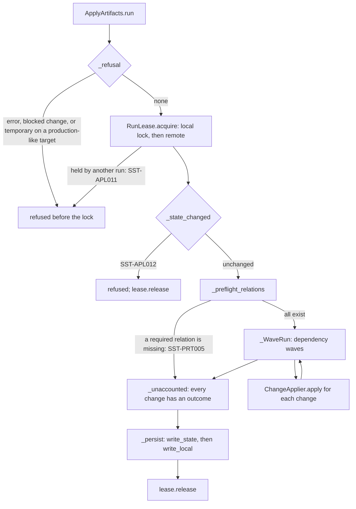
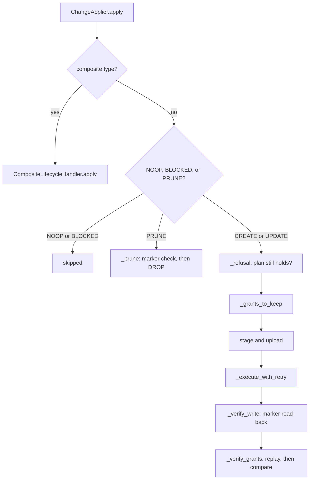
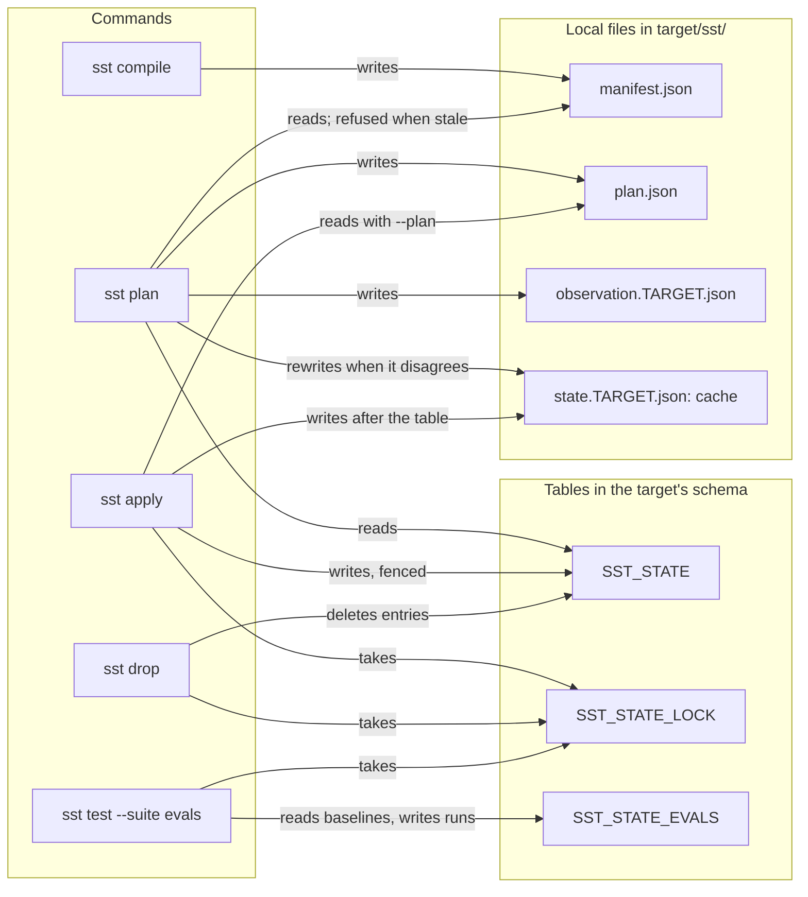

# Architecture

How the engine is put together, and why, for a maintainer who has to change it
without breaking a contract. [CONTRIBUTING.md](../../CONTRIBUTING.md#architecture)
lists the layout and the rules; this page explains what each rule buys and where
the seams between the parts are. [Concepts](../concepts.md) defines the
vocabulary used here: key, fingerprint, poisoned, ownership marker.

## Rings and import contracts

The package is four rings. Imports run one way, from the command line inward,
and the two middle rings never see each other. The rule exists so that the one
ring holding the logic, `domain`, can be tested on values alone, and so that the
use cases in `app` never depend on which file format or SDK sits behind them.

The diagram shows which ring may import which.

Drawn from: [pyproject.toml](../../pyproject.toml), [cli/wiring/project.py](../../snowflake_semantic_tools/cli/wiring/project.py).

`cli` is the composition root: it is the only ring that constructs an adapter and
hands it to a use case. A use case receives everything it touches through a
protocol in `domain/ports/`, so `app` and `adapters` meet only in `cli`.

`poetry run lint-imports` enforces seven contracts, by these exact names:

| Contract | Why it exists |
|---|---|
| Rings are layered: cli above (app \| adapters) above domain | A use case cannot reach for a concrete adapter, and an adapter cannot call back into a use case, so either side can be replaced alone. |
| domain is pure -- no I/O, no clock, no environment, no SDKs | Everything the domain needs arrives as a parameter, so its output is a function of its input. |
| app imports domain only -- no SDKs, no terminal | Orchestration stays independent of the YAML library, click, and the Snowflake driver; printing is the CLI's job. |
| adapters use domain ports and models, not domain renderers | Rendering is domain logic; an adapter reads and writes, it does not decide what SST publishes. |
| adapter subpackages are independent | `yaml`, `dbt`, `snowflake`, and `fs` never import one another, so each can be tested and swapped on its own; a top-level adapter module such as `project_source.py` composes them. |
| only the roundtrip, dbt and yaml adapters edit YAML | In-place editing with `ruamel` preserves comments and layout; confining it keeps one implementation of that delicate step. |
| only the yaml and dbt adapters parse YAML | Each file is parsed at the edge that owns its format, so every parse goes through the same template handling and refusals. |

A contract that has never rejected anything proves nothing, so
`tests/unit/test_ring_boundaries.py` writes a module that crosses each boundary
into a copy of the package, asserts that `lint-imports` reports that contract
broken, and checks that the package root holds only the four rings and
`_version.py`.

### Why the domain is pure

Purity is what makes the engine's outputs reproducible. Rendering reads no clock,
so the manifest carries no generation time; JSON documents are written with
`canonical_json` (sorted keys, no whitespace, UTF-8, no NaN), so equal values give
equal bytes; and `manifest_id` is the SHA-256 of that encoding. Two compiles of
the same project write the same `manifest.json`, which
`tests/unit/cli/test_compile.py` checks, and the golden suite can compare
rendered text with committed files byte for byte (after the two normalisations
`tests/golden/README.md` names).

The import contract is static: it cannot see a call that opens a file through an
object handed in from outside. `app/purity.py` closes that gap at run time.
`pure_phase` marks a block as pure for the current context, and an audit hook,
installed once when the module is imported, raises `ImpureCall` for a file,
socket, or process event inside one. `compile_checked` in
`app/compile/base.py` renders each semantic view, tool, and eval inside a pure
phase and reports `SST-INT002` when rendering one reached the outside world. Files
the import system opens are allowed; nothing else is.

Drawn from: [pyproject.toml](../../pyproject.toml), [tests/unit/test_ring_boundaries.py](../../tests/unit/test_ring_boundaries.py), [app/purity.py](../../snowflake_semantic_tools/app/purity.py), [app/compile/base.py](../../snowflake_semantic_tools/app/compile/base.py), [domain/state/documents.py](../../snowflake_semantic_tools/domain/state/documents.py), [tests/golden/README.md](../../tests/golden/README.md).

## Ports and their implementations

A use case never constructs what it talks to. It is given a port, and the
narrowest one that covers its calls: `ApplyArtifacts` takes an `ApplyPort`, a
`StateStore`, and a `ClockPort`; `CompileProject` takes a `ProjectInputs`; the
smoke suite takes a `SmokePort`. In production `cli` passes real adapters; in the
unit tests the same use case runs against in-memory implementations of the same
protocol. That is why the test suite needs no mocking library and no account:
the fakes are real implementations with observable state, held to the same
contract as the production adapter.

Snowflake is reached through one protocol per role, gathered into a union. The
diagram shows the roles, the union, and the three implementations of it.

Drawn from: [domain/ports/snowflake/\_\_init\_\_.py](../../snowflake_semantic_tools/domain/ports/snowflake/__init__.py), [domain/ports/snowflake/preflight.py](../../snowflake_semantic_tools/domain/ports/snowflake/preflight.py), [adapters/snowflake/connector/\_\_init\_\_.py](../../snowflake_semantic_tools/adapters/snowflake/connector/__init__.py), [tests/helpers/snowflake_fake/port.py](../../tests/helpers/snowflake_fake/port.py), [tests/helpers/snowflake_fake/read_only.py](../../tests/helpers/snowflake_fake/read_only.py).

`SnowflakeConnector` assembles one mixin per role over a single driver session:
`CatalogMethods`, `StageMethods`, `StateTableMethods`, `RunLockMethods`, and the
rest, plus `ProfilerMethods` and `CortexMethods` for the ports `sst enrich` reads
through. `FakeSnowflake` composes one fake per role over one in-memory account.
`ReadOnlySnowflake` wraps any `SnowflakePort`, passes reads through, and refuses
scripts, uploads, state writes, and the run lock, so a test can prove a command's
reads alone suffice. `tests/contract/test_snowflake_port.py` holds the offline
doubles to one set of observable results, and
`tests/contract_live/test_connector_contract.py` runs the same contract against
the real connector in a scratch schema: a divergence means the doubles promise
something Snowflake does not.

The other ports follow the same pattern:

| Port (`domain/ports/`) | Production adapter | Test implementation |
|---|---|---|
| `ProjectInputs` | `YamlProjectInputs` (`adapters/project_source.py`) | `InMemoryProjectInputs` (`tests/helpers/project_inputs.py`) |
| `StateStore` | `StateFileStore` (`adapters/fs/local.py`) | `InMemoryStateStore` (`tests/helpers/app_ports.py`) |
| `ClockPort` | `SystemClock` (`adapters/clock.py`) | `FixedClock` (`tests/helpers/clocks.py`) |
| `GoldenStore` | `GoldenFileStore` (`adapters/fs/golden.py`) | `InMemoryGoldenStore` (`tests/helpers/golden_store.py`) |
| `EvalStateStore` | `SnowflakeEvalStateStore` (`adapters/snowflake/eval_state.py`) | `InMemoryEvalStateStore` (`tests/helpers/eval_state_store.py`) |

`ClockPort` also issues run ids, so even a run's identity is injected. The
composition root lives in three places: `cli/wiring/` binds a project directory
to its adapters (inputs, connector, state file), `cli/runner.py` runs each
command body under one exception guard and turns every exception into an exit
code, and `cli/settings.py` resolves the settings that have both a flag and a
configuration key.

### SQL is a value, not a string

Every statement SST sends is an `Sql` value from `domain/sql`. `sql()` composes
one from a constant template and parts that are themselves `Sql`, each built by a
constructor that quotes its input or refuses it: `ident`, `qname`, `literal`,
`keyword`, `datatype`, `guard_expression`, and the rest. `Sql` cannot be
constructed outside that package, and the connector turns one into text only at
the driver, through `Sql.for_driver`. A value read from a project file or from
Snowflake therefore reaches a statement only through quoting. The enforcement is
under [Building SQL](../../CONTRIBUTING.md#building-sql).

Drawn from: [domain/ports/project.py](../../snowflake_semantic_tools/domain/ports/project.py), [domain/ports/clock.py](../../snowflake_semantic_tools/domain/ports/clock.py), [domain/ports/state.py](../../snowflake_semantic_tools/domain/ports/state.py), [domain/ports/golden.py](../../snowflake_semantic_tools/domain/ports/golden.py), [app/apply/run.py](../../snowflake_semantic_tools/app/apply/run.py), [cli/wiring/project.py](../../snowflake_semantic_tools/cli/wiring/project.py), [cli/runner.py](../../snowflake_semantic_tools/cli/runner.py), [cli/settings.py](../../snowflake_semantic_tools/cli/settings.py), [domain/sql/core.py](../../snowflake_semantic_tools/domain/sql/core.py), [tests/contract/test_snowflake_port.py](../../tests/contract/test_snowflake_port.py).

## The artifact and member registries

`domain/model/registry.py` declares, once, every kind of thing SST knows about.
Plan order, discovery directories, the reference functions, grant handling, and
the generated [artifact reference](../reference/artifacts.md) all read it, so a
type is described in one place.

There are two registries in one `Registry` value, because artifacts and members
behave differently:

- An `ArtifactType` is something SST publishes and tracks in state. It has a
  `ddl_position`, which orders plan and apply; `dependency_types`, which must all
  sit at lower positions (`SST-REG010`); and lifecycle facts: `prunable`,
  `replaces_on_update`, `grant_preservation`, `lifecycle`.
- A `MemberType` is never created, dropped, or pruned on its own. It reaches
  Snowflake inside the views it attaches to, so it has a `clause_position`, its
  place in its owner's DDL, unique per owner, and an `attaches_by` rule (table
  membership, or naming by the view), but no lifecycle at all.

Folding members into the artifact registry would give them lifecycle fields that
mean nothing. Only `semantic_view` may own members: `MEMBER_OWNING_TYPES` names
it, and `RegistryBuilder.freeze` refuses any other owner with `SST-REG022`.

Every field is plain data: names, integers, enums, tuples. A type whose objects
no single statement publishes is marked `ArtifactLifecycle.COMPOSITE`, and its
behaviour lives in a `CompositeLifecycleHandler` in `app/lifecycle/` (the
eval, extension, and profile handlers, all built on `CompositeHandler`). Plan
and apply route every artifact of such a type to its handler, which observes,
decides, publishes, and reports which resources state should record. An
`OBJECT` type is one Snowflake object, planned and applied by the generic path.

`freeze` runs its integrity checks in a fixed order and raises the first
failure, so a broken registry always reports the same fault: required fields
(`SST-REG001`), root keys claimed once (`SST-REG003`), positions (`SST-REG004`),
names that resolve (`SST-REG007`), ownership (`SST-REG022`), rule sets
(`SST-REG006`), dependency cycles and order (`SST-REG011`, `SST-REG010`), grant
handling against lifecycle (`SST-REG021`), unique reference functions
(`SST-REG005`), and agreement with the resolvers (`SST-REG020`). Because the
registry is built at import, a contradiction stops every command, the tests
included.

### Adding an artifact type

1. Register an `ArtifactType` in `ARTIFACT_REGISTRY`, with its summary, where it
   is authored, what it publishes, its `dir_key`, and its `validation_rules`
   (names in `RULE_SETS`). Give it a `ddl_position` above every type in its
   `dependency_types`, and either a `ref_function` some resolver handles or a
   place in `DELIBERATELY_UNREFERENCED`.
2. Teach `ProjectInputs` to load it, in `YamlProjectInputs` and
   `InMemoryProjectInputs` alike.
3. Write a compiler under `app/compile/` whose `run_result` returns a
   `CompileResult` of `CompiledArtifact` values, rendering each through
   `RenderedArtifact.create` from a renderer in `domain/render/`, and call it
   from `CompileProject.run` at the point its inputs exist.
4. For a composite type, implement its handler in `app/lifecycle/` and add it
   to `_lifecycle_handlers` in `app/plan.py`; an object type needs an
   `object_type` and nothing more.
5. Give it a route in `golden_payloads` (`app/golden.py`), which raises for a
   type with none, then commit goldens with `--update-golden`.
6. Run `poetry run sst docs` and commit the regenerated reference pages.

Drawn from: [domain/model/registry.py](../../snowflake_semantic_tools/domain/model/registry.py), [domain/ports/lifecycle.py](../../snowflake_semantic_tools/domain/ports/lifecycle.py), [app/lifecycle/composite.py](../../snowflake_semantic_tools/app/lifecycle/composite.py), [app/plan.py](../../snowflake_semantic_tools/app/plan.py), [app/golden.py](../../snowflake_semantic_tools/app/golden.py), [domain/render/reference_docs.py](../../snowflake_semantic_tools/domain/render/reference_docs.py).

## The compile pipeline

`CompileProject` reads the project only through `ProjectInputs`, so it touches
no file. It runs one typed compiler per artifact type, in a fixed order that is
also the order a broken input is reported in, and merges their results.

The diagram shows `CompileProject.run` from configuration to manifest.

Drawn from: [app/compile/project.py](../../snowflake_semantic_tools/app/compile/project.py), [app/compile/\_\_init\_\_.py](../../snowflake_semantic_tools/app/compile/__init__.py), [app/compile/base.py](../../snowflake_semantic_tools/app/compile/base.py), [app/manifest.py](../../snowflake_semantic_tools/app/manifest.py).

Skills and plugins compile only when `skills.catalog` or `skills.stage` is
configured, and profiles only with the stage channel. Each later compiler reads
what the earlier ones produced: tools read the dbt relations, agents the views
and tools that compiled, evals the tools each agent resolved. The checks that
span all four run after them, as a result that compiles nothing.

Every compiler returns a `CompileResult`: a tuple of `CompiledArtifact` values
and a `DiagnosticBag`. A problem in what was authored is a diagnostic, never an
exception. Each compiled artifact yields a `RenderedArtifact`, the canonical
text, its fingerprint, and the statements apply would run. `CompileArtifacts.merge`
orders the stream by registry position, then by key; `apply_overrides` then
applies the project's severity overrides, once, to everything. `manifest_for`
turns the result into the `Manifest`, recording what `ProjectInputs.manifest_sources`
read about the files.

### Loading semantic views

Semantic views are the one artifact type with members, so their loading is the
longest phase. `YamlProjectSource.load_project` reads SST's own files first, then
the dbt catalog, then runs `load_semantic_views_result`. The diagram groups its
twelve phases, in report order, and shows where poisoning takes a member or a
view out.

Drawn from: [adapters/project_source.py](../../snowflake_semantic_tools/adapters/project_source.py), [adapters/yaml/semantic/pipeline.py](../../snowflake_semantic_tools/adapters/yaml/semantic/pipeline.py), [adapters/yaml/semantic/poison.py](../../snowflake_semantic_tools/adapters/yaml/semantic/poison.py), [domain/model/project.py](../../snowflake_semantic_tools/domain/model/project.py), [domain/render/semantic_view.py](../../snowflake_semantic_tools/domain/render/semantic_view.py).

`Poison` is what keeps one fault to one diagnostic. It grows by copy as phases
find errors: a poisoned member attaches to no view, and a poisoned view is
checked but not built, while everything that does not depend on them still
builds. `_view_poison` reads every diagnostic reported before it, so only a
check that runs earlier can keep a view from being built; the ordering matters
when a check is moved. `_resolve_and_build` attaches each unpoisoned member by
`domain.resolve.membership`, builds the views, and checks each built view against
what attached. The result is a `ResolvedProject`: the views, the member-to-view
attachment, and every diagnostic. A view a diagnostic kept from building is
absent rather than half built.

The phase sequence lives in `adapters/yaml/semantic` because it walks parsed
documents, raw nodes, and file paths, which the domain may not touch. What it
calls is domain code: the checks in `domain.validate.semantic`, attachment in
`domain.resolve`, and rendering in `domain.render`, each a function of values
that the domain's tests exercise without a file.

## Templates and references

Authored files name things with `{{ function('arg') }}` calls rather than
hardcoded databases and schemas. An unquoted `{{` is not valid YAML: it opens a
flow mapping. So the parser hides each template before YAML sees it and puts it
back afterwards, and an author never has to quote a template.

The diagram shows a scalar's path from file text to resolved value.

Drawn from: [adapters/yaml/parse.py](../../snowflake_semantic_tools/adapters/yaml/parse.py), [adapters/yaml/documents.py](../../snowflake_semantic_tools/adapters/yaml/documents.py), [domain/parse/template.py](../../snowflake_semantic_tools/domain/parse/template.py), [domain/resolve/calls.py](../../snowflake_semantic_tools/domain/resolve/calls.py), [domain/resolve/template.py](../../snowflake_semantic_tools/domain/resolve/template.py).

`_neutralize_templates` replaces each span on an executable line with a
placeholder and records its `TemplateSource`: the raw text and its line and
column. Comments and block scalars are left alone, since they are already legal
YAML. An unterminated or nested span is `SST-LOD004`. `_restore_templates` puts
the raw text back into every string, so a template survives exactly as written,
and every diagnostic can point at its source position.

`scan_template_calls` in `domain/parse/template.py` turns the restored text into
`TemplateCall` values with exact spans. `call_problem` in
`domain/resolve/calls.py` decides whether a call is legal where it is written
before anything looks up what it names: a legacy `table()` or `column()` call is
refused at the call (`SST-REF034`, `SST-REF035`), an unknown function is
`SST-REF004`, a function the field does not accept is `SST-REF041`, and a wrong
argument count is `SST-REF015`. The resolver and the load-time checks both call
it, so a call is refused the same way wherever it appears.

`KNOWN_FUNCTIONS` is the whole dialect. Each function names one kind of thing,
and is resolved where that thing is known:

| Function | Names | Resolved by |
|---|---|---|
| `ref('model')`, `ref('model', 'column')` | a dbt model's relation, or one of its columns | `resolve_scalar` |
| `metric()` | a metric member | `resolve_scalar` |
| `custom_instructions()` | a custom instruction member | `resolve_scalar`, and the semantic load for a view's entries |
| `relationship()`, `filter()`, `verified_query()` | that member, by name, in custom instruction text | `resolve_scalar` |
| `var()` | a project variable from `vars:` | `resolve_scalar` |
| `tag()` | a tag from `tags:` | `resolve_scalar` |
| `semantic_view()`, `tool('group', 'name')`, `agent()` | that artifact | the agent loader, then `app/compile/agents/resolve_tools.py` |
| `skill()`, `plugin()` | a skill or plugin this project publishes | the agent loader, then `app/compile/agents/resolve_skills.py` |
| `extension()` | an extension another project publishes, from `skills.extensions` | the agent loader, then `app/compile/agents/resolve_skills.py` |
| `file()` | a file beside the agent | the agent loader |
| `eval_metric()` | a custom judge metric | the eval config reader |
| `table()`, `column()` | nothing: legacy spellings of `ref()` | refused |

`resolve_scalar` resolves a scalar's calls from last to first, so each
substitution leaves the earlier offsets valid, and records each call it
resolved as a `RefOrigin` whose `RefKind` attachment and validation later read.

Drawn from: [domain/resolve/calls.py](../../snowflake_semantic_tools/domain/resolve/calls.py), [domain/resolve/template.py](../../snowflake_semantic_tools/domain/resolve/template.py), [adapters/yaml/agents.py](../../snowflake_semantic_tools/adapters/yaml/agents.py), [app/compile/agents/resolve_tools.py](../../snowflake_semantic_tools/app/compile/agents/resolve_tools.py), [app/compile/agents/resolve_skills.py](../../snowflake_semantic_tools/app/compile/agents/resolve_skills.py), [adapters/yaml/evals/config.py](../../snowflake_semantic_tools/adapters/yaml/evals/config.py).

## Plan, apply, and the run

`plan` reads and never writes Snowflake. It compiles, validates, reads state and
what is live, decides one change per artifact, and saves the result as
`target/sst/plan.json`. `apply` plans again and executes. With `--plan <file>`
it executes the saved plan only when `SavedPlan.check_applicable` finds the
fresh plan identical to it: the same target (`SST-APL005` otherwise), the same
manifest, the same observation of Snowflake, and the same ordered changes,
statement hashes included. A saved plan is therefore a reviewable promise: what
apply runs is what the reviewer saw, or nothing.

The diagram shows `ApplyArtifacts.run`.

Drawn from: [app/apply/run.py](../../snowflake_semantic_tools/app/apply/run.py), [app/apply/lock.py](../../snowflake_semantic_tools/app/apply/lock.py), [domain/state/saved_plan.py](../../snowflake_semantic_tools/domain/state/saved_plan.py).

The lock comes first because everything after it must see a target no other run
is changing. `RunLease.acquire` takes the local lock, which is cheap and guards
one machine, then the remote lock in Snowflake, which guards the target against
every machine; refusing either releases the other. Under the lock the run reads
the state table again, and refuses a plan whose state changed since it was made
(`SST-APL012`). A heartbeat extends the remote lock on its own session. If it
finds the lock broken, `_halt` stops every worker session before its next
statement, no further change starts, and the run writes no state: the run that
took the lock owns the target's state now.

`_WaveRun` runs the changes on worker threads in dependency order. Under the
default policy a change starts once everything it depends on has ended, and is
skipped (`SST-APL002`) when one of those failed. An interrupt stops new changes,
waits for the running ones, and lets the run account and persist what finished;
the command then exits 130. State is written once, after the waves: remote
first, fenced by the lease's token, then the local cache, so the cache never
claims what the table does not hold.

The diagram shows what `ChangeApplier.apply` does with one change.

Drawn from: [app/apply/one.py](../../snowflake_semantic_tools/app/apply/one.py), [domain/model/lifecycle/apply.py](../../snowflake_semantic_tools/domain/model/lifecycle/apply.py).

`_refusal` re-checks what plan saw before anything runs: an object created since
the plan, or an updated one whose ownership marker changed, is `SST-APL012`, and a
replace that would drop grants is `SST-APL004`. The explicit grants an update
must keep are read before the statements run. `_execute_with_retry` follows the
default `RetryPolicy`: three attempts in all, waiting one second, then two, and
only for a transient failure of a script that wrote nothing; a script that failed
after a statement completed is a partial write, never re-run from the top,
because statements such as `ADD VERSION` are not idempotent. Afterwards the
ownership marker is read back, and for a type with `GrantPreservation.REPLAY` the
kept grants are granted again before the grants are compared by identity
(`SST-APL009` for a lost one). Once statements ran, the outcome reports a write
even when checking it failed, so state keeps the object as SST's and the next plan
finishes the job.

## Where state lives

SST keeps two kinds of record: what the project compiles to, and what apply
published. The diagram shows which command reads and writes each file and table;
every arrow starts at the command.

Drawn from: [cli/commands/compile.py](../../snowflake_semantic_tools/cli/commands/compile.py), [cli/commands/plan.py](../../snowflake_semantic_tools/cli/commands/plan.py), [cli/wiring/plan.py](../../snowflake_semantic_tools/cli/wiring/plan.py), [adapters/fs/local.py](../../snowflake_semantic_tools/adapters/fs/local.py), [app/state.py](../../snowflake_semantic_tools/app/state.py), [domain/state/lock.py](../../snowflake_semantic_tools/domain/state/lock.py), [cli/commands/test.py](../../snowflake_semantic_tools/cli/commands/test.py), [app/drop.py](../../snowflake_semantic_tools/app/drop.py).

`TARGET` stands for the target's name as `domain/file_names.py` writes it. The
state table defaults to `SST_STATE` in the target's database and schema
(`state:` moves it); the lock table is its name with `_LOCK`, and the eval
baseline and gate table its name with `_EVALS`. `plan --use-cached-state`
plans from the observation file in the `--state` directory, which an earlier
plan recorded, instead of connecting. Apply keeps a local lock file beside the
state cache, `<state file>.lock`.

| | Manifest | State |
|---|---|---|
| Produced by | `sst compile` | `sst apply`, `sst drop` |
| Lives in | `target/sst/manifest.json` | the state table, cached in `target/sst/state.<target>.json` |
| Describes | what the project renders now | what was published, with each object's fingerprint and the manifest it came from |
| Deterministic | yes: its id is the hash of its content | no: it records run ids, times, and the commit |
| When stale | `plan`, `apply`, and the smoke and eval suites refuse to start until `sst compile` runs again | online, the table wins and a disagreeing cache is rewritten (`SST-MAN027`); a state table changed since the plan refuses the apply (`SST-APL012`) |

### Fingerprints and checksums

The manifest records two digests for different jobs. An artifact's fingerprint is
the SHA-256 of its rendered text after canonicalisation: `canonical` in
`domain/sql/core.py` right-strips every line and strips the whole, and
`RenderedArtifact.create` ends it with one newline. A compiler whose output
depends on more than the text, such as an agent's full definition, replaces the
fingerprint with a digest of that. A file checksum is the SHA-256 of an input
file's bytes. Both feed `manifest_id`, so reformatting a YAML file makes the
compiled manifest stale. But plan decides each artifact by its own fingerprint
against the one its state entry recorded (`domain/plan/classify.py`), so a
reformat that renders the same text republishes nothing.

The dbt manifest is digested the same way, by what SST reads rather than by its
bytes. `_dbt_projection` keeps each model's name, relation, checksum, keys, and
columns, sorted by name, and the manifest records the SHA-256 of that
projection. dbt rewrites its own manifest's metadata on every parse, so hashing
the whole file would make every compile look new. A run that reads the dbt
manifest twice and sees two digests reports `SST-MAN031`.

### Schema versions of SST's own files

The manifest and the state document each carry a `schema_version` (2 for both).
An older schema with a migration is migrated in memory and never rewritten: a
manifest read that way records `migrated_from`, which is never written, hashed,
or compared, and `read_notes` reports it as `SST-MAN201`. An older schema with no
migration, and a newer one, are refused (`SST-MAN202` and `SST-MAN203` for a
manifest, `SST-MAN023` for state). A local state cache written by a later SST
release is reported with `SST-MAN024`.

### The impact index

The manifest also stores an `ImpactIndex` (`domain/state/manifest.py`): for each
source file, dbt model, and member, the artifacts that use it. `build_manifest`
writes it, and `Manifest.from_dict` refuses a manifest whose index leaves an
artifact out under one of its source files (`SST-MAN004`). No plan decision reads
it. The `state:modified` selector in `domain/plan/impact.py` compares
fingerprints between the `--state` manifest and the current one instead.

Drawn from: [domain/state/manifest.py](../../snowflake_semantic_tools/domain/state/manifest.py), [domain/state/applied.py](../../snowflake_semantic_tools/domain/state/applied.py), [domain/model/lifecycle/rendered.py](../../snowflake_semantic_tools/domain/model/lifecycle/rendered.py), [domain/plan/classify.py](../../snowflake_semantic_tools/domain/plan/classify.py), [domain/plan/impact.py](../../snowflake_semantic_tools/domain/plan/impact.py), [app/manifest.py](../../snowflake_semantic_tools/app/manifest.py), [adapters/project_source.py](../../snowflake_semantic_tools/adapters/project_source.py).

## What connects to Snowflake

Most of SST runs offline, and the offline test suite never reaches the network.
These are the commands that connect, and what they do once connected:

| Command | Connects | Reads | Writes |
|---|---|---|---|
| `compile`, `format`, `list`, `explain`, `docs`, `clean`, `init`, `migrate refs`, `baseline show`, `baseline renew` | never | | local files only |
| `test --suite golden` | never | | goldens, with `--update-golden` |
| `validate` | unless `--no-snowflake-syntax-check` and no `--verify-schema` | `EXPLAIN` of each expression and query, verified-query row counts, what exists | nothing |
| `baseline add --target`, `baseline prune --target` | yes, as `validate --target` | as `validate` | the local baseline file |
| `debug` | unless `--no-connect` | the session's role and account | nothing |
| `enrich` | when it first reads the warehouse or Cortex | column types, distinct values, Cortex answers | dbt model YAML, locally |
| `diff` | when either side is a target, as `--to` is by default | the state table and ownership markers | nothing |
| `plan` | unless `--use-cached-state` | the catalog, grants, the state table | `plan.json` and the observation file, locally |
| `apply` | yes | as `plan` | the planned objects, the lock table, the state table |
| `test --suite smoke` | yes | state, ownership markers, the probes' queries | nothing |
| `test --suite evals` | yes | the published agents | evaluation runs, the lock table, the eval table |
| `drop` | yes | the object's marker, the state table | one `DROP`, the lock table, the state table |

Run without `--suite`, `sst test` runs the golden suite and, once a compiled
manifest exists, each connected suite that applies to the project.

Drawn from: [cli/commands/validate.py](../../snowflake_semantic_tools/cli/commands/validate.py), [cli/commands/baseline.py](../../snowflake_semantic_tools/cli/commands/baseline.py), [cli/commands/debug.py](../../snowflake_semantic_tools/cli/commands/debug.py), [cli/wiring/enrich.py](../../snowflake_semantic_tools/cli/wiring/enrich.py), [cli/commands/diff.py](../../snowflake_semantic_tools/cli/commands/diff.py), [cli/wiring/plan.py](../../snowflake_semantic_tools/cli/wiring/plan.py), [cli/commands/apply.py](../../snowflake_semantic_tools/cli/commands/apply.py), [cli/commands/test.py](../../snowflake_semantic_tools/cli/commands/test.py), [cli/commands/drop.py](../../snowflake_semantic_tools/cli/commands/drop.py), [app/validate.py](../../snowflake_semantic_tools/app/validate.py).
