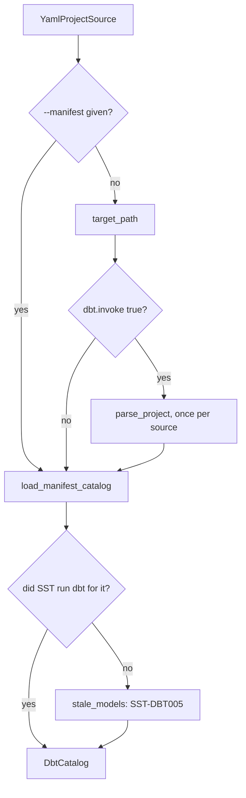
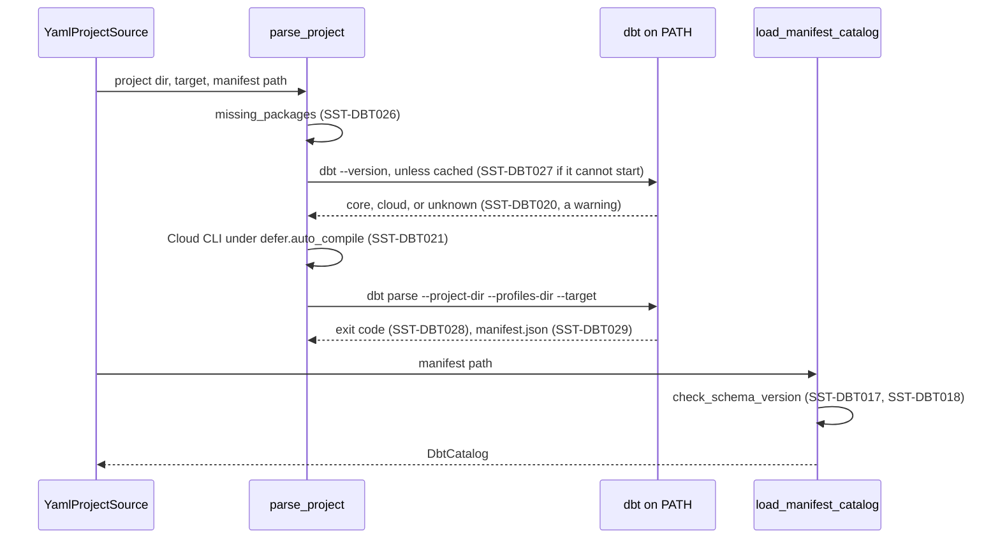
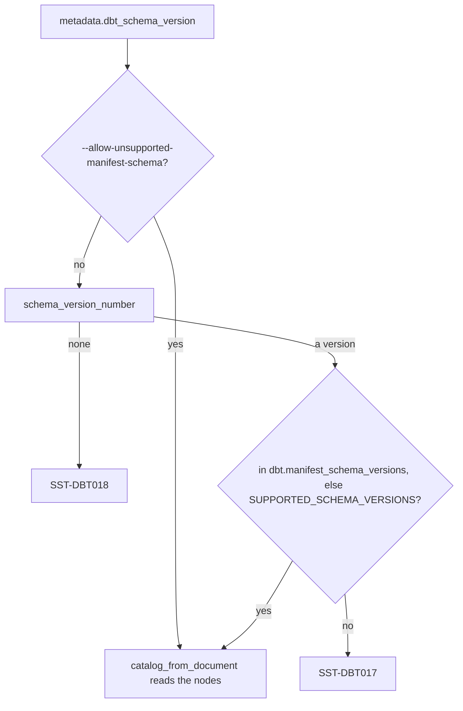

# dbt compatibility

SST builds every semantic view from a dbt project, so the dbt manifest is the
one contract between the two tools. This page says how SST obtains that file,
which parts of it SST reads, what it refuses, which dbt releases it is checked
against, and what a maintainer does when dbt changes.

## How SST gets the manifest

SST never imports dbt. It starts the `dbt` executable that `PATH` finds, as an
argument list with no shell, and reads the `manifest.json` that run writes. The
package depends on dbt only through the optional `dbt` extra, which installs
dbt Core with the Snowflake adapter for an environment that has no dbt of its
own.

Three inputs decide where the manifest comes from:

- `--manifest <file>` reads that file and never runs dbt, not even to produce a
  deferred target's manifest. Because SST did not write it, every root-project
  model file under the model paths is compared with the checksum the manifest
  recorded, and a changed one is an error (`SST-DBT005`), or a warning under
  `--allow-stale-manifest`.
- `dbt.invoke: false` reads the manifest already under `dbt_project.yml`'s
  `target-path` and never runs dbt. SST did not write that file either, so it
  gets the same checksum comparison as `--manifest`: a changed model file is
  `SST-DBT005`, or a warning under `--allow-stale-manifest`.
- Otherwise, the default, SST runs `dbt.command` before the first read. A
  project source runs it at most once for its target, so a command that reads both the models
  and the tools parses the project once.

The flowchart shows the choice.



Drawn from: [project_source.py](../../snowflake_semantic_tools/adapters/project_source.py), [project.py](../../snowflake_semantic_tools/adapters/dbt/project.py).

`dbt.command` is `parse` by default, or `compile`. `parse` is the default
because it needs no warehouse, so everything up to `sst compile` stays offline;
`compile` needs a warehouse connection.

Before dbt runs, `parse_project` refuses a `packages.yml` whose packages are not
installed under `packages-install-path` (`SST-DBT026`). It then asks `dbt --version` which
installation it is; that answer is cached in `sst/dbt_installation.json` under
dbt's target path, keyed by the executable's path, its resolved file, that
file's size and modification time, and SST's version. Finally it runs:

```bash
dbt parse --project-dir <project> --profiles-dir <dir> [--target <target>] [--target-path <dir>]
```

The sequence shows those steps and the diagnostic each can stop with.



Drawn from: [invoke.py](../../snowflake_semantic_tools/adapters/dbt/invoke.py), [manifest.py](../../snowflake_semantic_tools/adapters/dbt/manifest.py), [project_source.py](../../snowflake_semantic_tools/adapters/project_source.py).

dbt and SST read the same `profiles.yml`. SST takes the first that exists of
`--profiles-dir` (`$SST_PROFILES_DIR`), `$DBT_PROFILES_DIR`, the project root,
and `~/.dbt`, and passes its directory to dbt as `--profiles-dir`; when none
exists it passes the project root, so dbt reports the absence itself. An SST
target is a dbt target: `--target` names an output of the profile that
`dbt_project.yml`'s `profile:` names, SST passes the same name to dbt, and an
output whose `type` names another adapter is refused (`SST-CFG011`). A deferred
target's manifest lives under `defer.state_path`, by default
`sst_target/defer/<target>`: with `defer.auto_compile` SST parses that target
the same way, passing that directory as `--target-path`; otherwise the manifest
there is read as supplied. dbt runs in SST's own
environment, so every variable SST sees reaches dbt too.

A `dbt` that cannot be started, for `--version` or for the parse, is
`SST-DBT027`; a non-zero `dbt parse` passes dbt's own output through, then stops with `SST-DBT028`; a zero
exit that wrote no manifest where `target-path` says is `SST-DBT029`.
`sst debug` prints where the manifest comes from, its schema version, the
versions accepted, and the dbt on `PATH`.

Drawn from: [invoke.py](../../snowflake_semantic_tools/adapters/dbt/invoke.py), [locations.py](../../snowflake_semantic_tools/adapters/locations.py), [profiles.py](../../snowflake_semantic_tools/adapters/dbt/profiles.py), [deferral.py](../../snowflake_semantic_tools/adapters/deferral.py), [values.py](../../snowflake_semantic_tools/domain/model/config_schema/values.py), [debug.py](../../snowflake_semantic_tools/cli/commands/debug.py), [pyproject.toml](../../pyproject.toml).

## What SST reads from the manifest

`catalog_from_document` projects the manifest into a `DbtCatalog` of immutable
models, columns, and sources. Apart from `sst debug`, which reads the schema
version on its own to report it, nothing else in SST reads dbt's JSON, so this
projection is the whole read surface, and the table below is that surface.
Paths are relative to the manifest root; `<id>` is a node's unique id.

| Manifest path | What SST uses it for | When it is missing or wrong |
|---|---|---|
| `metadata.dbt_schema_version` | the schema-version gate | absent or unparseable: `SST-DBT018`; outside the accepted set: `SST-DBT017` |
| `metadata.dbt_version` | which forms of a model file the staleness check hashes: whitespace-collapsed from 1.12, raw or stripped before | absent or not a release number: every form is tried, so a whitespace-only edit may read as fresh |
| `metadata.project_name` | tells the root project's models from a package's: only root-project models are enriched or checked for staleness | absent: only models with no `package_name` count as the root project's |
| `nodes` | every model and test | not an object: the run stops, naming the path |
| `nodes.<id>.resource_type` | `model` selects models, `test` selects tests; every other node is ignored | no model at all: `SST-DBT001` |
| `nodes.<id>.name` | the name `{{ ref() }}` resolves, case-insensitively | empty: the model is skipped (`SST-DBT013`); a ref to a name no model has: `SST-REF001` |
| `nodes.<id>.relation_name` | the relation a view or tool reads, honouring `alias:` | empty: the model has no relation, so a view table that names it gets `SST-VAL303` and any other member that uses it `SST-DBT009`; not a three-part name: `SST-REF019`; two models on one relation with different semantic columns: `SST-DBT010`; a literal relation that names a model where dbt builds it under another name: `SST-DBT006` |
| `nodes.<id>.database`, `nodes.<id>.schema` | checked only, since the relation already names them | present and empty: the model is skipped (`SST-DBT014`) |
| `nodes.<id>.config.materialized` | why a model has no relation (`ephemeral` when unset); whether a search service indexes a relation every dbt run rebuilds | a table or view under an `INCREMENTAL` search service: `SST-VAL617` |
| `nodes.<id>.meta.sst`, else `nodes.<id>.config.meta.sst` | `primary_key` and `unique_keys`, as lists of column names | the 0.3 forms: `SST-DBT032`; neither key: `SST-VAL312`; a key column the model lacks: `SST-VAL310`; `database` or `schema` here: `SST-DBT030`; any other key: `SST-PRS004` |
| `nodes.<id>.columns.<name>.name`, `.description`, `.data_type` | the column, its comment in the view, and its type; dbt's `data_type` wins over `meta.sst.data_type` | no description: `SST-VAL003`; no type: `SST-VAL309`; a fact that is not numeric: `SST-VAL305`; a time dimension that is not temporal: `SST-VAL306`; `meta.sst.data_type` disagreeing: `SST-DBT004` |
| `nodes.<id>.columns.<name>.meta.sst` (or under `config`) | `column_type`, `data_type`, `synonyms`, `sample_values`, `is_enum`, `exclude`, `governance_tags` (which marks the column sensitive, as `pii_tags` does); `access_modifier` only to refuse a private dimension | no role: `SST-VAL308`; an unknown role: `SST-DBT003`; enum completeness: `SST-VAL314`, `SST-VAL315`; a sentinel such as `nan` as a sample value: `SST-VAL316`; a private dimension: `SST-VAL222`; any other key, `access_modifier` otherwise included: `SST-PRS004` |
| `nodes.<id>.columns.<name>.meta.pii_tags` (or under `config`) | the column is sensitive: enrich never reads its values, and a view publishes none | sample values on a tagged column: `SST-VAL328`, from `validate` and `enrich` |
| `nodes.<id>.description` | context for the synonyms enrich asks Cortex for | none |
| `nodes.<id>.checksum.checksum` | the staleness check of a manifest SST did not write, and the digest of the dbt side SST records in its own manifest | absent on a model a view uses: `SST-DBT015` |
| `nodes.<id>.contract.enforced`, or under `config` | whether column types are pinned | not enforced while a column's type is left to inference: `SST-DBT024` |
| `nodes.<id>.original_file_path`, `.patch_path`, `.package_name` | which YAML file enrich edits, where a diagnostic points, and root-project selection | none |
| test nodes' `attached_node`, else `depends_on.nodes` | how many tests each model has | a model a view uses with none: `SST-DBT023` |
| test nodes' `test_metadata.name`, `column_name`, `test_metadata.kwargs` | the columns a `unique`, `unique_combination_of_columns`, or `relationships` test names, which enrich treats as keys, never as facts | none |
| `disabled` | the names of disabled models | a view table that names one: `SST-VAL303`; any other member that uses one: `SST-DBT009` |
| `sources.<id>.source_name`, `.name`, `.relation_name` | the relation a `{{ source() }}` table reads | undeclared, or without a relation: `SST-DBT011`; a pair declared twice: `SST-DBT012` |

A missing field reads as empty and lands in the column on the right. A part
with the wrong shape, such as `columns` that is not an object or `synonyms`
that is not a list, stops the run with a message naming its manifest path.
Nodes are read in sorted unique-id order, so the catalog's order never depends
on the order of keys in the file.

`tests/contract/test_dbt_manifest_contract.py` holds every manifest under
`tests/fixtures/dbt_manifests/` to this table: each path is present, with the
JSON type SST expects, on the reference project's models, columns, tests and
sources; each model checksum is one the staleness check recognises; and the
reference project renders the same semantic views from it as the DDL goldens
pin. The committed manifests must also read as one catalog apart from the dbt
version and the checksums, which dbt 1.12 computes over whitespace-collapsed
code where earlier releases hash the file as read; the staleness check compares
each manifest's checksums in the form its `metadata.dbt_version` hashes.

Drawn from: [manifest.py](../../snowflake_semantic_tools/adapters/dbt/manifest.py), [dbt.py](../../snowflake_semantic_tools/domain/model/dbt.py), [dbt_seam.py](../../snowflake_semantic_tools/domain/validate/dbt_seam.py), [semantic/dbt.py](../../snowflake_semantic_tools/domain/validate/semantic/dbt.py), [build.py](../../snowflake_semantic_tools/adapters/yaml/semantic/build.py), [enrich.py](../../snowflake_semantic_tools/app/enrich.py), [columns.py](../../snowflake_semantic_tools/domain/enrich/columns.py), [tool.py](../../snowflake_semantic_tools/domain/validate/tool.py), [views.py](../../snowflake_semantic_tools/domain/validate/semantic/views.py), [phases.py](../../snowflake_semantic_tools/adapters/yaml/semantic/phases.py), [project.py](../../snowflake_semantic_tools/adapters/dbt/project.py), [test_dbt_manifest_contract.py](../../tests/contract/test_dbt_manifest_contract.py).

## The schema-version gate

dbt publishes a schema for each manifest version and names it in
`metadata.dbt_schema_version`. SST reads exactly the versions in
`SUPPORTED_SCHEMA_VERSIONS` in `adapters/dbt/manifest.py`, today `{12}`, and
accepts both URL spellings dbt has written, `.../manifest/v12.json` and
`.../manifest/v12/manifest.json`. A version outside the set is `SST-DBT017`; a
key that is absent or names no version is `SST-DBT018`. Both stop the run before
any model is read.

The gate exists because the reader is deliberately forgiving about absent keys.
If dbt renamed `relation_name`, every model would read as one with no relation
and everything that uses a model would fail (`SST-VAL303`, `SST-DBT009`); if it renamed `resource_type` or
its values, no model would be selected at all. A renamed key inside `meta` or
`columns` would be worse: it would drop metadata column by column, and every
diagnostic would blame the project's YAML instead of the manifest. The gate
turns all of these into one error that names the cause. The set is explicit,
never a range, because dbt does not promise that a later schema is a superset
of an earlier one.

Two overrides exist, each for a different reader.
`--allow-unsupported-manifest-schema` reads any version for one run, and the
run's output records it among the guarantees that run switched off. `dbt.manifest_schema_versions` in
`sst_config.yml`, such as `[12]`, replaces the accepted set for the project; it
does not add to it, so a list without `12` refuses a v12 manifest.



Drawn from: [manifest.py](../../snowflake_semantic_tools/adapters/dbt/manifest.py), [keys.py](../../snowflake_semantic_tools/domain/model/config_schema/keys.py), [globals.py](../../snowflake_semantic_tools/cli/globals.py).

## Supported dbt versions

SST supports **dbt Core 1.10 to 1.13 and dbt v2 2.0** (the Fusion engine, in
both its `dbt` and `dbt-oss` distributions), on manifest schema v12. That is
what the repository runs:

| dbt | Install | Committed manifest | `dbt` job |
|---|---|---|---|
| dbt Core 1.10 | `dbt-core==1.10.23 dbt-snowflake==1.10.8` | `dbt-1.10.23` | yes |
| dbt Core 1.11 | `dbt-core==1.11.15 dbt-snowflake==1.11.6` | `dbt-1.11.15` | yes |
| dbt Core 1.12 | `dbt-core==1.12.5 dbt-snowflake==1.12.1` | `dbt-1.12.5` | yes |
| dbt Core 1.13 | `dbt-core==1.13.0b1 dbt-snowflake==1.12.3` (pre-release) | `dbt-1.13.0b1` | yes |
| dbt v2 2.0 | `dbt==2.0.8` | `dbt-2.0.8` | yes |
| dbt v2 2.0, OSS | `dbt-oss==2.0.8` | `dbt-2.0.8` (the same manifest) | yes |

- The `dbt` extra accepts `dbt-snowflake` from 1.10 up to, not including, 2.0:
  it installs dbt Core 1.x, and the lock file resolves it to dbt Core 1.12.5
  with `dbt-snowflake` 1.12.1. dbt v2 is not an extra; see [Using dbt
  v2](#using-dbt-v2).
- The required gate's `dbt` job runs real dbt, once for each release line the
  reference project's `require-dbt-version` admits, as the table lists. A dbt
  Core line installs the extra and pins dbt Core and `dbt-snowflake` to the
  releases its committed manifest was captured with; a dbt v2 line installs
  `dbt` or `dbt-oss` alone, without the extra, since it brings its own adapter
  and its own `dbt` executable. Each runs `dbt deps`, then `pytest
  tests/unit/test_goldens.py` with `SST_GOLDEN_PROJECT` naming the reference
  project, which compiles it with no manifest, so SST starts `dbt parse` itself
  and renders every artifact from the manifest it writes for comparison with
  the goldens. It then holds that manifest to the contract test above. The
  reference project's default target carries no credential, so nothing
  connects to Snowflake and no secret is needed; the job reaches only the
  package indexes it installs from. Only the packages a line names are pinned:
  pip keeps each locked dependency they still accept and resolves any they do
  not, such as `dbt-adapters` or `dbt-common`, outside the lock.
- The rest of the gate does not run dbt. It installs the package without the
  extra, runs dbt-facing code against a fake runner, loads the reference
  project against a committed manifest written by dbt 1.11, and holds the full
  manifests under `tests/fixtures/dbt_manifests/` to the read surface above.
- The manual evals workflow installs the extra, runs `dbt build` on the
  reference project with the locked dbt, and compiles against the manifest that
  build writes.
- The reference project pins `require-dbt-version` to `[">=1.10.0",
  "<2.1.0"]`, and `tests/unit/test_ci_workflows.py` fails when the `dbt` job's
  matrix or the committed manifests stop covering every line it admits.

So every change is checked on manifest schema v12 with `dbt parse` under each
release in the table, and against each committed manifest. `dbt build` runs
only in the manual workflow, with the locked 1.12. dbt 1.13 is tested on its
pre-release until it ships. dbt 1.8 and 1.9 also write manifest v12 and SST
reads theirs alike, but they are past dbt's support window and cannot parse
the reference project's generic-test `arguments:` syntax, so they are not
tested; any release that writes manifest v12 still passes the schema gate.

The manifests the releases write differ in two ways SST allows for. Up to 1.11,
dbt hashes a model's file raw or stripped; from 1.12, dbt v2 included, it
collapses every run of whitespace first, and the staleness check reads both. And
where the YAML sets nothing, dbt v2 leaves a column's `data_type` and `config`,
and a test's `column_name`, out of the manifest rather than writing them empty;
SST reads an absent one as empty, and the contract test allows exactly those
three paths to be absent.

SST asks every dbt it identifies -- dbt Core or dbt v2 -- to `--write-json`, so
a setting that turns JSON artifacts off (`DBT_ENGINE_WRITE_JSON=0`,
`--no-write-json`, which dbt now promotes for speed) cannot hide the manifest.
A dbt SST does not identify is run as configured, and a manifest it does not
write is `SST-DBT029`.

The dbt Cloud CLI is recognised from its `dbt --version` output and parsed with
the same command as dbt Core, without `--write-json`. One combination is
refused: `defer.auto_compile` (`SST-DBT021`), because the Cloud CLI cannot parse
a target other than its default locally. Running the Cloud CLI through `dbt
parse` is not tested. A Cloud CLI project can instead produce the manifest
itself and give SST `--manifest`, or set `dbt.invoke: false`.

### Using dbt v2

dbt v2 is recognised from its one-line `dbt --version` answer, `dbt 2.0.8` or
`dbt-oss 2.0.8`; `sst debug` reports it as installation `v2` or `v2-oss`, and it
warns nothing. It is parsed with the same arguments as dbt Core. The `dbt`
extra stays on dbt Core 1.x until a `dbt-snowflake` 2.x ships, so install dbt v2
yourself, beside SST, and SST runs it from `PATH`:

```bash
python -m pip install snowflake-semantic-tools dbt      # or dbt-oss
```

Any other `dbt --version` answer, such as an early `dbt-fusion` beta, warns
`SST-DBT020` on every run that starts dbt, and SST still runs `dbt parse`;
whether the result is read then depends only on the schema gate.

Drawn from: [pyproject.toml](../../pyproject.toml), [test-and-lint.yml](../../.github/workflows/test-and-lint.yml), [slow.yml](../../.github/workflows/slow.yml), [reference_project_manifest.json](../../tests/fixtures/reference_project_manifest.json), [dbt_project.yml](../../tests/fixtures/reference_project/dbt_project.yml), [invoke.py](../../snowflake_semantic_tools/adapters/dbt/invoke.py), [test_dbt_invoke.py](../../tests/unit/adapters/test_dbt_invoke.py), [test_ci_workflows.py](../../tests/unit/test_ci_workflows.py), [test_dbt_manifest_contract.py](../../tests/contract/test_dbt_manifest_contract.py).

## Advice for a dbt project

Pin dbt in `dbt_project.yml` with
[`require-dbt-version`](https://docs.getdbt.com/reference/project-configs/require-dbt-version),
to the releases SST is tested with, so an upgrade is a reviewed change rather
than something a fresh environment does on its own:

```yaml
require-dbt-version: [">=1.10.0", "<2.1.0"]
```

Keep the values SST needs from `profiles.yml` to `env_var()`. SST renders
`{{ env_var('NAME') }}` and `{{ env_var('NAME', 'default') }}` itself in every
field it reads, and refuses any other template there, `{{ var() }}` included
(`SST-CFG049`); fields it ignores are left as written. The [configuration
guide](../guides/configuration.md#authentication) lists those fields.

dbt's `vars:` and SST's are separate. `{{ var() }}` in SST's files resolves only
against `vars:` in `sst_config.yml` (`SST-CFG029` for an undeclared name); SST
never reads `vars:` in `dbt_project.yml`, and passes no `--vars` to `dbt
parse`. A project whose models or relations depend on a `--vars` value should
run dbt with that value itself and pass the manifest with `--manifest`.

Run `dbt deps` before SST in a fresh checkout (`SST-DBT026`). A project with no
`dbt_project.yml` reads no dbt manifest; see [Projects without
dbt](../guides/configuration.md#projects-without-dbt).

Drawn from: [profiles.py](../../snowflake_semantic_tools/adapters/dbt/profiles.py), [config.py](../../snowflake_semantic_tools/domain/resolve/config.py), [invoke.py](../../snowflake_semantic_tools/adapters/dbt/invoke.py), [project.py](../../snowflake_semantic_tools/adapters/dbt/project.py).

## When dbt releases a new version

The manifest schema is what SST feels, not the dbt version number, so the first
question about a release is which schema it writes.

1. In an environment with the candidate dbt and its Snowflake adapter, run
   `dbt deps` and then `dbt parse --no-partial-parse` in a copy of
   `tests/fixtures/reference_project`, and read `metadata.dbt_schema_version`
   from the manifest it writes. The project's default target carries no
   credential; parsing needs none.
2. Capture that manifest as a fixture with `python -m
   tests.helpers.manifest_capture <copy>/target/manifest.json <copy>`, which
   scrubs it into `tests/fixtures/dbt_manifests/v<schema>/dbt-<release>/`.
   Run `tests/contract/test_dbt_manifest_contract.py`: it fails, naming the
   path, if the release moved or retyped anything SST reads.
3. If the schema is still v12, the reader needs no change. Widen the `dbt`
   extra in `pyproject.toml` if the release falls outside it, regenerate
   `poetry.lock`, update `DEPENDENCIES.md` with them, and widen the reference
   project's `require-dbt-version`, the `dbt` job's matrix in
   `.github/workflows/test-and-lint.yml` (the minor, with the dbt Core and
   `dbt-snowflake` releases the manifest was captured with), and the manifests under
   `tests/fixtures/dbt_manifests/` to match. Then run the manual evals
   workflow, which builds the reference project with the locked dbt.
4. If the schema changed, walk the table under [What SST reads from the
   manifest](#what-sst-reads-from-the-manifest) against dbt's new schema and
   changelog, one path at a time, before anything else. For a path that moved,
   read it where both versions put it, so neither is selected wrongly. Then add
   the version to `SUPPORTED_SCHEMA_VERSIONS`, keeping the old one while any
   tested dbt still writes it. The contract test refuses a version in the set
   without a fixture directory, and a fixture directory for a version outside
   it.
5. Update the tests that use a version number as the unsupported example:
   `tests/codes/dbt/test_sst_dbt017.py` and
   `tests/unit/adapters/test_dbt_manifest.py` use v13, and
   `tests/unit/cli/test_debug.py` uses v11. Manifests built in tests take their
   schema from `SUPPORTED_SCHEMA` in `adapters/dbt/manifest.py` or the `SCHEMA`
   constant in `tests/helpers/seam_projects.py`.
6. Compare the output. The goldens are rendered from the committed vendored
   manifest; render them again with the new dbt by running `dbt deps` on the
   reference project and then
   `SST_GOLDEN_PROJECT=tests/fixtures/reference_project poetry run pytest
   tests/unit/test_goldens.py`, as `tests/README.md` shows. Any difference is a
   change in what SST publishes and needs an explanation, not an updated
   golden. `python -m tests.helpers.update_goldens` compiles from the vendored
   manifest, so once a replaced vendored manifest's difference is explained,
   it regenerates the goldens from that manifest.
7. Run the gates in [CONTRIBUTING.md](../../CONTRIBUTING.md), and update the
   versions `docs/getting-started.md` names.

The committed `tests/fixtures/reference_project_manifest.json` is a reduced
copy of a dbt 1.11 manifest: its metadata and its model and test nodes,
trimmed to little more than the keys SST reads, and no source nodes. The
goldens and most tests load the project against it. The full manifests under
`tests/fixtures/dbt_manifests/` are what each release wrote, less the run's
paths, ids and timestamps and the `macros` map, which SST never reads. Each
records the reference project as it was captured, and the contract test checks
it against the code it records, so a later edit to the project does not fail
it; capture them again when the edit touches something the table lists.
Replacing the reduced manifest with a full one changes which seam diagnostics
the reference project reports (a full manifest records each model's
materialisation, so `SST-VAL617` fires on the search service), so do it as its
own change.

Drawn from: [manifest.py](../../snowflake_semantic_tools/adapters/dbt/manifest.py), [seam_projects.py](../../tests/helpers/seam_projects.py), [manifest_capture.py](../../tests/helpers/manifest_capture.py), [test_dbt_manifest_contract.py](../../tests/contract/test_dbt_manifest_contract.py), [test_sst_dbt017.py](../../tests/codes/dbt/test_sst_dbt017.py), [test_dbt_manifest.py](../../tests/unit/adapters/test_dbt_manifest.py), [test_debug.py](../../tests/unit/cli/test_debug.py), [reference_project.py](../../tests/helpers/reference_project.py), [tests/README.md](../../tests/README.md), [slow.yml](../../.github/workflows/slow.yml).
