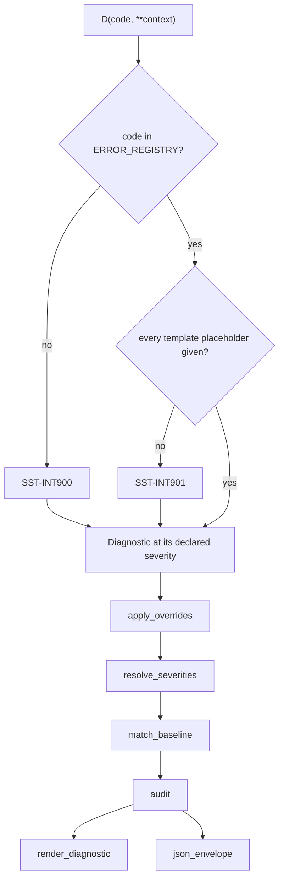
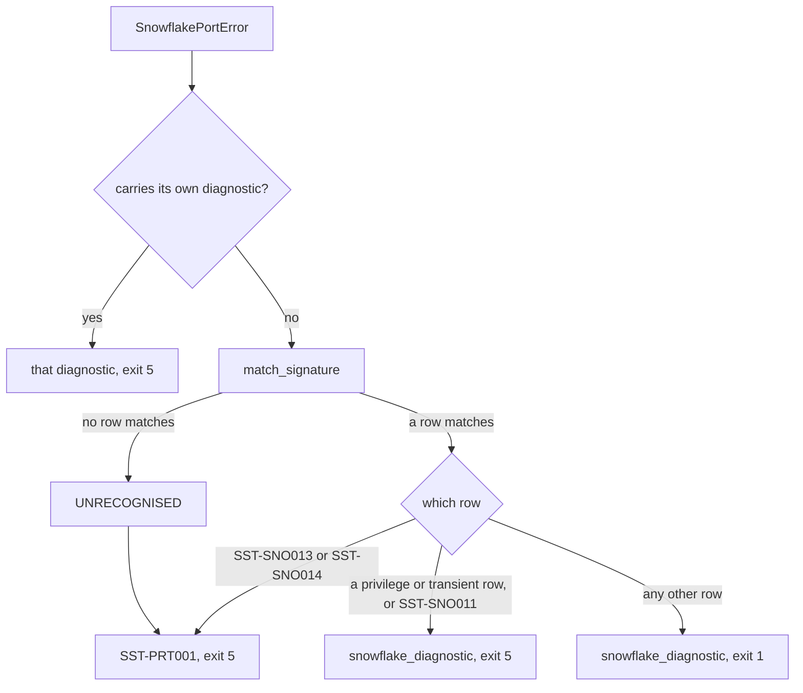

# Diagnostics

Every problem SST reports is a diagnostic: a registered code, the values its message template
needs, and where it points. The registry is the contract. A code's severity, message, suggestion,
and when it is raised are declared once, and every command, the JSON envelope, `sst explain`, and
the generated [error code reference](../reference/error-codes.md) read them from there. This page
explains why the system is shaped the way it is. How to add or retire a code is in
[CONTRIBUTING.md](../../CONTRIBUTING.md#adding-a-diagnostic-code) and
[tests/codes/README.md](../../tests/codes/README.md).

## Codes

A code is `SST-`, a three-letter area, and three digits, such as `SST-REF001`. The registry refuses
any other shape (`SST-REG012`) and an entry whose subsystem is not the area its code names
(`SST-REG013`).

The area names the subsystem that reports the problem, not the artifact the problem is about. What
a user does next depends on where the pipeline stopped: an unresolved `{{ ref() }}` (`SST-REF001`)
is fixed in YAML, and a statement Snowflake refused (an `SNO` code) is fixed in the account. A rule
that applies to many artifact types is one code with the artifact in the diagnostic's payload, so
"a name declared twice" is `SST-VAL001` for a view, a metric, or an agent alike. Each diagnostic
reports its area, in lowercase, as its `phase`, and the error reference has one section per area:
registry, configuration, discovery, parsing, loading, references, membership, validation, dbt,
rendering, manifest and state, planning, apply, Snowflake, external systems, and internal.

`VAL` is the largest area, so its hundreds digit is a band, and each band is its own module:

| Band | Checks | Module |
|---|---|---|
| `VAL0xx` | names, descriptions, prose, files, and references, for every type | `val_shared` |
| `VAL1xx` | metrics | `val_metric` |
| `VAL2xx` | relationships | `val_relationship` |
| `VAL3xx` | semantic views: their tables, columns, keys, and scope | `val_semantic_view` |
| `VAL4xx` | filters, custom instructions, verified queries, and compiled SQL | `val_filter` |
| `VAL5xx` | agents | `val_agent` |
| `VAL6xx` | tools | `val_tool` |
| `VAL7xx` | evals | `val_eval` |
| `VAL8xx` | skills, plugins, and profiles | `val_skill` |

An artifact or member type's `validation_rules` names the bands that check it, and `RULE_SETS` maps
each name to its band.

The 900 band of any area is for conditions that mean SST itself is wrong, not the project: an
unregistered code (`SST-INT900`), an attachment that is not idempotent (`SST-MEM900`). A 900-band
code must be an error, and in `INT` and `REG` one no setting may demote; the registry refuses
anything else (`SST-REG014`). A failure in INT or REG means the engine or its registry cannot be
trusted, so no project setting may quiet it.

A number is never reused. Codes appear in CI scripts, severity overrides, baselines, and old issue
threads, and a number that changed meaning would silently change what each of those says. A code
that is no longer raised is retired: its number stays in `RETIRED_CODES`, its reason in
`TOMBSTONES`, and the registry refuses to register it again (`SST-REG017`). `sst explain` still
answers for a retired number and for an SST 0.3 code, which survives as an alias naming the codes, if any,
that now report its condition.

Drawn from: [core.py](../../snowflake_semantic_tools/domain/diagnostics/core.py),
[integrity.py](../../snowflake_semantic_tools/domain/diagnostics/integrity.py),
[specs/\_\_init\_\_.py](../../snowflake_semantic_tools/domain/diagnostics/specs/__init__.py),
[\_\_init\_\_.py](../../snowflake_semantic_tools/domain/diagnostics/__init__.py),
[specs/retired.py](../../snowflake_semantic_tools/domain/diagnostics/specs/retired.py),
[specs/aliases.py](../../snowflake_semantic_tools/domain/diagnostics/specs/aliases.py),
[explain.py](../../snowflake_semantic_tools/domain/diagnostics/explain.py).

## One code, one severity

A code declares one severity, and a diagnostic takes it from the registry: `D` has no severity
argument. A condition that should sometimes block and sometimes only warn is two codes. A baseline
that is about to expire is `SST-CFG035`, a warning; one that has expired is `SST-CFG039`, an error.
So a severity override, a baseline entry, or a pipeline that greps for a code always means one
thing, and the error reference can state each code's severity without a "usually".

A diagnostic remembers the severity it was declared with. `audit` checks every reported diagnostic
against the registry and reports, as `SST-INT007`, one whose declared severity is not the registered
one, or whose effective severity no legal step could give it. Even a flag that softens a code goes
through that rule: under `--allow-stale-manifest`, `SST-DBT005` is recorded as an override to
warning, not rewritten in place.

Drawn from: [\_\_init\_\_.py](../../snowflake_semantic_tools/domain/diagnostics/__init__.py),
[specs/cfg.py](../../snowflake_semantic_tools/domain/diagnostics/specs/cfg.py),
[project_source.py](../../snowflake_semantic_tools/adapters/project_source.py).

## How a severity is resolved

A diagnostic's effective severity is resolved in one order, by the diagnostics package, before any
command reads it. Nothing else compares severities to decide whether a run blocks: a comparison on
`.severity` outside `domain/diagnostics/` is `SST-REG015`, and callers ask `Diagnostic.blocks` or
`DiagnosticBag.has_errors` instead.

1. **Declared.** `D` builds the diagnostic at the registry's severity.
2. **Overrides.** `diagnostics.severity_overrides` in `sst_config.yml` sets a code's severity for
   the project, and the diagnostic records the override.
3. **Strict.** `--strict` or `validation.strict` promotes every warning to an error; the flag wins
   when both are set, and `SST-CFG034` reports the disagreement. Promotion follows the run's
   selection: a run restricted by `--select` or `--exclude` promotes no warning about an artifact it
   leaves out, since it plans and publishes none of them. A warning that names no artifact concerns
   the whole project and is promoted regardless.
4. **Baseline.** `.sst/baseline.json` (or `--baseline`) holds known warnings by fingerprint. A held
   diagnostic keeps its severity and stays in the envelope, but does not block and is not shown by
   default.

Overrides come before strict, so an error a project demotes to a warning still blocks under strict.
The baseline comes last, so it holds a warning whether or not strict promoted it.

Each step has a floor, because each exists to adjust a project's policy, not to hide a broken
engine:

- An override may not lower a non-demotable code, may not demote an error below warning, and may
  not promote an info code above warning. `override_refusal` states the rule; the configuration
  check reports an illegal override as `SST-CFG033`, and it is never applied.
- A baseline suppresses and never demotes, so it may hold only a demotable code registered below
  error. An error the project accepts belongs in `severity_overrides`, where a reviewer sees it as a
  policy change.
- A baseline expires. Within 30 days of its expiry date a run reports `SST-CFG035`; past it the
  baseline holds nothing and the run fails with `SST-CFG039` until it is renewed with a reason,
  which the file records.

The path from a raise to the output, showing where each step and each internal check sits:

`D` never raises: a bad code or a missing placeholder becomes an internal error reported in its
place, so a bug in one raise site cannot hide the rest of a run's diagnostics. `audit` runs once
over everything a command reports, and a run that would have exited 0 or 2 exits 1 when it finds a
diagnostic that breaks an emission invariant.

Drawn from: [policy.py](../../snowflake_semantic_tools/domain/diagnostics/policy.py),
[\_\_init\_\_.py](../../snowflake_semantic_tools/domain/diagnostics/__init__.py),
[baseline.py](../../snowflake_semantic_tools/domain/diagnostics/baseline.py),
[integrity.py](../../snowflake_semantic_tools/domain/diagnostics/integrity.py),
[app/policy.py](../../snowflake_semantic_tools/app/policy.py),
[app/baseline.py](../../snowflake_semantic_tools/app/baseline.py),
[cli/runner.py](../../snowflake_semantic_tools/cli/runner.py),
[cli/output.py](../../snowflake_semantic_tools/cli/output.py).

## Cascades and poisoning

One fault should produce one diagnostic. A broken metric that then fails to attach, makes its view
fail to build, and leaves its agent without a tool would otherwise report four problems, three of
which disappear when the first is fixed.

The semantic load prevents most of this by poisoning: a definition a diagnostic proves broken is
still checked, so every independent error is reported at once, but a poisoned member attaches to
no view and a poisoned view is not built. A member left unattached because its references did not
resolve is reported once more, at info (`SST-MEM107`), and the check for members that attach
nowhere skips poisoned members and the metrics built on them. Planning does the same for artifacts: a change with its
own validation errors is `BLOCKED` with reason `validation_errors`, every change that depends on a
blocked one is `BLOCKED` with reason `dependency_blocked`, all the way down the dependency graph,
and `apply` refuses a plan that holds a blocked change (`SST-APL003`).

When a diagnostic is reported because of another, it names that code in `caused_by`, and its cause
must be in the same run (`SST-INT008` otherwise). A caused diagnostic downgraded to info is a
cascade: the human output counts it instead of showing it unless `--show-cascade` is given, the
envelope counts it under `summary.suppressed_cascade`, and no severity override applies to it. A
caused diagnostic keeps its severity unless it is downgraded: `SST-MEM005`, raised beside
`SST-VAL205` for a relationship no view covers, names its cause and is still a warning.

Drawn from: [poison.py](../../snowflake_semantic_tools/adapters/yaml/semantic/poison.py),
[membership_reach.py](../../snowflake_semantic_tools/domain/resolve/membership_reach.py),
[fanout.py](../../snowflake_semantic_tools/domain/validate/semantic/fanout.py),
[prune.py](../../snowflake_semantic_tools/domain/plan/prune.py),
[action.py](../../snowflake_semantic_tools/domain/model/lifecycle/action.py),
[relationships.py](../../snowflake_semantic_tools/adapters/yaml/semantic/relationships.py),
[\_\_init\_\_.py](../../snowflake_semantic_tools/domain/diagnostics/__init__.py),
[cli/output.py](../../snowflake_semantic_tools/cli/output.py).

## Identity

A diagnostic has two fingerprints, for two different questions. Neither is an artifact's
fingerprint, the digest of what it renders.

`stable_fingerprint` is the identity a user relies on. It is 16 hex characters of BLAKE2b over the
code, the type and name of the artifact or member the subject names, the file, and the template
values, sorted by name. The origin's line and column are left out, so a comment inserted above a
problem keeps its baseline entry, while renaming the artifact or changing a value in the message
makes a new diagnostic. A code whose message itself names a line, such as `SST-LOD011`, carries the
line as a value, so its identity does move with it. The JSON envelope reports it as `fingerprint`, `--verbose` prints it, and the
baseline matches on it alone. A baseline entry that matches more than one diagnostic in a run holds
none of them and is reported as `SST-INT009`, since it cannot say which one was meant.

`Diagnostic.fingerprint` is a SHA-256 over the code, subject, file, line, column, and formatted
message. It is a determinism check: the golden suite of `sst test` compiles the project twice and
reports `SST-INT006` for each code whose fingerprints differ between the two runs.

Drawn from: [baseline.py](../../snowflake_semantic_tools/domain/diagnostics/baseline.py),
[\_\_init\_\_.py](../../snowflake_semantic_tools/domain/diagnostics/__init__.py),
[cli/output.py](../../snowflake_semantic_tools/cli/output.py),
[cli/commands/test.py](../../snowflake_semantic_tools/cli/commands/test.py).

## What is a contract

The exit code, the `--output json` envelope, and the diagnostic codes are what a pipeline may
depend on, and changing what one means is a breaking change. The human output is not among them.

With `--output json`, every command prints one JSON object on stdout, keys sorted. Its top-level fields
are `tool`, `sst_version`, `schema_version`, `command`, `status` (`ok`, `changes`, or `error`),
`exit_code`, `invocation` (the command line, target, project, configuration file, overrides, and
timings), `diagnostics`, `summary`, and `data`, the command's own result. Each diagnostic carries
its code, effective and declared severity, `promoted_from` or `demoted_from`, message, suggestion,
phase, help URL, fingerprint, template values as `params`, the artifact or member it concerns, its
location and related locations, whether a baseline holds it, and `caused_by`. `params` uses a
shared vocabulary of placeholder names, and the registry refuses a template that names any other
(`SST-REG016`), so a consumer can act on a value without parsing the message. `schema_version`
changes only when a field is removed or changes meaning; [CI/CD](../guides/ci-cd.md#json-output)
describes the envelope for users. An envelope that would carry a credential the run resolved is
replaced by one reporting `SST-PRT012`.

The human output lists every diagnostic the envelope does, shaped by the visibility flags: info,
baselined, and cascade diagnostics are counted rather than shown unless `--show-info`,
`--show-baselined`, or `--show-cascade` asks for them, four or more of one code collapse to the
first three unless `--show-all-occurrences`, and `--quiet` shows errors only. None of it changes the
exit code, and its layout may change between releases. A script reads the envelope.

Drawn from: [cli/output.py](../../snowflake_semantic_tools/cli/output.py),
[integrity.py](../../snowflake_semantic_tools/domain/diagnostics/integrity.py),
[\_\_init\_\_.py](../../snowflake_semantic_tools/domain/diagnostics/__init__.py).

## Precheck: how early a problem can be caught

Each code declares where its condition can first be detected, because that bounds how early SST can
report it:

- `local` needs no connection, so a command can report it offline; most validation codes reach
  offline `sst validate`, in an editor or a pull request, before anyone has credentials. Most codes
  are local.
- `observe` needs a read of Snowflake but no write. `sst plan`, or a connected `sst validate`, can
  report it before `apply` changes anything.
- `runtime` is seen only while a statement runs. No check can report it ahead of the statement, so
  `apply` or a test suite meets it.

The aim is to report a condition at the earliest point it can be known. A target schema that does
not exist is observable, so `plan` reports it as `SST-PLN010` before anything is written; if `apply`
meets one anyway, Snowflake's refusal is `SST-SNO005`. The [coverage reference](../reference/coverage.md)
lists each code's precheck beside the modules that raise it and the tests that cover it.

Drawn from: [core.py](../../snowflake_semantic_tools/domain/diagnostics/core.py),
[specs/pln.py](../../snowflake_semantic_tools/domain/diagnostics/specs/pln.py),
[specs/sno.py](../../snowflake_semantic_tools/domain/diagnostics/specs/sno.py).

## Snowflake errors

Snowflake reports failures as a driver error with a message and, usually, an error number and a
SQLSTATE. SST turns each into an `SNO` code through one table, `SIGNATURES`, and `match_signature`
is the only function that matches an error against it. It tries the error number first, then the SQLSTATE, then the message wording, each
pass in table order, because a number is the most stable evidence and wording the least. A row that
matches on wording alone is fragile; `fragile_signatures` lists those rows so the set stays visible
and can shrink as numbers are observed.

An error no row matches is `SST-SNO001`, "Snowflake refused and SST does not recognise the refusal",
and never a guessed specific code. A wrong specific code sends the user to the wrong fix; `SNO001`
is honest and countable. Every command appends the `SNO` diagnostics its result reports to
`target/sst/run_log.jsonl` (one that reaches the exception guard below is not logged), and `sst debug --snowflake-signatures` reports what share went
unrecognised, which is the signal to add a signature.

During `apply`, a failed statement is classified by the same table, and the change's outcome carries
the code, the kind of failure, and whether a retry may succeed; the run then reports the refusal
under its `SNO` code. A Snowflake error that reaches a command's exception guard is classified again,
to choose the exit code:

A failed login, a dropped connection, and an error no signature recognises are reported as the
connection failing, `SST-PRT001`. A refused privilege or a missed
deadline is Snowflake not cooperating, exit 5; any other refusal, such as an object that does not
exist or a compilation error, is a statement Snowflake rejected, exit 1.

Drawn from: [signatures.py](../../snowflake_semantic_tools/domain/diagnostics/signatures.py),
[app/apply/errors.py](../../snowflake_semantic_tools/app/apply/errors.py),
[cli/runner.py](../../snowflake_semantic_tools/cli/runner.py),
[cli/run_log.py](../../snowflake_semantic_tools/cli/run_log.py),
[specs/sno.py](../../snowflake_semantic_tools/domain/diagnostics/specs/sno.py).
