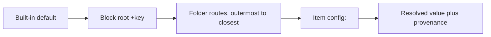

# Configuration

SST reads two files:

- **`sst_config.yml`**, in the project root (the directory that holds
  `dbt_project.yml`), says what SST publishes and where;
- **`profiles.yml`** holds the connection targets, in dbt's format.

The [configuration reference](../reference/config.md) lists every key, its type,
and its default; it is generated from the schema SST validates against. This
page explains how the pieces fit.

## Which files are read

The project root is the current directory, or `--project-dir`
(`$SST_PROJECT_DIR`). The configuration file is, in order:

1. the file `--config` names;
2. else the file `$SST_CONFIG` names;
3. else `sst_config.yml` or `sst_config.yaml` in the project root. SST looks
   nowhere else: not in a parent directory, not in your home directory.

A named file that does not exist is an error (`SST-CFG001`), and so is a
project root with neither spelling. A root that holds both spellings is an
error (`SST-CFG005`) rather than a precedence. A file named by `--config` or
`$SST_CONFIG` is used even then, with a warning (`SST-CFG032`) naming the
files it shadows. Directories in the file, such as `project.agents_dir`, are
relative to the project root wherever the file itself lives.

`profiles.yml` is the first that exists of:

1. `--profiles-dir` (`$SST_PROFILES_DIR`);
2. `$DBT_PROFILES_DIR`;
3. the project root;
4. `~/.dbt/`.

SST runs `dbt parse` with the directory of that file as `--profiles-dir`, so
dbt and SST read the same profile. When none exists, the run stops with
`SST-CFG009`, naming every path it searched. `sst debug` prints the candidates
for both files and the ones it chose.

Before it parses, SST asks `dbt --version` which installation it is (dbt Core
or the dbt Cloud CLI). The answer is kept in `sst/dbt_installation.json` under
dbt's target path, keyed by the `dbt` executable on `PATH` (its path, the file
it resolves to, that file's size and modification time) and by SST's version,
so installing, upgrading or switching dbt makes the next run ask again. An
installation SST cannot identify is asked every run, and warns every run
(`SST-DBT020`). `sst debug` always asks. SST still runs `dbt parse` every time;
pass `--manifest`, or set `dbt.invoke: false`, to read a manifest you keep
current yourself. Either way SST compares each model file with the checksum the
manifest recorded, and a changed one is an error (`SST-DBT005`) unless
`--allow-stale-manifest` is given.

## How keys are validated

Every key in `sst_config.yml` is checked against that schema when a command
starts:

- an unknown key is a warning (`SST-CFG003`); a misspelled top-level block,
  within two edits of a known one, is an error that names it (`SST-CFG007`),
  because every setting under it would otherwise be ignored;
- a value of the wrong type is an error (`SST-CFG004`), and so is one outside
  its choices or range (`SST-CFG008`);
- a removed key is an error that says why it was removed (`SST-CFG043`, or a
  dedicated code such as `SST-CFG015` for `evals.+schema`); a block that moved,
  such as `skills.stage`, is an error naming the block that holds it now
  (`SST-CFG042`); and `deploy:`, the old name of `apply:`, is an error naming
  its replacement (`SST-CFG200`);
- `validation.snowflake_syntax_check` must be written out, `true` or `false`
  (`SST-CFG031`): whether expressions were compiled against Snowflake decides
  what a passing `sst validate` proves. Written with no value, it is unset, so
  `SST-CFG031` too; while that error blocks the run, validate does not connect.

An empty value (`key:` with nothing after it) means the key is unset, except
for a `+` key: one written with no value is an error (`SST-CFG054`), because
an absent `+` key inherits and an empty one would read as a value it is not
(see [Precedence](#precedence)).

## Locations and targets

Every artifact type has a block, and, for every type but evals (which publish
into their agent's schema), its `+database` / `+schema` keys decide where it
publishes. Values can use three substitutions from the selected target:

```yaml
semantic_views:
  +database: "{{ target.database }}"
  +schema: "{{ target.schema }}"

tools:
  +warehouse: "{{ target.warehouse }}"
```

`--target` picks the target from `profiles.yml`, so one configuration publishes
to development and production from the same authored files. A key that is not
set, or is set to `""`, falls back to the target's own database, schema, or
warehouse.

A location key -- `+database` and `+schema` of every block, `+bundle_stage`,
`+stage`, and `+registry_table`, which may also be written as a three-part
name, and `agents.+scratch_schema`, which must be a two-part `DATABASE.SCHEMA`
-- must name a Snowflake identifier, `{{ target.* }}` standing for the
target's own: a value of another type is `SST-CFG004`, and text that is no
identifier, such as `" "` or `A.B` for a schema, is `SST-CFG008`. The key is
then read as unset, so its diagnostic is reported with every other one.

Two more templates are evaluated anywhere in the file except inside `vars:`:

- `{{ var('<name>') }}` becomes the value `vars:` declares for it; an
  undeclared name is an error (`SST-CFG029`), and a declared variable whose
  value is empty, `""` or nothing at all, is an error too (`SST-REF009`), as in
  project YAML. A variable holding a list or a mapping cannot be used as text
  (`SST-CFG059`).
- A value that is wholly a target conditional becomes the literal of its first
  true arm. Arms compare `target.name` with `==` or `!=`, or test it with `in`
  or `not in` against a tuple or list of quoted names (`('prod', 'ci_prod')`,
  `['prod']`) or a variable holding a list of them (`var('production_targets')`,
  `SST-CFG059` when it holds anything else), and chain with `else`; the final
  `else` is optional, but a target no arm matches is then an error
  (`SST-CFG016`). A conditional with an arm outside this grammar is an error for
  every target (`SST-CFG058`), and so is one that is only part of a value, such
  as `"{{ ... if target.name ... }}.STATE"` (`SST-CFG060`). For a boolean or
  integer key, `'true'`, `'false'`, or digits are read as that type.

A key whose template does not resolve is read as unset once its error is
reported: no reader then refuses its template text as a name or a type, and
the error still fails the run.

```yaml
agents:
  +schema: "{{ 'AGENTS' if target.name == 'prod' else 'AGENTS_DEV' }}"
  +secure: "{{ 'true' if target.name == 'prod' else 'false' }}"
```

A template is read as the YAML scalar holding it reads, so either quoting style
works: `'{{ ''AGENTS'' if target.name == ''prod'' else ''AGENTS_DEV'' }}'`, as a
YAML writer such as PyYAML emits it, is the same value as the double-quoted
spelling above. The same holds for every template in project YAML.

Every other template, `{{ target.* }}` among them, is left as written for the
key that reads it; every key that takes `{{ target.* }}` renders it the same
way, each placeholder with the target's own value.

### Reusing targets and values

Name a set of targets once, and a value that depends on the target once, in
`vars:`. A key whose value is wholly `{{ var('<name>') }}` resolves as the
conditional the variable holds, so every key that uses it moves together:

```yaml
vars:
  production_targets: [prod, ci_prod, prefect_prod]
  sst_db: "{{ 'SST' if target.name in var('production_targets') else '' }}"
  agent_spec_stage: "{{ 'SST.STATE.AGENT_SPECS' if target.name in var('production_targets') else 'AGENT_SPECS' }}"

state:
  +database: "{{ var('sst_db') }}"
apply:
  agent_spec_stage: "{{ var('agent_spec_stage') }}"
```

A variable holding a conditional resolves only as a key's whole value:
`"{{ var('sst_db') }}.STATE.AGENT_SPECS"` is `SST-CFG060`, so hold the full
value in its own variable instead, as `agent_spec_stage` does above. An error in
a shared conditional is reported at every key that uses it.

The configuration never runs dbt macros or any other Jinja. It is read before
dbt runs, since it decides how dbt is invoked, and it stays offline and the same
whichever dbt is installed. Where dbt macros already decide a location, such as
a model's schema through `generate_schema_name`, SST reads the result from the
manifest.

## Folder routes

Keys that start with `+` set defaults. In every artifact block, an unprefixed
key names a folder below that type's root, and its `+` keys apply to the
artifacts in that folder and below. Routes nest as folders do, and each `+` key
folds separately, so the closest folder that sets it wins. An artifact's own
`config:` block still wins over every route ([Precedence](#precedence)). A route
to a folder that does not exist is an error (`SST-CFG041`), in every block, so
a mistyped route cannot quietly route nothing.

| Block | Routes start from | An artifact's folder is |
|---|---|---|
| `semantic_views` | `<semantic_models_dir>/` | the view file's directory |
| `tools` | `tools_dir/` | the tool file's directory |
| `agents` | `agents_dir/` | the agent's own folder |
| `evals` | `agents_dir/` | its agent's folder |
| `skills` | `skills_dir/` | the skill's own folder |
| `plugins` | `plugins_dir/` | the plugin's own folder |
| `cowork_profiles` | `cowork_profiles_dir/` | the profile's own folder |
| `coco_desktop_profiles` | `coco_desktop_profiles_dir/` | the profile's own folder |

```yaml
agents:
  +schema: AGENTS
  finance:              # agents/finance/<agent>/agent.yml
    +schema: FINANCE_AGENTS
    restricted:         # agents/finance/restricted/<agent>/agent.yml
      +secure: true     # still FINANCE_AGENTS

skills:
  +bundle_stage: SKILL_BUNDLE_SRC
  finance:              # skills/finance/<skill>/SKILL.md
    +certified: true
```

Because a skill's, a plugin's, an agent's, and a profile's folder ends in its
own name, a route can also name one item. Tool members route by the folder of
their file, so `tools: {partner: {+immutable: true}}` makes every member under
`tools/partner/` immutable; a project that kept one tool group per folder, named
for the group, keeps its old `tools.<group>` keys as they were.

## Precedence

Every setting of an artifact -- a semantic view, a tool member, an agent, a
skill, a plugin, a CoCo Desktop profile, a CoWork profile, or an eval -- resolves through one chain, the same
for every key and every type, closest first:

1. the artifact's own `config:` block;
2. the closest folder route over the artifact's file that sets the `+` key;
3. the block root's `+` key;
4. SST's built-in default, which the
   [configuration reference](../reference/config.md) lists.



Each step overrides the one before it, key by key.

```yaml
# sst_config.yml
snowflake:
  orchestration_models: [auto, claude-sonnet-4-6]
agents:
  +orchestration_model: claude-sonnet-4-6
  +budget_seconds: 120
  finance:
    +budget_seconds: 60

# agents/finance/close/agent.yml
name: close_agent
config:
  budget_seconds: 0        # its own value wins, though it is 0
  tags: []                 # and an empty list is a value: no tags
```

`close_agent` resolves `budget_seconds` to 0 from its `config:`, `tags` to
none, and `orchestration_model` to `claude-sonnet-4-6` from the root; any key
nothing sets takes the default.

- `config:` takes exactly the block's `+` keys, written without the `+`: for a
  view, the `semantic_views:` keys; for a tool member, the `tools:` keys; for
  an agent, the `agents:` keys; for a
  skill, in its `SKILL.md` frontmatter, the `skills:` keys; for a plugin, in
  `plugin.yml`, the `plugins:` keys; for a profile, in `coco_desktop_profile.yml`, the
  `coco_desktop_profiles:` keys; and for an eval, in its config file, the `evals:` keys. Any
  other key, or one written with its `+`, is an error (`SST-CFG053`). A value
  is checked by the same rules as the `+` key: its type (`SST-CFG004`), its
  choices or bounds (`SST-CFG008`), and a key's own code, such as
  `SST-CFG023` for `max_staleness`.
- An absent key inherits from the next step down. An explicit value is a value
  whatever it is -- `0`, `false`, `[]`, `auto` -- so it never falls through to
  a route or the root.
- A key written with no value, `null` or nothing after the colon, is an error
  wherever it is written, under `config:` or as a `+` key in this file
  (`SST-CFG054`). To inherit, delete the key.
- A setting's `{{ target.* }}` templates are rendered after it resolves.

`sst list --long` prints each artifact's settings with where each came from:
`config`, `route:<folder>`, `root`, or `default`. With `--output json`, each
listed item carries them under `settings`.

## Blocks

| Block | What it controls |
|---|---|
| `project` | Where each artifact type is authored. A directory key that is set must name a directory that exists (`SST-CFG047`); an unset one falls back to its default, which may be absent. |
| `validation` | `strict` promotes warnings to errors; `snowflake_syntax_check` compiles expressions against Snowflake and runs each allowed orchestration model in a throwaway agent; `description_floor` and `instruction_budget` bound descriptions and instructions; `exclude_dirs` skips directories during discovery. |
| `diagnostics` | `severity_overrides`: the severity a code reports at; see [below](#severity-overrides). |
| `enrichment` | What `sst enrich` samples and asks Cortex for, and whether it may read row data at all. |
| `generation` | How many Snowflake sessions `plan`, `validate`, `apply`, and `test` use, and how long one statement may run. |
| `dbt` | Whether SST runs dbt, which command writes the manifest, and which manifest schema versions it reads. |
| `defer` | The target whose relations dbt objects resolve to while publishing to `--target`. |
| `vars` | Values `{{ var() }}` substitutes, in authored files and in this one, and in an agent's `extension()` version. |
| `tags` | Tags `{{ tag() }}` resolves, by `fqn:` or by `default_prefix`; an entry with neither, or a dotted key without `fqn:`, is an error (`SST-CFG036`). |
| `state` | Where the state table lives (default `SST_STATE` in the target's database and schema). |
| `governance` | Which Snowflake column tags make a column sensitive, and whether `enrich` and connected `validate` read them; see [governance tags](enrich.md#governance-tags). |
| `semantic_views`, `tools`, `agents` | Location and defaults for each type. |
| `cowork_profiles` | Location and defaults for Snowflake CoWork profiles (a private preview[^preview]); see [CoWork profiles](cowork-profiles.md). |
| `evals` | Defaults for evaluations; never a location, because evals publish into their agent's schema. |
| `skills`, `plugins` | Where each skill and plugin publishes as a Cortex Extension, if `+bundle_stage` resolves for it; see [skills](skills.md) and [plugins and profiles](plugins-and-coco-desktop-profiles.md). |
| `coco_desktop_profiles` | Where each CoCo Desktop profile publishes, if `+stage` resolves for it; see [plugins and profiles](plugins-and-coco-desktop-profiles.md). |
| `extensions` | Extensions this project consumes but does not publish, which `{{ extension() }}` names. |
| `apply` | The stages apply uploads agent specs and eval configs through, and whether it stops at the first failure. |
| `snowflake` | Allowlists, such as the orchestration models agents may name. |
| `ask` | Whether `sst ask` keeps transcripts, and its color theme; see [asking an agent](ask.md). |
| `plan` | `drift_check`: which live properties `plan` compares to find a hand edit (`SST-PLN014`). |

## Severity overrides

`diagnostics.severity_overrides` sets the severity a code reports at, in every
command:

```yaml
diagnostics:
  severity_overrides:
    SST-VAL004: error     # a description below the floor now blocks
    SST-CFG014: info      # an unset role or warehouse is expected here
```

A warning can become an error or info. An error can become a warning, no
lower, and an info a warning, no higher. A code the error registry marks
non-demotable cannot be lowered at all. An override that breaks these rules is
an error (`SST-CFG033`), and one that names no registered code is a warning
(`SST-CFG003`). `validation.strict` and `--strict` apply after the overrides:
every warning then left, an overridden one included, becomes an error, except a code
the error reference marks *never promoted*.
Whitespace findings (`SST-LOD012` for trailing whitespace and CRLF, `SST-VAL009`
for tabs and the final newline) are info, so strict mode never promotes them and
they never block a plan or an apply; `sst format --check` is their gate. The
[error codes](../reference/error-codes.md) list each code's severity and
whether it can be demoted.

## Projects without dbt

A project that publishes only skills, plugins, and profiles does not need dbt.
Without a `dbt_project.yml`, SST reads no dbt manifest and takes its
`profiles.yml` profile from `project.target_profile`:

```yaml
project:
  target_profile: skills
validation:
  snowflake_syntax_check: false
skills:
  +bundle_stage: SKILL_BUNDLE_SRC
```

Semantic views, tools, agents, and evals are built from dbt models, so their
blocks are an error in such a project (`SST-CFG046`), as are `enrichment:` and
the `project` keys `semantic_models_dir`, `agents_dir`, `tools_dir`, and
`eval_metrics_dir`. In a dbt project, `project.target_profile` may be omitted;
when it is set, it must match `dbt_project.yml`'s `profile:`.

## Environment variables

| Variable | Stands for |
|---|---|
| `SST_PROJECT_DIR` | `--project-dir` |
| `SST_CONFIG` | `--config` |
| `SST_PROFILES_DIR` | `--profiles-dir` |
| `SST_TARGET` | `--target`; `sst drop` and the `sst baseline` commands never read it |
| `SST_DEFER_TARGET` | `--defer-target`, which wins over `defer.target` |
| `SST_STATE_DIR` | `--state` |
| `SST_THREADS` | `--threads`, 1 to 16 |
| `SST_STRICT` | `--strict` / `--no-strict` |
| `SST_OUTPUT` | `--output` |
| `SST_LOG_LEVEL` | `--log-level` |
| `SST_NO_COLOR` | `--no-color` |
| `SST_COLOR` | `--color` |
| `SST_ASK_THEME` | `sst ask --theme` |

A flag on the command line wins over its variable, and the variable over the
configuration key it stands for, such as `session.threads` or
`validation.strict`. A boolean variable takes `1`, `true`, `yes`, or `on`, or
`0`, `false`, `no`, or `off`, in any case; any other value, like a value of the
wrong type in any variable, stops the run before it starts with exit code 4
(`SST-CFG004`), never a silent default. The same value given as a flag is a
usage error, exit code 3.

`--threads` (else `$SST_THREADS`, else `session.threads`) is how many Snowflake
sessions `plan`, `validate` and `apply` work on at once. Unset, all three take the
same default, 4. `--threads 1` works
on one session at a time. The plan, its diagnostics and the saved plan file are
the same for any count. `sst test` and `sst eval` default to 1.

SST also reads `$DBT_PROFILES_DIR` (see [above](#which-files-are-read)) and the
standard `$NO_COLOR`: any non-empty value turns color off, as `--no-color`
does. Color is only ever used for `table` output on a terminal. Variables that
`profiles.yml` names with `env_var()` are read as the next section describes.

## Authentication

SST connects with the fields of the selected `profiles.yml` output, read the way
dbt-snowflake reads them. The profile's default `target:` is rendered the same
way, so `target: "{{ env_var('DBT_TARGET', 'dev') }}"` selects the target dbt
selects. `{{ env_var('NAME') }}` and
`{{ env_var('NAME', 'default') }}` are rendered anywhere in a value, so
`"svc_{{ env_var('SUFFIX') }}"` works. dbt's `as_number`, `as_bool`,
`as_native`, and `as_text` filters are accepted too; on a value that is one
`env_var()` call, they type it as dbt does. An unset variable with no default
is an error (`SST-CFG013`), and so is any other template, such as
`{{ var() }}` or `` (`SST-CFG049`). Numbers and booleans can be
written plainly or as strings.

| Method | Fields |
|---|---|
| Browser SSO | `authenticator: externalbrowser` |
| Key pair, file | `private_key_path` (or `private_key_file`), and `private_key_passphrase` (or `private_key_file_pwd`) for an encrypted key |
| Key pair, inline | `private_key` as PEM or base64 DER, and `private_key_passphrase` for an encrypted key |
| OAuth access token | `token`; `authenticator: oauth` is implied when no other method or authenticator is set |
| Password | `password` |

Every output also needs `account` and `user` to connect (`SST-CFG012`), and
`database` and `schema` are required: they are where SST publishes by default
and keeps its state. `role`, `warehouse`, `query_tag`, `host`, `port`,
`protocol`, `insecure_mode`, `client_session_keep_alive`, and `connect_timeout`
are used when set; an unset `role` or `warehouse` is a warning (`SST-CFG014`),
since the account's defaults then decide, and `insecure_mode: true` is a
warning too (`SST-CFG051`).

- `type` must be `snowflake` when set (`SST-CFG011`).
- dbt settings with no meaning for one connection -- `threads`,
  `connect_retries`, `retry_on_database_errors`, `retry_all`,
  `reuse_connections`, `s3_stage_vpce_dns_name`,
  `platform_detection_timeout_seconds` -- are ignored, and never rendered, so
  an unset variable there cannot stop a run.
- Any other field is a warning (`SST-CFG048`), so a misspelled credential field
  is reported instead of dropped silently.
- `oauth_client_id` and `oauth_client_secret` ask dbt to exchange a refresh
  token; SST does not, so they are an error (`SST-CFG050`). Supply an access
  token in `token` instead. `private_key` together with a key file, or
  `private_key_path` and `private_key_file` naming different files, is an
  error too, and a key that cannot be read is reported without echoing it.
- A credential that is written but renders empty is an error (`SST-PRT011`),
  not an attempt without it.
- `sst debug` shows the method SST will use, never the credential.

Commit `profiles.yml` with every secret behind `env_var()`, or generate it in
CI.

## Useful commands

```bash
sst debug                     # the files, profile, target, and state table SST resolved; connects
sst debug --no-connect        # the same, offline
sst validate --no-snowflake-syntax-check   # fully offline
```

[^preview]: A Snowflake private preview, as of 2026-10-23.
