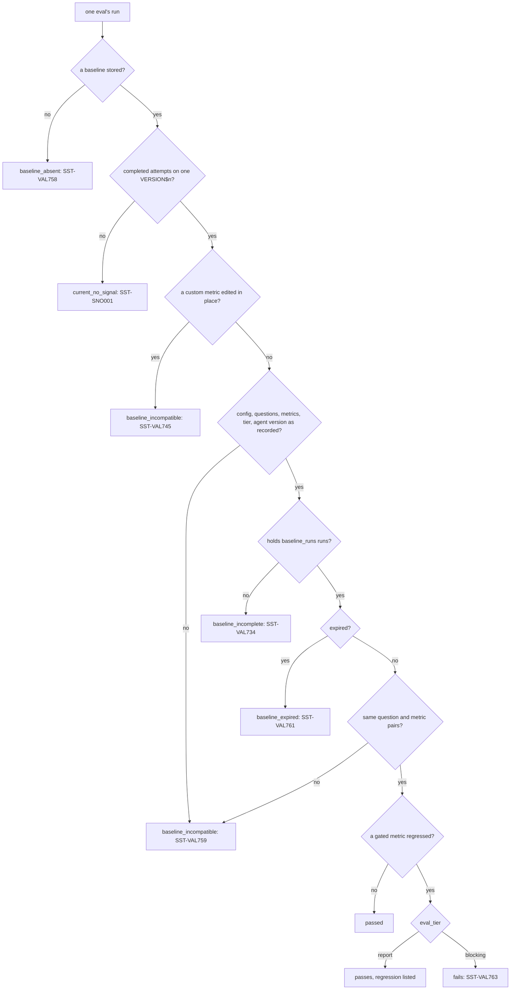

# Evals

An eval runs an agent against a fixed set of questions and scores the answers.
SST publishes the question set and run configuration with the agent, runs them
with `sst eval`, and gates a change by comparing the scores with
a captured **baseline**.

## Layout

```text
agents/
  sales_analyst/
    agent.yml
    evals/
      dataset.yml
      config.yml
eval_metrics/
  answer_grounding.yml     # optional custom judges, shared by every eval
```

Every file in an agent's `evals/` folder is read: one with `questions:` is a
dataset, any other a run configuration. Each declares a `name:` (`SST-PRS002`),
unique among the folder's files of its kind (`SST-VAL765`). The agent names the
pair it runs:

```yaml
# agents/sales_analyst/agent.yml
evals:
  dataset: "{{ eval_dataset('sales_questions') }}"
  config: "{{ eval_config('sales_nightly') }}"
```

Both keys are required (`SST-PRS002`), and each is one reference call: a path or
any other bare value is an error naming the function to write (`SST-REF050`),
and a call of another function `SST-REF041`. A name that no file of that kind in
the agent's own `evals/` folder declares is `SST-REF048`; another agent's files
are not searched. A linked file or folder is refused (`SST-PRT009`). A file
names no agent: the folder it sits in says whose eval it is, and an `agent:`
key is an error (`SST-PRS126`). A file the agent does not name is still
validated, against the named file of the other kind, so a folder can hold the
next config before the agent switches to it.

Eval objects always publish into their agent's schema, so an eval and the agent
it evaluates move between targets together. Neither eval file may set
`database`, `schema` or `enabled` (`SST-VAL703`), and `evals:` in
`sst_config.yml` holds defaults, never a location.

## The dataset

```yaml
name: sales_questions
description: Order and revenue questions the agent must route correctly.
questions:
  - question: How many orders were placed at each location from January to March 2026?
    ground_truth:
      ground_truth_invocations:
        - tool_name: SALES
          tool_input: Count orders grouped by location for January to March 2026.
          tool_output: An order count per location.
      ground_truth_output: |-
        The reply reports an order count for every location and names the
        months it covers.
```

- Each question needs at least one expectation: `ground_truth_invocations`,
  `ground_truth_output`, or `required_filters` (`SST-VAL705`). An empty
  `ground_truth_invocations` list is an expectation too: that no tool is called.
- `tool_name` is the name the agent exposes for the tool, matched exactly, case
  included; an unknown name is an error (`SST-VAL708`). Write `tool_input` and
  `tool_output` as prose: an input that is SQL text is a brittle match
  (`SST-RND022`).
- Dates are absolute. A relative date such as "last quarter" or "yesterday" in
  a question or an expectation is an error (`SST-VAL706`): its meaning changes
  between runs, so scores from different days stop being comparable.
- A `ground_truth_output` holding a number in digits must also declare
  `immutable: true` and an `immutable_reason` saying why the figure cannot
  change (`SST-PRS015`). An absolute date is not such a figure: "in 2024",
  "Q3 2024", "March 5, 2024", "2024-03-31" and "as of 2024-03-31" need
  neither, while "2000 orders" still does.
- A question byte-identical to one of the agent's `sample_questions` is a
  warning (`SST-VAL707`): the agent was tuned on it, so it catches nothing.
- A dataset smaller than `evals.+min_dataset_rows` is a warning (`SST-VAL710`),
  and `SST-VAL711` (info) counts the agent's tools no question expects.
- `description` is for reviewers; it is never sent to Snowflake.

### Writing good questions

The gate catches a question that used to pass and now fails, so a question is
worth as much as its expectation stays true while nothing about the agent
changes.

- Assert what survives new data. Which tools are called, with an absolute date
  range in their input, and a `ground_truth_output` that says what the reply
  must contain -- both periods, the direction of change -- stay true as rows
  land; a figure does not, which is why one needs `immutable: true`.
- Ask what the agent should decline, with `ground_truth_invocations: []` and an
  output that describes the refusal. `tool_selection_accuracy` scores it with
  no LLM judge (`SST-VAL725`).
- Keep a few core questions the agent must always answer right beside broader
  coverage. SST gates every question alike, so this is a way of writing the
  dataset, not a key: make sure the core passes before capturing, because a
  question a gated metric failed in any baseline run cannot regress against
  that baseline.

Drawn from: [eval_dataset.py](../../snowflake_semantic_tools/domain/validate/eval_dataset.py), [gate.py](../../snowflake_semantic_tools/app/evals/gate.py).

### How the dataset is published

`sst apply` publishes the dataset in the agent's schema. With `dataset.mint:
auto`, the default, it creates a source table named by
`dataset.source_table_template`, loads one row per question, creates the
evaluation dataset named by `dataset.name_template` over it, and adds a version
`SST_<12 hex>` whose METADATA records the agent, the source table, the payload
digest and, in a git work tree, the commit (`SST-VAL714` warns when it cannot).
Adding that version needs OWNERSHIP of the dataset (`SST-VAL713`).

In the dataset templates, `{{ sha7 }}` is the first seven characters of the
question payload's digest, not the commit. Changed questions so publish a new
table and dataset under new names; the old ones stay, and `sst plan --prune`
only reports them, because a run or baseline may still reference them. State
keeps those earlier tables and datasets as SST's, so reverting to earlier
questions is an update that reuses the table and dataset SST minted for them,
with their run history, rather than an unmanaged object (`SST-PLN024`).
A table and dataset state does not record at all, as an apply stopped after
minting them leaves, are adopted the same way when the dataset holds the
eval's `SST_<12 hex>` version and its METADATA names the same agent, source
table and payload digest; otherwise they are `SST-PLN024`.

`dataset.mint: never` creates nothing: the dataset the template names must
already exist (`SST-SNO003`), and only the run configuration publishes. The
dataset file must still hold the same questions, because every run's results
are checked against them.

## The run configuration

```yaml
name: sales_nightly
config:
  agent_version: committed
  eval_tier: blocking
  retry: 1
  concurrency: 2
  baseline_runs: 5
dataset:
  name_template: EVAL_{{ agent | upper }}_{{ sha7 }}
  source_table_template: EVAL_SRC_{{ agent | upper }}_{{ sha7 }}
metrics:
  system:
    - name: tool_selection_accuracy
      version: v3
      gate: true
      threshold:
        min: 0.8
    - name: answer_correctness
      version: v3
      gate: false
  custom:
    - "{{ eval_metric('answer_grounding') }}"
run:
  name_template: EVAL_{{ agent | upper }}_{{ sha7 }}_{{ variant }}_{{ ts }}
  variant: ci
```

| Key | Meaning |
|---|---|
| `config` | The eval's own settings: the `evals:` keys of `sst_config.yml` without their `+` (`SST-CFG053` for any other). Each wins over the [folder routes](#settings-and-folder-routes) over its agent's folder and the block root. `agent_version`, or a `run:` setting such as `run.retry`, written outside `config:` is an error naming its `config:` key (`SST-PRS126`). |
| `config.agent_version` | `committed` (the agent's default version, which only `sst apply` moves), `alias:<name>`, or `VERSION$<n>`. `LIVE`, or no version set anywhere, is refused (`SST-VAL719`): an eval must run against a version that cannot change under it. Each run resolves the selector to a concrete `VERSION$<n>`. |
| `dataset.name_template`, `dataset.source_table_template` | Both required (`SST-VAL762`). They take `{{ agent }}` or `{{ agent \| upper }}`, which the dataset name must use (`SST-PRS002`), and `{{ sha7 }}`. Names are capped at 128 characters (`SST-VAL702`, `SST-PRS010`). |
| `dataset.mint` | `auto` (default) or `never`; see above. |
| `metrics.system` | Snowflake's metrics: `tool_selection_accuracy`, `tool_execution_accuracy`, `answer_correctness`, `logical_consistency`. Each takes `name`, `version`, `gate` and `threshold`. |
| `metrics.custom` | One `{{ eval_metric('<name>') }}` per custom judge (`SST-REF026` when none has that name). |
| `run.name_template` | Takes `{{ agent }}`, `{{ sha7 }}` (the commit's first seven characters; outside a git work tree, the eval's fingerprint's), `{{ variant }}` and `{{ ts }}` (compact UTC, `YYYYMMDDTHHMMSSZ`). It must carry `{{ sha7 }}` (`SST-VAL718`) and be unique per agent (`SST-VAL717`). Every attempt after the first -- a retry, or a baseline capture's further runs -- appends `_R2`, `_R3`, and so on. |
| `run.variant` | Why the run happened; fills `{{ variant }}`. Default `ci`. |
| `run.label`, `run.description` | Rendered into the run's `run_params`. |
| `run.accept_statuses` | Only `COMPLETED` (`SST-PRS013` otherwise). A partial status is never a pass (`SST-VAL730`). |

A `sweep:` block is refused in this release (`SST-CFG044`).

### Metrics, versions and judge models

A system metric pins `version`, so a scoring change on the Snowflake side cannot
move a gate silently. Only `v3` is accepted: no version here or in
`evals.+metric_version` is `SST-VAL722`, and any other is `SST-PRS013` (with the
warning `SST-VAL723`). `v1`, which Snowflake refuses when a run starts, is
`SST-VAL764` in place of the warning, and no severity override lowers it. A system metric's judge comes with its version, so
`judge_model` on one is an error (`SST-VAL724`). `tool_selection_accuracy` uses
no LLM judge (`SST-VAL725`, info); gating on the reference-free
`logical_consistency` is a warning (`SST-VAL726`).

A custom metric must name its judge `model`, or inherit `evals.+judge_model`; a
missing or `auto` model, here and in `evals.+judge_model`, is `SST-VAL738`, and
when `snowflake.orchestration_models` is set the model must be in it
(`SST-VAL739`).

From 2026-10-13, Snowflake runs an unversioned or `auto` system metric at
version `v3` rather than `v1`, and a custom metric with no judge model on
`claude-sonnet-4-6` (behavior change BCR-2442). SST is unaffected: it always
renders an explicit `version` and an explicit judge `model`, and accepts no
other. Scores from different metric versions or judge models are not
comparable, so a baseline records each metric's version, and each custom
metric's judge model and definition digest; a run whose metrics differ from its
baseline's is [not compared](#when-a-baseline-stops-matching).

### Thresholds and gating

A metric's `threshold` (`min`, `max`, or both, with `min <= max`) decides whether
it **passed** on a question: it passed when Snowflake scored it without an
error and the score lies inside the threshold. A metric without a threshold
passed whenever it was scored.

`gate: true` makes a system metric **gated**, and a custom metric's
`gate_default: true` does the same: its regressions against the baseline count.
A gated system or routing metric needs a usable threshold; an ungated metric may
not have one, nor may a custom metric's `threshold_default` appear without
`gate_default` (`SST-VAL733`). A gated custom metric with no `threshold_default`
passes on every question it is scored, so it regresses only when scoring fails. Whether a regression fails the run is the eval's
[tier](#tiers-and-exit-codes).

## Custom judges

A custom metric is an LLM judge with a prompt and score bands. Every `.yml` or
`.yaml` file under `eval_metrics/` (`project.eval_metrics_dir`), at any depth,
is one metric:

```yaml
# eval_metrics/answer_grounding.yml
name: answer_grounding
description: Whether the answer is grounded in the view it cites.
model: claude-sonnet-4-6
score_ranges:
  min_score: [0, 1]
  median_score: [2, 3]
  max_score: [4, 5]
prompt: |-
  You are scoring whether an analytical answer is grounded in the semantic
  view it claims to have used.

  Score 4 to 5 when the cited view can answer the question and the answer
  says which view it used.
  Score 2 to 3 when the view can answer it but the answer omits the view or
  the units.
  Score 0 to 1 when the cited view cannot answer the question.

  If evidence is insufficient or two scores are tied, choose the lower score.
  Return the numeric score alone.
gate_default: true
threshold_default:
  min: 3
```

- `score_ranges` are three contiguous integer bands (`SST-PRS114`).
- The prompt must state its scale and how to report the score (`SST-VAL741`,
  `SST-VAL742`), stay inside the bands (`SST-VAL747`), and say what to do on a
  tie or with too little evidence (`SST-VAL743`). It may use only the judge's
  placeholders, such as `{{ input }}`, `{{ output }}` and `{{ ground_truth }}`
  (`SST-PRS116`).
- `gate_default` gates the metric in every eval that uses it, and
  `threshold_default` needs a `min` inside the bands (`SST-PRS115`).
- `enabled: false` leaves the metric out of every eval config; `meta` is never
  rendered.
- A name that is a system metric's is an error (`SST-VAL737`).

An eval includes the metric with `{{ eval_metric('answer_grounding') }}`; the
judge creates no Snowflake object, and its name, model, bands and prompt are
inlined into each eval config that uses it.

A custom metric has no Snowflake version: its name is what its scores are
filed under. So once an eval using it is applied, `sst plan` refuses an edit to
its model, prompt or bands under the same name (`SST-VAL744`). Publish the
edited judge under a new name, such as `answer_grounding_v2`.

## Settings and folder routes

An eval's settings are the `evals:` block's keys, and each resolves through the
one [precedence chain](configuration.md#precedence): the config file's own
`config:`, then the closest folder route over its agent's folder under
`agents_dir/`, then the block root, then the default below. Evals always
publish into their agent's schema, so `+database` and `+schema` are refused
(`SST-CFG015`); a route that names no folder is `SST-CFG041`.

```yaml
evals:
  +eval_tier: blocking
  +retry: 1
  ops:                     # the evals of the agents under agents/ops/
    +eval_tier: report
```

| Key | What it sets |
|---|---|
| `+agent_version` | the agent version a run targets |
| `+metrics` | `metrics.system`, when the `metrics:` block has no `system` key: each listed system metric, ungated and without a threshold. `system: []` enables none. A name that is not a system metric is `SST-PRS013`. |
| `+metric_version` | each system metric's `version` |
| `+judge_model` | each custom metric's `model`; a system metric's judge comes with its version |
| `+eval_tier` | `blocking` or `report`, else `report`; see [tiers](#tiers-and-exit-codes) |
| `+retry` | extra attempts allowed after attempts that did not pass, else 0 |
| `+concurrency` | the runs in flight at once; at the root, across the suite, and the ceiling a route or an eval's `config:` is checked against (`SST-VAL731`) |
| `+baseline_runs` | completed runs a baseline captures, else 1 |
| `+min_dataset_rows` | the dataset size below which `SST-VAL710` warns |
| `+retention` | the retention class, `audit` or `decision`, reported with each run's results; SST never deletes runs or eval objects |
| `+candidate_models` | the orchestration models a [comparison](#comparing-orchestration-models) runs beside the pinned one; never `auto` (`SST-VAL770`), and each listed in `snowflake.orchestration_models` when that is set (`SST-VAL771`) |
| `+compare_runs` | the runs of each model a comparison makes, else 2 |

`sst list evals --long` prints each eval's settings and where each came from.

`apply.eval_config_stage.stage` names the stage, in each agent's schema, that
holds the rendered run configurations (default `EVAL_CONFIGS`).

## Offline checks and connected runs

Everything above is checked offline: `sst compile` reports the dataset,
configuration and judge diagnostics without connecting to Snowflake, and
`sst compile --emit-ddl` writes each eval's rendered run configuration and source
table statements, so a review can diff them.

`sst eval` is connected: it runs the agent in Snowflake, so expect the run times
below. `sst test` never runs an agent; it only smoke-probes what was published.

## Running

```bash
sst compile
sst apply --target dev
sst eval --target dev --capture-baseline --reason "first baseline"
sst eval --target dev
```

The first `sst eval` captures a baseline; every later one runs the evals and
gates them on it. A gate run with no baseline fails (`SST-VAL758`) before any of
its runs starts.

### Before any run starts

1. The compiled manifest must be the one the project compiles to now; a missing,
   stale or other-target manifest stops the suite (exit 4).
2. The suite takes the target's run lock, the one `sst apply` takes, and holds
   it until it ends, so no apply on any machine regenerates what the evals run
   against. A lock another run holds stops the suite before any eval starts
   (`SST-APL011`, exit 1, as it stops `sst apply`), naming the run that holds
   it; `data.error` says the same. `--break-stale-lock` takes over a lock whose
   run has expired (`SST-APL010`), never a live one.
3. Every eval it would run must be applied exactly as this manifest renders it,
   so a result always describes the published agent. An eval never applied on
   the target is `SST-APL036` (`SST-APL037` once, when no eval is), one applied
   from an older compile `SST-APL038`, and one whose live eval changed since it
   was applied `SST-APL012`.
4. **Role preflight.** An evaluation runs as Snowflake tasks, which run as the
   session's primary role and ignore secondary roles. So the primary role must
   hold `CREATE TASK`, `CREATE STAGE` and `CREATE FILE FORMAT` on each agent's
   schema: granted to it, to a role or database role granted to it, or through
   ownership of the schema. SST reads the grants upward, from the roles `SHOW
   GRANTS ON SCHEMA` names, climbing `SHOW GRANTS OF ROLE` and `SHOW GRANTS OF
   DATABASE ROLE` toward the primary role, through a chain of at most 16 roles;
   it never lists the primary role's own grants, which can be many. A privilege
   only a secondary role holds is `SST-VAL727`; one no role in the session holds
   is `SST-VAL728`. Either stops the suite before any run starts (exit 1).
5. **Baselines.** Unless the run captures, each eval's agent version is
   resolved and its stored baseline read, and an eval the baseline cannot gate
   is refused before it starts: no baseline (`SST-VAL758`), one captured for
   another agent version, dataset, config, metrics or tier (`SST-VAL745`,
   `SST-VAL759`), one with too few runs (`SST-VAL734`), or one that has expired
   (`SST-VAL761`) -- the checks [When a baseline stops matching](#when-a-baseline-stops-matching)
   lists. Every attempt runs on the version resolved here, and the run lock
   keeps an apply from committing another meanwhile, so the refusal is exact.
   The other evals still run, and the suite then fails (exit 1); with
   `--fail-fast`, a refusal starts no eval at all. The run's next step names
   the capture that replaces the baseline. An eval whose agent version does not
   resolve is not checked here; the step below reports it.
6. Each eval's agent version is resolved (`SST-VAL720` when it does not
   exist), and its staged run configuration is read back and uploaded again
   unless it matches what was applied. A config stage with another file
   format is `SST-VAL729`.

### Attempts, retries and concurrency

Each eval runs as one or more **attempts**, each a Snowflake evaluation run,
started in the agent's schema with `EXECUTE_AI_EVALUATION('START', ...)`. An
attempt **passed** when its run ended `COMPLETED` and its results were read
and matched the compiled dataset and metrics.

Attempts run in rounds. The first round starts, for every eval, as many
attempts as it still needs: one for a gate run, `baseline_runs` for a baseline
capture. Once every attempt of the round has ended, the next round starts one
attempt for each that did not pass, while `retry` allows: an eval may make its
needed attempts plus `retry` in all. So an attempt is retried only after one did
not pass -- it failed, settled partially completed, could not be started, its
status or results could not be read, or it ran out of time -- and never after a
`CANCELLED` run.

When a retry completes in its place, each attempt that did not pass is reported
as the warning `SST-APL029`, naming its run, its status and its details, rather
than with what it reports on its own (`SST-APL023`, `SST-APL024`,
`SST-SNO001`); the eval passes. When none completes, every attempt reports its
own diagnostic, and the suite fails.

A round runs at most this many attempts at once, across all evals, each on a
session of its own: `evals.+concurrency`, else the largest `concurrency` any
eval resolves, else `--threads` (else `$SST_THREADS`, else `generation.threads`),
else 1. Every attempt re-invokes the agent on every question, so concurrency is
real load and real spend. With `--fail-fast`, evals run one after another, and
the suite stops after the first one that did not pass.

### Polling

SST reads each run's status every 5 seconds, until the run reaches a terminal
status:

- `CREATED`, `INVOCATION_IN_PROGRESS`, `INVOCATION_COMPLETED` and
  `COMPUTATION_IN_PROGRESS` keep it polling. Any other status ends the attempt:
  `COMPLETED` passes, and any other, such as `FAILED`, `CANCELLED` or one
  Snowflake does not document, fails it (`SST-APL023`, with the run's status
  details).
- **Deadline.** A run that has not ended 20 minutes after SST asked Snowflake to
  start it fails (`SST-APL023`); the time the start itself takes counts. SST
  cancels it in Snowflake (`EXECUTE_AI_EVALUATION('CANCEL', ...)`), so it does
  not go on computing, and billing, with nothing to read it. It does the same
  for any run whose status it gave up reading. The cancel is best effort: the
  `SST-APL023` message says whether it went through, and names the run when it
  did not.
- **Per-read timeout.** Each status read may take 30 seconds at most, network
  retries included, and never longer than what is left of the deadline; a slow
  read uses up the time it took. Reading a completed run's results has the
  same limit.
- **Transient reads.** A read that fails on the network is retried at the next
  poll, with a `warn` line. Only five failed reads in a row fail the
  attempt (`SST-APL023`), and then only after one last read, so a run that
  completed while the network was down is still kept rather than retried. A
  read that succeeds resets the count. A read that times out after its 30
  seconds -- most often because the warehouse is busy with the runs' own judges
  -- is retried too, but it is not a failed read: it resets the count, and
  only the deadline ends polling through such reads. A `warn` line says when a
  run's reads start timing out. A read Snowflake answered with something
  SST cannot use, such as a row describing another run, fails the attempt at
  once.
- **Partial statuses settle.** `PARTIALLY_COMPLETED` and
  `INVOCATION_PARTIALLY_COMPLETED` are provisional: Snowflake can report a run
  as `PARTIALLY_COMPLETED` for up to a minute after its last metric is scored,
  while it finalizes the run, and then report the same run `COMPLETED`. So a
  partial status does not end the attempt when it is first read: the suite keeps
  polling and accepts it only once it has read the same status for 3 minutes,
  counted from its first read (failed reads in between included). Any other
  status restarts the wait, and a run that turns `COMPLETED` is kept without a
  retry. A partial status still read at the deadline ends the attempt. A run
  that settles partially completed is reported as `SST-APL024` and, when
  `retry` allows, retried like any attempt that did not pass.

None of these limits is configurable.

### Progress on stderr

A run takes minutes, so the suite shows its runs on stderr while they go on.

On a terminal, each run in flight is one live row, redrawn in place under its
eval's key: a spinner, its status, and its time so far, in the order the runs
started, above the run's own progress line. A run that ends leaves the rows and
prints once as a finished line, so only work in flight stays live, however many
evals the suite has:

```text
✓ eval:jaffle_analyst  COMPLETED · 72.4s
⠋ eval:store_ops_analyst         INVOCATION_IN_PROGRESS  1m05s
⠋ eval:guest_experience_analyst  CREATED  14s
```

A retried attempt keeps its row (`attempt 2 of 3`), and a status read that fails
or times out shows on the row and also prints as a warning line, so it outlives
the row. When more runs are in flight than the terminal has rows, the rows show
the first of them and `+N more running`.

Without a terminal (CI, a pipe), the suite prints a line to stderr when each
attempt starts, when its status changes, when a status read fails and is
retried, when a run's status reads start timing out, and when the attempt ends,
plus a line naming the runs still in flight
at most once a minute. A poll that sees no change prints nothing. For example:

```text
eval run EVAL_SALES_ANALYST_1a2b3c4_ci_20261008T091500Z: starting (attempt 1 of 2)
eval run EVAL_SALES_ANALYST_1a2b3c4_ci_20261008T091500Z: CREATED after 1s
eval run EVAL_SALES_ANALYST_1a2b3c4_ci_20261008T091500Z: INVOCATION_IN_PROGRESS after 32s
waiting on 1 run: EVAL_SALES_ANALYST_1a2b3c4_ci_20261008T091500Z INVOCATION_IN_PROGRESS 1m02s
waiting on 1 run: EVAL_SALES_ANALYST_1a2b3c4_ci_20261008T091500Z INVOCATION_IN_PROGRESS 2m03s
eval run EVAL_SALES_ANALYST_1a2b3c4_ci_20261008T091500Z: INVOCATION_COMPLETED after 2m43s
eval run EVAL_SALES_ANALYST_1a2b3c4_ci_20261008T091500Z: COMPUTATION_IN_PROGRESS after 2m48s
waiting on 1 run: EVAL_SALES_ANALYST_1a2b3c4_ci_20261008T091500Z COMPUTATION_IN_PROGRESS 3m04s
warn  eval run EVAL_SALES_ANALYST_1a2b3c4_ci_20261008T091500Z: status read failed (1/5), retrying: <first line of the error>
waiting on 1 run: EVAL_SALES_ANALYST_1a2b3c4_ci_20261008T091500Z COMPUTATION_IN_PROGRESS 4m05s
eval run EVAL_SALES_ANALYST_1a2b3c4_ci_20261008T091500Z: COMPLETED after 4m51s
eval run EVAL_SALES_ANALYST_1a2b3c4_ci_20261008T091500Z: ended COMPLETED after 4m51s
```

A partial status says how long it is given to settle, once, when it is first
read:

```text
eval run EVAL_SALES_ANALYST_1a2b3c4_ci_20261008T091500Z: PARTIALLY_COMPLETED after 6m55s (waiting up to 3m00s for it to settle)
eval run EVAL_SALES_ANALYST_1a2b3c4_ci_20261008T091500Z: COMPLETED after 7m30s
eval run EVAL_SALES_ANALYST_1a2b3c4_ci_20261008T091500Z: ended COMPLETED after 7m30s
```

An attempt that ends without a terminal status says why: `ended START_FAILED`
or `ended STATUS_FAILED`. With several runs in flight their lines interleave,
each whole, and the `waiting on` line lists every run, a run no read has
described yet as `STARTING`. `--quiet` and `--output json` print none of
these lines.

### How long a run takes

- **One attempt** takes as long as Snowflake needs to invoke the agent on every
  question and then score every metric: minutes, growing with the number of
  questions, the judged metrics (one model call per question for each), and the
  SQL the agent's tools run. On top of that, SST notices the end within one poll
  interval (5 seconds), holds a partial status up to 3 minutes, and reads the
  results. An attempt ends at most about 21 minutes after its run was started:
  the 20-minute deadline, one last read of up to 30 seconds, and a results read
  of up to 30 seconds.
- **Retries** add rounds, and a round waits for all of its attempts, so a
  failed attempt's retry starts only after the slowest attempt of its round has
  ended. A gate run makes at most `1 + retry` attempts per eval, one round each.
- **Concurrency** sets how many attempts of a round run at once. With nothing
  set it is 1, and every run waits for the one before it.
- **A baseline capture** starts `baseline_runs` attempts per eval in its first
  round, so it takes several run times unless concurrency covers them.

For the configuration above (`retry: 1`, `concurrency: 2`, `baseline_runs: 5`)
and a run that takes 7 minutes, a gate run takes about 7 minutes, about 14 when
its first attempt fails and the retry passes, and at most about 42 when both
reach the deadline. A capture runs its five runs two at a time, about 21
minutes, plus a 7-minute retry round if one of them fails.

Ctrl-C or `SIGTERM` stops the suite and releases the lock (exit 130). A run
already started goes on in Snowflake: the message names each one, for you to
check or cancel.

### Reading results

Each attempt prints as a tree. Its line names the eval, its status and how many
questions passed; under it come a published attempt's run name, each metric's
pass count, average and threshold, what the attempt cost, and the questions that
fell short, each with its score per metric and why:

```text
eval:jaffle_concierge  unpublished  COMPLETED  6/7 questions passed
├── answer_correctness       7/7 passed  average 0.986  approximate, never gates
├── tool_selection_accuracy  6/7 passed  average 0.929  needs at least 0.8
├── cost  37.2s wall · 102.6s agent time · agent 250,640 in / 1,651 out
│         not measured: LLM calls, judge tokens
└── 1 of 7 questions fell short  (-v lists every question)
    └── ✗ 6  Which jaffles on the menu have no meat in them?
        ├── answer_correctness       1.00
        └── tool_selection_accuracy  0.50  needs at least 0.8
            ├── expected  menu_search
            └── called    menu_search, menu_search
```

Here the agent called `menu_search` twice where the question expects one call,
so it scored 0.5 (one match over one match and one extra call) and the run
failed on question 6. `-v` (`sst -v test ...`) lists every question instead, each
with its time and the agent's tokens, every metric's tools or judge's reason,
and the agent's answer; a reason or an answer is cut to two lines:

```text
└── questions  6 of 7 passed
    ├── ✓ 1  How long are deliveries from Brooklyn taking?  4.1s · 38,862 in / 715 out
    │   ├── answer_correctness       1.00
    │   │   └── reason  The answer gives the Brooklyn store's current delivery time
    │   │               in minutes, as the expected answer does.
    │   ├── tool_selection_accuracy  1.00
    │   │   ├── expected  delivery_eta
    │   │   └── called    delivery_eta
    │   └── answer  Deliveries from the Brooklyn store are currently taking about
    │               **40 minutes**.
```

How to read the numbers:

- **A question's score** has two places; an **average** has three, over the
  questions that metric scored. `needs at least 0.8` is the metric's
  `threshold` (`{min: 0.8}`); `needs at most`, and `needs 0.5 to 0.9` for a
  band, read the same way. A failing score shows the threshold beside it.
- **Agent time** adds each question's time with the agent. Questions run at
  once, so it can exceed **wall**, how long the attempt took from its first
  question to its last answer; wall is measured for unpublished runs only.
- **Agent tokens** and **LLM calls** are the agent's own: what it read and
  wrote answering, and how many model calls it made. **Judge tokens** are the
  scoring calls' tokens, which a published run reports per metric.
- A count nothing measured is listed after `not measured:` instead of showing 0.
  An unpublished run measures the agent's tokens, from each reply's usage, but
  not its LLM calls or the judge's tokens, which `DATA_AGENT_RUN` and
  `AI_COMPLETE` do not report.
- A published run's called tools come from the evaluation service's
  tool-selection criteria; when those cannot be read, the service's explanation
  is shown instead. A regression the gate found is marked `regressed` on its
  question and counted on its metric's line.

`--quiet` prints each attempt's line, metrics and cost, and no questions.
`-o plain` prints the same tree without connectors or colour, each line indented
by its depth, and cuts nothing.

With `--output json`, `data` carries `evals` (each eval's retention class and
attempts), `attempt_count`, `cost_totals`, `regression_count`, `regressions`,
`gate_verdict` (`passed`, `regressed`, `no_signal`, `captured`, or
`not_evaluated` when a baseline capture captured nothing, as when it falls
short), `gate_reasons`, and `captured_baselines`. Each attempt carries its
`run_name`, `attempt`, `terminal_status`, `status_details`, `retrieval_error`,
`metric_summaries`, `cost`, `wall_ms` (null unless measured) and `questions`.
Each question carries its `index` in the dataset, `question_key`,
`input_query`, `passed`, the agent's `answer` or `error`, `expected_tools`
(null when the question states no expectation) and `called_tools` (null when
not known), `metrics` (each with `metric_name`, `score`, `passed`, `threshold`
as `{min, max}` and `explanation`), and its own `cost`. Every cost carries
`duration_ms` (agent time), the judge's `prompt_tokens`, `completion_tokens`
and `total_tokens`, the agent's `total_input_tokens`, `total_output_tokens` and
`llm_call_count`, and `unmeasured`, the names of the fields nothing measured.
Credits are not attributed.

## Baselines

A baseline records, for each question and metric, whether the metric passed in
each of `baseline_runs` completed runs of the published agent. It keeps only
metadata -- pass flags, each metric's threshold and gating, the tier, and the
identities of the dataset, the run configuration, the agent version (and the
`sst-spec:` fingerprint its comment carries) and the metrics -- never a
question, an answer or a score. Baselines are stored in
Snowflake, per target, in a table beside SST's state table named after it with
the suffix `_EVALS`. (They are not the diagnostic baseline file,
`.sst/baseline.json`.)

### Capturing

Capture a baseline on purpose, with a reason that is recorded beside it:

```bash
sst eval --capture-baseline --reason "new tool for supply cost"
```

`--capture-baseline` and `--reason` go together (exit 3 otherwise), and a
capture is refused with `--unpublished`, `--compare-models` or `--refresh-cost`
(exit 3). A capture
runs each eval until `baseline_runs` attempts have completed, starting all of
them in its first round, and gates nothing. It takes the first `baseline_runs`
completed attempts, all against one agent version. The baselines of every eval
are written together, and only when every eval got its runs: a capture that
falls short writes none and exits 1, reporting each attempt's own outcome and
then `SST-VAL734` for each eval that completed too few. `SST-VAL746` (info) records the version
each system metric was captured under.

### What a gate compares

A gate run compares its one passing attempt with the baseline, question by
question. A gated metric **regresses** on a question when it passed that
question in every baseline run and failed it now. A question a gated metric
failed in any baseline run cannot regress, so a larger `baseline_runs` keeps
questions the agent answers inconsistently out of the gate. Ungated metrics
never regress; they are only reported.

### When a baseline stops matching

The gate compares nothing, and the run fails whatever its tier, until a new
baseline is captured, when:

- the eval has no baseline: `SST-VAL758` (`baseline_absent`);
- a custom metric's judge model or definition differs from the one the baseline
  recorded: `SST-VAL745` (`baseline_incompatible`);
- anything else the baseline recorded differs -- the questions, the rendered
  run configuration (metrics and their versions, agent selector, dataset name,
  label), a threshold or gate flag, the tier, the set of question and metric
  pairs, or the agent version the run resolved: `SST-VAL759`
  (`baseline_incompatible`). The agent version matches when it is the
  `VERSION$<n>` the baseline was captured on, or when its comment carries the
  same `sst-spec:` fingerprint the baseline recorded from that version's
  ([agents guide](agents.md#publishing)): a revert or restore commits a new
  version holding a specification already gated, and the baseline still
  applies. Publishing a version with another specification needs a new
  baseline, and so does one without an `sst-spec:` comment, such as a version
  committed outside SST; a baseline captured before SST recorded the
  fingerprint matches only its own version. A change to only the agent's
  comment, profile, tags, alias, or `secure` adds no version, so the baseline
  stays valid;
- the baseline holds fewer runs than `baseline_runs` now asks: `SST-VAL734`
  (`baseline_incomplete`);
- it has expired: `SST-VAL761` (`baseline_expired`);
- no attempt completed and was read, so there is nothing to compare:
  `SST-SNO001` (`current_no_signal`).

The reason is listed in `gate_reasons`, and `gate_verdict` is `no_signal`.
`SST-VAL759` names each part that differs, such as `it was captured on
VERSION$2, and this run uses VERSION$3` or `metric 'answer_correctness' changed
its threshold`. Every reason but the question and metric pairs and
`current_no_signal` is known before the run starts, so an eval refused for one
of them starts no run ([Before any run starts](#before-any-run-starts)); the
checks are made again once the run's attempts are in. For `baseline_absent`,
`baseline_incompatible`, `baseline_incomplete` and `baseline_expired`, running
the suite again cannot pass, so the run's next step is the capture,
`sst eval --select <eval> --capture-baseline --reason "<why>"`.

**After upgrading to the SST that pins agent defaults by name** (the same
upgrade as the one-time `SST-PLN107` pins in the
[agents guide](agents.md#versions-the-default-and-releases)).
`agent_version: committed` used to render `LAST`, the newest committed version;
it now renders `DEFAULT`, the version `sst apply` pinned, since a model
comparison commits versions newer than the release. The rendered run
configuration changes once, so each eval's config is republished on the next
apply and its baseline stops matching (`SST-VAL759`): capture each again once,
`sst eval --capture-baseline --reason "committed runs on the pinned default"`.

### Expiry

A baseline expires 30 days after it is captured. In its last 7 days each gate
run warns (`SST-VAL760`); after that the gate reports the expired baseline as an
error (`SST-VAL761`) until a new one is captured.

### Tiers and exit codes

The eval's `eval_tier` setting, else `report`, decides what a regression
does: `blocking` fails the run with `SST-VAL763` (exit 1); `report` lists it in
`regressions` with `gate_verdict: regressed`, and the run passes.

`sst eval` exits 0 when every eval passed and its gate compared cleanly; 1
when another run holds the lock, an attempt failed without a retry passing, the
preflight refused, the gate could not compare, a blocking eval regressed, or a
capture fell short; 3 for an invalid command line; 4 when the manifest is stale
or no eval matches the selection; 5 when Snowflake cannot be reached; and 130
when interrupted.

### How the gate reaches its verdict

The gate checks one eval's run in this order, and the first check that fails
gives the reason, which fails the run whatever its tier. Each check down to the
expiry is first made before the run starts, against the agent version the eval
resolves to, and an eval that fails one starts no run; its gate is recorded
with no runs:



A run that gets past the expiry check against a baseline with 7 days or fewer
left also warns (`SST-VAL760`). Across the suite, `gate_verdict` is `no_signal`
when any eval's gate gave a reason, else `regressed` when any eval regressed,
else `passed`.

Drawn from: [gate.py](../../snowflake_semantic_tools/app/evals/gate.py), [suite.py](../../snowflake_semantic_tools/app/evals/suite.py), [results.py](../../snowflake_semantic_tools/domain/model/eval/results.py).

## Comparing orchestration models

`--compare-models` answers "which model should this agent pin?" with the eval
the project already gates on. It runs the eval's questions on its *subject*,
the published agent or CoWork profile the eval scores, `compare_runs` times per
model, the pinned one and each candidate, and
reports how each scored, what it cost, which questions it fixed or broke, and
whether any candidate clearly beats the pinned model. Nothing it does changes
what anyone is served: adopting a winner is an ordinary change and
`sst apply`.

### Setting it up

Name the candidates beside the eval settings, or under a folder route, or in
one eval's `config:`. When the project sets `snowflake.orchestration_models`,
each candidate must be one it lists (`SST-VAL771`); `auto` is never a candidate
(`SST-VAL770`):

```yaml
evals:
  +candidate_models:
    - claude-opus-4-8
    - claude-haiku-4-5
  +compare_runs: 2          # runs per model; the default
```

The subject must be published exactly as compiled, with its default pinned by
name, so run `sst plan` and `sst apply` first.

### Running a comparison

```bash
# every eval --select picks, against its +candidate_models
sst eval --compare-models --select eval:jaffle_analyst --target dev

# candidates named on the command line instead, three runs each
sst eval --compare-models claude-opus-4-8,claude-haiku-4-5 --compare-runs 3 \
  --select eval:cowork_profile:gtm --target dev

# an hour later: read the cost that had not landed yet, and decide again
sst eval --refresh-cost sst_target/compare/jaffle_analyst_20261022T043148Z/compare.json --target dev
```

`--compare-models` is refused with `--capture-baseline` or `--unpublished`, and
an eval with no candidate is `SST-VAL772`. The
pinned model, the one `+orchestration_model` names, always runs too; a
candidate equal to it runs once, as pinned. A CoWork profile is compared only
where its eval runs: on a rehearsal target, never where CoWork lists it
([Evaluating CoWork profiles](#evaluating-cowork-profiles)).

A comparison of one eval with two candidates and two runs each takes about as
long as one eval run: every run starts at once.

### What a comparison changes in Snowflake

Each candidate runs on a real committed version of the published agent, so
Snowsight's Evaluations tab lists every run against its version. Under the run
lock `sst apply` takes, for each subject the comparison:

1. checks it is published exactly as compiled: its plan is NOOP, it has a live
   version, its alias (when it sets one) is on its release, and its default is
   pinned by name to that release (`SST-APL108` otherwise: run `sst plan`, then
   `sst apply`);
2. commits the live version, which holds the released specification, as a
   version commented `hold`. Until step 4 the subject has no live version, so a
   caller naming no version is served the default, which is the release
   ([which version a caller gets](agents.md#versions-the-default-and-releases));
3. for each candidate, stages the released specification with only
   `models.orchestration` changed, adds a version from it, and moves the alias
   `EVAL_<MODEL>` onto it from wherever an earlier comparison left it. The
   alias is the model's name upper-cased, every character but a letter or digit
   made `_`: `claude-opus-4-8` is `EVAL_CLAUDE_OPUS_4_8`;
4. adds a version of the released specification commented `restore`, and opens
   the live version from it. Step 4 runs even when steps 2 or 3 failed, and
   before any evaluation starts, so the subject is without a live version for
   seconds.

The runs then name their version: the pinned model's by `VERSION$<n>`, each
candidate's by its alias. What never changes:

- the default and the release's alias, which only `sst apply` moves;
- what a caller is served: the live version holds the released specification
  before and after, and a candidate is never written into it;
- the eval's baseline and recorded state.

The versions a comparison commits stay, each commented
`sst-eval-model:<model> run:<id>` (`hold` and `restore` for the copies). Plan
never takes one for a release, never reports one as drift, and never unsets an
`EVAL_` alias; an `+alias` of the project's own starting `EVAL_` is refused
(`SST-VAL561`). Comparing again moves each `EVAL_` alias to the new run's
version; the older version keeps its runs in Snowsight, and
`SHOW VERSIONS IN AGENT` lists them all. Comparing two candidates with the
pinned model adds four versions: the hold copy, one per candidate, and the
restore copy.

### Runs and cost

Every model runs `--compare-runs`, else `+compare_runs`, else 2 times. Each
run's config differs from the published one only in `agent_version`; the
dataset version, metrics and judges are the published ones, so the models are
compared on exactly what the gate measures. Nothing is gated.

Cost comes from Snowflake's usage views:

| Figure | From |
|---|---|
| agent credits, per model | `SNOWFLAKE.ACCOUNT_USAGE.CORTEX_AGENT_USAGE_HISTORY`, by each question's request |
| SQL credits | the same rows' `METADATA:sql_query_credits` |
| judge tokens | the eval spans' judge requests in `CORTEX_REST_API_USAGE_HISTORY`, which has tokens but no credits |
| credits per question | agent credits, with SQL credits once known, per question answered |

The views lag up to an hour (SQL credits up to eight), so a figure not landed
yet is **pending** (`SST-VAL773`): `--refresh-cost <compare.json>` reads them
again, ranks and decides again, and rewrites both files, running nothing. A
role that may not read the views reports cost **unavailable** (`SST-VAL774`);
the scores stand. A CoWork profile's cost is its router's alone: the subagent
runs it routed to are not attributed (`SST-VAL776`), so compare each subagent
on its own eval for what it costs.

### Reading the report

The terminal prints, per eval, the models ranked, the questions where a
candidate fixes or breaks the pinned model's result, and the verdict:

```text
eval:jaffle_analyst  6 questions × 2 runs  winner claude-opus-4-8
  #  model              role       tool_selection_accuracy        answer_correctness  credits/q  p95    version
  1  claude-opus-4-8    candidate  1.00  [         ●]  1.00-1.00  1.00                0.1169     27.5s  VERSION$6 EVAL_CLAUDE_OPUS_4_8
  2  claude-sonnet-4-6  pinned     0.92  [        ● ]  0.92-0.92  1.00                0.0526     36.7s  VERSION$4
  3  claude-haiku-4-5   candidate  0.78  [      ├●┤ ]  0.72-0.83  0.86                0.0177     14.8s  VERSION$7 EVAL_CLAUDE_HAIKU_4_5
  questions that differ
    q3  claude-opus-4-8 fixes  Which jaffles on the menu have no meat in them?
    q6  claude-haiku-4-5 breaks  What was revenue by product at each location in 2025?
  verdict  claude-opus-4-8 beats the pinned claude-sonnet-4-6 on tool_selection_accuracy (1.00 vs 0.92) outside the spread, at 2.2x the credits per question.
  pin      # agent.yml of agent 'jaffle_analyst'
           config:
             orchestration_model: claude-opus-4-8
```

`report.html` and `compare.json` are written to `--compare-report`, else
`sst_target/compare/<eval>_<UTC time>/`. The HTML page is one self-contained
file: no scripts, nothing fetched, so it opens offline and can be attached to a
review. It shows the verdict, a scorecard per model, each metric's mean with
the spread of its runs against the gate's threshold, quality against credits
per question, a question-by-model grid (hover a cell for the judge's reason,
and for a profile, the route), the cost breakdown, and what was held fixed.
`compare.json` is the [`sst.compare/1`](../design/compare-report-schema.md)
object; `--output json` prints the same object as its `data`.

Models rank by their gated metric means in metric order, then the ungated
ones, then credits per question and p95 latency. The verdict is one of:

| Verdict | When |
|---|---|
| `winner` | a candidate beats the pinned model on the first gated metric with its lowest run above the pinned model's highest, each having completed at least 2 runs |
| `no_clear_winner` | a candidate leads, but the runs overlap or there are too few to tell a lead from noise: compare more runs |
| `pinned_holds` | no candidate's mean is higher; a candidate that ties at a lower price is named in the summary |
| `incomplete` | the pinned model or every candidate scored no run |

A model `SHOW CORTEX BASE MODELS` lists as preview, internal or deprecated is
reported but never named the winner (`SST-VAL775`).

### Adopting a winner

The verdict's `pin` lines are the change to review, never one SST makes. They
pin the model for the compared subject alone, in its own file, since the
comparison measured that subject and no other:

```yaml
# agents/sales/jaffle_analyst/agent.yml
config:
  orchestration_model: claude-opus-4-8
```

Moving every agent at once, with `agents.+orchestration_model`, is a separate
decision each agent's own comparison should back. Then:

1. `sst plan` shows the agent's update with a new version;
2. `sst apply` publishes it and moves the alias and the default to it;
3. capture the eval's baseline again, since the model change is a
   specification change (`SST-VAL759`); until then the eval's gate fails with
   `no_signal`, whatever its tier:
   `sst eval --select eval:jaffle_analyst --capture-baseline --reason "pin claude-opus-4-8"`.

The `EVAL_` versions stay; the next comparison moves their aliases.

### When a comparison goes wrong

| Code | What happened | What to do |
|---|---|---|
| `SST-APL108` | the subject is not published as compiled | `sst plan`, then `sst apply`, then compare again |
| `SST-APL109` | a candidate's version could not be committed | the other candidates still ran; the detail is Snowflake's error |
| `SST-APL110` | the live version could not be restored | callers naming no version are served the release meanwhile; `sst plan`, then `sst apply`, repairs it |
| `SST-VAL773` | some cost has not landed yet | `sst eval --refresh-cost <compare.json>` in about an hour |
| `SST-VAL774` | the role may not read the usage views | the scores stand; read them with a role that may |
| `SST-MAN032` | `--refresh-cost` cannot use the file | point it at a `compare.json` a comparison wrote |

A comparison killed outright, before its restore ran, leaves the agent with no
live version, so callers naming no version are served the release. The next
`sst plan` shows the drift (`SST-PLN102`); `sst apply` commits a release of the
same specification and opens the live version from it, and breaks the killed
run's lock (`SST-APL010`).

## Trying a change before publishing

Each published eval run grades a published agent, so the loop above adds an
agent version per edit. Before that, cheapest first:

1. Ask the edited agent a question with [`sst ask`](ask.md):
   one temporary agent, nothing published.
2. Run its evals unpublished, below.
3. Publish to a [per-developer target](#a-per-developer-target) and run the
   published suite there.

### Unpublished eval runs

```bash
sst eval --unpublished --target dev
sst eval --unpublished --select sales_analyst --output json
```

`--unpublished` asks each question of each selected eval's compiled dataset of
its agent's compiled specification: a temporary agent per question, dropped
once it answers, in the agent's schema or `agents.+scratch_schema`. As
[`sst ask`](ask.md) does, each view, search service, tool, skill and sub-agent the
agent reaches that compiles differently from what the target's state records is
copied there first, once per agent, and the agent is pointed at the copies, which
are dropped when the run ends. Questions run at once as the
[suite's concurrency](#attempts-retries-and-concurrency) allows, each on a
session of its own. Nothing else of the published suite happens: no `sst
compile` or `sst apply` is needed first, no run lock is taken, the publication
checks (`SST-APL036` to `SST-APL038`, `SST-APL012`) and the agent version selector (`SST-VAL719`) do not
apply, no config is staged, and no baseline or gate state is read or written.
`--capture-baseline` and `--compare-models` are refused with it (exit 3).

Each metric is scored from the reply:

| Metric | Scored |
|---|---|
| `tool_selection_accuracy` | Exactly, and gates. Only calls of tools the agent's specification declares count, so Snowflake's own system tools (`server_skill`, `system_execute_sql`) never do, and a `data_to_chart` tool is ignored, called or expected, as the evaluation service ignores an extra chart (measured on a live account). The calls that remain are compared with the tools `ground_truth_invocations` lists as multisets, names matched without case: the score is the matched calls over matched, missing and extra calls, so one expected tool called twice scores 0.5, as the evaluation service scored it (measured). An empty list expects no call; a question without the key is unscored. |
| `answer_correctness` | Approximately, by an SST-written judge prompt asking whether the answer meets `ground_truth_output`, on 0 to 1. The judge is the eval's `judge_model`, else the agent's orchestration model; with neither, or `auto`, it is unscored (`SST-ASK004`). A question with no `ground_truth_output` is unscored. |
| a custom metric | Approximately, by its own prompt and `model`, on its own score bands, with `{{ input }}`, `{{ output }}`, `{{ ground_truth }}`, `{{ tool_info }}`, `{{ duration }}`, `{{ error }}` and `{{ status }}` filled from the reply. A prompt that names neither `{{ input }}` nor `{{ output }}` is given the question and the answer after it, as the evaluation service gives them. A prompt using `{{ start_timestamp }}`, a `{{ span_* }}` placeholder or `{{ llm_model }}`, which only a published run's trace fills, is unscored (`SST-ASK004`). |
| `tool_execution_accuracy`, `logical_consistency` | Not at all: only the evaluation service scores them (`SST-ASK005`, info). |

Each judge is one `AI_COMPLETE` call at temperature 0 asking for JSON with a
`score` and a `reason`; one that fails, or answers no number on the metric's
scale, leaves that question unscored (`SST-ASK006`). These rules are SST's own,
calibrated against the evaluation service on one live project: tool selection
matched the service's pass count and average score, while a judged metric's average
differed by up to a point on a 0 to 5 scale. An unpublished score is a signal
for iterating, never a substitute for the published gate.

**Gating.** Only exact metrics gate, on their thresholds alone: a question
`tool_selection_accuracy` scores outside its `threshold` fails the run
(`SST-ASK007`, exit 1), which names each such question with its score and the
tools it was expected to call and called. A judged metric's scores are
reported, marked `approximate, never gates` and listed under
`approximated_metrics`, and never fail the run or a question. An agent that
cannot answer a question also fails it (`SST-ASK002`). The output is the
published suite's, [read the same way](#reading-results), with one attempt per
eval named `unpublished` and the judge's reason for each judged score;
`--output json` adds `"mode": "unpublished"`, `approximated_metrics`,
`unscored_metrics` and a `gate_verdict` of `passed` or `failed`. The exit codes are the suite's: 0 passed, 1 failed, 3
a refused command line, 4 no eval in the selection, 5 Snowflake unreachable.

**What it sees** is what [`sst ask`](ask.md) sees: the agent on scratch copies
of each edited view, search service, tool, skill and sub-agent it reaches, so an
unpublished edit to one of them is what its questions run against. A copy
Snowflake refuses fails the run (`SST-ASK008`).

### A per-developer target

When a change needs the evaluation service itself, a baseline, or an edited view
tried together with the agent, publish it to a target of your own, never the
one others publish to, then run the loop under [Running](#running) against it:

```yaml
# profiles.yml
my_project:
  outputs:
    dev_jdoe:
      type: snowflake
      account: my_account
      user: JDOE
      role: ANALYST
      database: DEV_JDOE
      schema: SEMANTIC
      warehouse: DEV_WH
```

```bash
sst plan --target dev_jdoe --defer-target prod
sst apply --target dev_jdoe --defer-target prod
sst eval --target dev_jdoe
```

- **Each developer needs a state table of their own, and object locations of
  their own.** A target whose routes overlap another's, or that shares its state
  table, sees every object the other published as unmanaged (`SST-PLN024`).
  Routing every block and `state:` by `{{ target.database }}` and
  `{{ target.schema }}`, as the reference project does, gives each target its
  own.
- **Agents may live in a personal database; evals may not.** Measured on a live
  account, an agent in `USER$<user>.PUBLIC` is created and runs. But Snowflake
  creates no table, dataset or stage in a personal database (error 060119), and
  an eval publishes its source table, dataset and config stage in its agent's
  schema. So `sst validate` and `sst plan` refuse an eval whose agent resolves
  to a `USER$` database (`SST-VAL766`); `sst ask` and `--unpublished` runs,
  which create only temporary agents, still work for it. Give an agent whose
  evals you publish a schema in an ordinary database.
- A permanent agent's specification is staged on `apply.agent_spec_stage`,
  which defaults to the target's own database and schema, so a target whose own
  database is a personal one needs that stage routed to an ordinary schema.
  SST does not check this before apply.
- `--defer-target prod` resolves the dbt models the views read to production's
  relations, so the developer's views query production data.

## Evaluating CoWork profiles

> **Snowflake private preview.** CoWork profiles are a Snowflake private
> preview (PrPr) feature. See Snowflake's
> [About profiles in Snowflake CoWork](https://docs.snowflake.com/en/LIMITEDACCESS/snowflake-cortex/about-cowork-profiles)
> and
> [Set up profile routing in Snowflake CoWork](https://docs.snowflake.com/en/LIMITEDACCESS/snowflake-cortex/set-up-cowork-profile-routing).
> What follows was measured on a preview account and may change before
> general availability.

A [CoWork profile](cowork-profiles.md) answers nothing itself: its router hands
each question to one of its subagents, or declines it. Its own failures are
routing failures: the wrong agent, a route where it should decline, or a
decline where it should route. A profile's eval is scored on those, with
`routing_accuracy`, a metric SST computes itself from the run's trace, beside
the Snowflake metrics and custom judges that still read the answer.

### Layout

```text
cowork_profiles/
  gtm/
    cowork_profile.yml
    evals/
      dataset.yml
      config.yml
```

```yaml
# cowork_profiles/gtm/cowork_profile.yml
evals:
  dataset: "{{ eval_dataset('gtm_routing') }}"
  config: "{{ eval_config('gtm_ci') }}"
```

The `evals:` block and the `evals/` folder beside `cowork_profile.yml` are read
as an agent's are, under [the same rules](#layout). A profile's eval is keyed
`eval:cowork_profile:<profile>`, so it never shares a key, or a baseline, with
an agent of the same name; `--select` and `--exclude` take that key. Its eval
objects publish into the profile's schema, and [folder
routes](#settings-and-folder-routes) may name a profile's folder.

### The dataset

```yaml
# cowork_profiles/gtm/evals/dataset.yml
name: gtm_routing
questions:
  - question: Which campaigns had the best return on spend?
    ground_truth:
      ground_truth_subagents: ["{{ agent('guest_experience_analyst') }}"]
      ground_truth_output: The reply ranks campaigns by return on spend.
  - question: Which suppliers deliver late most often?
    ground_truth:
      ground_truth_subagents: []        # the profile should decline
      ground_truth_output: The reply declines and points to the Jaffle profile.
```

`ground_truth_subagents` lists the subagents a question may be routed to, any
one of them, each written as the profile's `spec.subagents` entry writes it:
`{{ agent('<name>') }}` for an agent the project publishes, `{{ tool('<name>')
}}` for one a tool member names. An empty list expects the profile to decline.
Compile renders each entry as the qualified name the profile's router gives that
agent on the target, so dev and prod each score against their own agents, and
the rendered names are in `GROUND_TRUTH`, where a custom judge's
`{{ ground_truth }}` reads them.

| Code | When |
|---|---|
| `SST-VAL881` | An entry names no subagent of the profile; the message lists them. |
| `SST-VAL883` | A row sets `ground_truth_invocations`: no metric that reads it sees a router's calls. |
| `SST-VAL884` | No row sets `ground_truth_subagents` (warning). |
| `SST-VAL885` | No row expects a decline (info). |
| `SST-VAL768` | An agent's dataset sets `ground_truth_subagents`. |

The [dataset rules](#the-dataset) for agents apply unchanged: relative dates,
the row floor, duplicate names.

### The run configuration

```yaml
# cowork_profiles/gtm/evals/config.yml
name: gtm_ci
config:
  agent_version: committed
dataset:
  name_template: EVAL_{{ agent | upper }}_{{ sha7 }}
  source_table_template: EVAL_SRC_{{ agent | upper }}_{{ sha7 }}
metrics:
  routing:
    - name: routing_accuracy
      gate: true
      threshold: {min: 0.9}
  system:
    - name: answer_correctness
      version: v3
      gate: false
  custom:
    - "{{ eval_metric('states_its_scope') }}"
run:
  name_template: EVAL_{{ agent | upper }}_{{ sha7 }}_{{ variant }}_{{ ts }}
```

`metrics.routing` takes one metric, `routing_accuracy`, with `gate` and
`threshold` as a system metric takes them (`SST-VAL733`, `SST-VAL735`). Its
score lies in [0, 1], so a bound outside it is `SST-VAL769`; on an agent's eval
the block is `SST-VAL767`. It is never written into the config Snowflake runs.
For one question, with E the subagents it accepts and A the router's routes, one
per routing call:

- E empty: 1 when A is empty, else 0.
- Otherwise: 0 when A is empty, else the routes in A that are in E over all the
  routes in A.

Names compare as Snowflake resolves them. A question with no
`ground_truth_subagents` has no score and fails, as does one the run left
untraced (below). The score uses no judge, so the same routes always score the
same, and it is fit to gate.

Which of Snowflake's metrics work on a profile:

| Metric | On a profile's eval |
|---|---|
| `answer_correctness`, `logical_consistency` | Score as for an agent. |
| a custom judge | Scores as for an agent; `{{ ground_truth }}` holds the rendered subagents. |
| `tool_selection_accuracy`, `tool_execution_accuracy` | Blind: neither sees a router call, so every record reports no tool invoked, and a row that expects a decline scores 1.0 whatever the router did. The profile's config naming either, in `metrics.system` or its own `config.metrics`, is `SST-VAL882`. One inherited from `evals.+metrics` or a folder route is left out, with `SST-VAL887` (info). |

Snowflake is sent only its own metrics and the custom judges, so a profile's
config needs at least one of them beside `routing_accuracy`: one with none is
`SST-PRS101`, and one left with none once the inherited tool metrics are left
out is `SST-VAL888`.

### How routing is scored

Once a run completes and its results are read, SST reads the run's spans from
`SNOWFLAKE.LOCAL.AI_OBSERVABILITY_EVENTS` in one query: each record's root span,
and one span per routing call, whose
`snow.ai.observability.agent.tool.agent_router.subagent_name` attribute names
the subagent chosen. Records are matched to questions by the record id
`GET_AI_EVALUATION_DATA` reports. The query is filtered by the run's name and
the profile both: a run's spans outlive `EXECUTE_AI_EVALUATION('DELETE')`, and
each attempt's run name carries its timestamp, so no read mixes in another
run's records.

A record with a root span and no routing span was declined. A record with no
root span has not been traced yet, so it is not read as a decline: the spans
are read up to six times in all, the poll interval apart, and never past the
attempt's deadline. A question still untraced fails `routing_accuracy` with
no score (`SST-SNO035`, a warning). Whether spans can lag a run's terminal
status is not measured. A read that fails in transit is tried again the same
way; one Snowflake refuses, or one SST cannot read, fails the attempt
(`SST-SNO034`), as results that cannot be read do, and the attempt is
[retried](#attempts-retries-and-concurrency) as any such attempt is.

[Reading results](#reading-results) shows each question's subagents under
`routing_accuracy`, as it shows tools under tool selection:

```text
    └── ✗ 2  Which suppliers deliver late most often?
        ├── answer_correctness  1.00
        └── routing_accuracy    0.00  needs at least 0.9
            ├── expected  none (a decline)
            └── routed    JAFFLE_CX_DEV.AGENTS.GUEST_EXPERIENCE_ANALYST
```

`routed none` is a decline, and `routed not known` a question the run left
untraced. With `--output json` each of the profile's questions also carries
`expected_subagents` and `routed_subagents`; an agent's questions carry
neither.

A baseline records `routing_accuracy` at the version of its rule,
`sst:routing_accuracy:v1`, with its threshold and gating. The config Snowflake
runs does not carry them, so changing either leaves the eval's config
fingerprint alone, and the baseline still stops matching
(`SST-VAL759`, naming the metric).

### Where a profile's eval runs

A profile's eval runs only where its profile is a rehearsal: on a target that
publishes the profile to `SNOWFLAKE_INTELLIGENCE.PROFILES`, the eval does not
compile (`SST-VAL886`, an info that strict mode leaves alone), so nothing of it is planned there. CoWork
lists every agent in that schema as a profile, and eval tables, datasets and
stages there are not measured. The rehearsal routes the same way, so evaluate it
on a target that publishes the profile elsewhere, such as dev.

`sst eval --unpublished` refuses a profile's eval before it
connects (`SST-ASK013`): an unpublished run would need a temporary router agent,
which is not measured. `sst ask` does not run profiles.

### Privileges

Reading the spans needs a role that can read
`SNOWFLAKE.LOCAL.AI_OBSERVABILITY_EVENTS`. They were read as ACCOUNTADMIN when
measured; what a narrower role needs, and whether the router attributes are
redacted without `READ UNREDACTED AI OBSERVABILITY EVENTS TABLE`, is not
measured. A refused read is `SST-SNO034`.

| Code | Severity | When |
|---|---|---|
| `SST-VAL887` | info | An inherited `metrics` setting's tool metric is left out of a profile's eval. |
| `SST-VAL888` | error | A profile's config has no Snowflake or custom metric once those are left out. |
| `SST-SNO034` | error | A profile run's spans could not be read. |
| `SST-SNO035` | warning | Some questions of a profile run have no trace after the last read. |

Drawn from: [routes.py](../../snowflake_semantic_tools/app/evals/routes.py), [routing.py](../../snowflake_semantic_tools/domain/evaluate/routing.py), [eval_subject.py](../../snowflake_semantic_tools/domain/validate/eval_subject.py), [gate.py](../../snowflake_semantic_tools/app/evals/gate.py).
