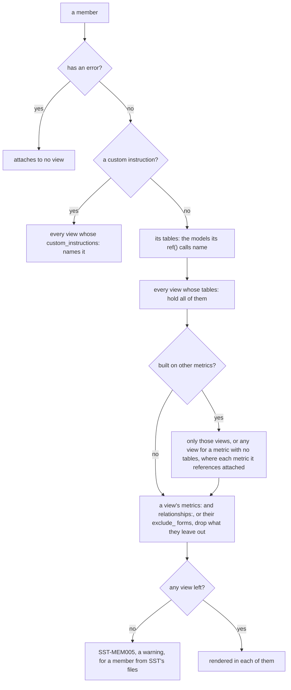

# Semantic views

A semantic view is a set of dbt models plus the members that describe how to
query them. This guide covers every member type. The complete key list is in
the [configuration reference](../reference/config.md); every rule below has an
entry in the [error code reference](../reference/error-codes.md).

Files live under `project.semantic_models_dir` (default `semantic_models/`) and
can be split and named however you like: SST reads every YAML file there, at any
depth, and recognises members by their root key. Views themselves live under its
`semantic_views/` folder, where folder routes apply; a view anywhere else is not
built and is reported (`SST-PRS004`).

### File shapes

The usual file holds one item, as a mapping under its type's singular root, and
is named for it:

```yaml
# semantic_models/metrics/total_revenue.yml
metric:
  name: total_revenue
  description: Order value in cents, including tax.
  expr: "SUM({{ ref('orders', 'order_total') }})"
```

A list under the plural root is still read, and holds any number of items:

```yaml
# semantic_models/metrics/order_metrics.yml
snowflake_metrics:
  - name: order_count
    description: Number of distinct orders placed.
    expr: "COUNT(DISTINCT {{ ref('orders', 'order_id') }})"
  - name: customer_count
    description: Number of distinct customers who placed an order.
    expr: "COUNT(DISTINCT {{ ref('customers', 'customer_id') }})"
```

| Item | Single-item root | List root |
|---|---|---|
| View | `semantic_view:` | `semantic_views:` |
| Metric | `metric:` | `snowflake_metrics:` |
| Relationship | `relationship:` | `snowflake_relationships:` |
| Filter | `filter:` | `snowflake_filters:` |
| Verified query | `verified_query:` | `snowflake_verified_queries:` |
| Custom instruction | `custom_instruction:` | `snowflake_custom_instructions:` |

SST reads a single-item file exactly as a one-item list, so every rule below
applies to both shapes, and a diagnostic points at the line the file writes. A
file may hold items of several types, but not both roots of one type
(`SST-PRS003`), and a singular root must hold a mapping (`SST-PRS003`).
`sst format` lays a single-item file out as it lays out a list item, with `name`
first. The examples below use the single-item shape.

## Views

```yaml
# semantic_models/semantic_views/sales.yml
semantic_view:
  name: sales
  description: |-
    Orders, the customers who placed them, and where. Use for order volume,
    order value, and revenue by customer or location.
  tables:
    - "{{ ref('orders') }}"
    - "{{ ref('customers') }}"
    - "{{ ref('locations') }}"
  variables:
    - name: large_order_cents
      data_type: NUMBER
      description: Threshold above which an order counts as large.
      default_value: 1000
  config:
    max_staleness: 300
    tags:
      - name: "{{ tag('cost_center') }}"
        value: analytics
  custom_instructions:
    - "{{ custom_instructions('sql_conventions') }}"
```

- `tables:` is required and lists models with `{{ ref('<model>') }}`, or dbt
  sources with `{{ source('<source>', '<table>') }}` (a source contributes a
  table but no columns). Any other entry is an error (`SST-REF044`), and so is a
  model listed twice (`SST-PRS006`). Each table's logical name is its model
  name, upper-cased; its relation is the model's relation, so an aliased model
  keeps its model name in the view. `tables:` decides which members attach (see
  [Concepts](../concepts.md#association-how-members-find-views)).
- `description:` is what an agent reads to pick this view; say what it answers
  and what it does not, and when to use it (`SST-VAL005`). It renders as the
  view's `COMMENT`.
- A table's keys, synonyms, `COMMENT` and `distinct_range` come from its dbt
  model (see [Columns](#columns-facts-dimensions-time-dimensions)), so every
  view that holds the table renders it the same. A view does not write
  `table_config` (`SST-PRS126`).
- `variables:` declares view variables that expressions use by bare name. Each
  needs `name`, `data_type` and `default_value`, and a `BOOLEAN`, `NUMBER` or
  string default must be of that type; `description` renders as the variable's
  `COMMENT`. A member that reads a variable must find it declared on every view
  it attaches to (`SST-VAL326`); a variable nothing reads is warned about
  (`SST-VAL220`).
- `config:` holds the view's own settings, described next.

### Settings

`config:` is the only place a view overrides the `semantic_views:` block of
`sst_config.yml`. Its keys are exactly the block's `+` keys without the `+`, and
each resolves through one chain: the view's own `config:`, then the closest
folder route over its file, then the block root, then SST's default. A key the
view leaves out inherits; a key written with no value is an error
(`SST-CFG054`), and any other key under `config:` is an error (`SST-CFG053`). A
value is checked by the rules its `+` key follows. `sst list --long` prints each
view's settings with where each came from (see
[Configuration](configuration.md#precedence)).

- `database` and `schema` are where the view publishes; unset, the target's.
- `enabled: false` keeps a view in the project without publishing it.
- `max_staleness` is in seconds, at least 120 (`SST-CFG023`), and renders as
  `MAX_STALENESS = '300 seconds'`.
- `tags` entries each name one `{{ tag('<name>') }}` declared under `tags:` in
  `sst_config.yml` (`SST-REF028`) and a value of at most 256 characters
  (`SST-PRS026`); an entry that is not a `name` and `value` mapping is
  `SST-PRS027`. A tag is its entry's `fqn:`, else `default_prefix` and its
  name in upper case; an entry with no `fqn:` is an error when the block sets
  no `default_prefix` or its key is dotted (`SST-CFG036`). They render inline
  as `WITH TAG (...)`. A closer setting replaces the whole list. Apply replaces
  the view, which removes any tag on it that its `tags` do not declare, such as
  one set by hand, and plan warns about each first (`SST-PLN039`).

`enabled`, `tags`, and `max_staleness` written beside `tables:` rather than
under `config:` are an error that names their `config:` key (`SST-PRS126`).

### How members attach

A view does not list most of its members: each member finds the views its tables
fit, and each view then narrows what reached it. How one member reaches its
views:



Drawn from: [members.py](../../snowflake_semantic_tools/domain/resolve/members.py), [membership.py](../../snowflake_semantic_tools/domain/resolve/membership.py), [semantic_view.py](../../snowflake_semantic_tools/domain/model/semantic_view.py).

- A member's tables must all be in a view's `tables:`; a view that holds only
  some of them does not get it, even when it joins to the rest. A member left
  unattached that way is warned about, naming the view that reaches the missing
  table only through a join (`SST-MEM010`).
- A member's tables are the models its `ref()` calls name: a metric's or a
  filter's in its expression, and a verified query's in its SQL. A member never
  writes `tables:` (`SST-PRS126`). One that names no model is an error and
  attaches nowhere (`SST-MEM002`), except a derived metric, which needs none:
  it lands in every view that holds all the metrics it references.
- A member with an error is never attached, and neither is a metric built on
  it; a member whose references did not resolve is reported as
  left out (`SST-MEM107`).
- A relationship whose two tables share no view is an error (`SST-VAL205`) as
  well as the warning, and a custom instruction name no block declares is
  `SST-REF007`.
- A member that attaches to more than one view is reported as information
  (`SST-MEM011`).

Drawn from: [membership_tables.py](../../snowflake_semantic_tools/domain/resolve/membership_tables.py), [membership_reach.py](../../snowflake_semantic_tools/domain/resolve/membership_reach.py).

### Narrowing what a view exposes

A view publishes every member its tables attach. To expose a relevant subset,
list what to keep or what to drop, per kind -- never both for one kind
(`SST-VAL329`):

```yaml
semantic_view:
  name: product_costs
  description: |-
    Use for product margin and supply cost by product.
  tables:
    - "{{ ref('order_items') }}"
    - "{{ ref('products') }}"
  columns:                       # or exclude_columns:
    - "{{ ref('order_items', 'item_price') }}"
    - "{{ ref('products', 'product_name') }}"
  metrics:                       # or exclude_metrics:
    - "{{ metric('total_line_item_revenue') }}"
  relationships:                 # or exclude_relationships:
    - order_items_to_products
```

- A column entry is a two-argument `ref()`; a metric entry is a `metric()` call
  or a bare name; a relationship entry is a bare name.
- An entry must name something the view's tables provide (`SST-VAL330`); a
  column excluded globally cannot be listed, and excluding it again only warns
  (`SST-VAL331`).
- A kept metric needs the relationships in its `using_relationships`
  (`SST-VAL332`) and the dimensions its window or non-additive entries name
  (`SST-VAL318`).
- Filters are never scoped: they attach by their tables as usual.

## Columns: facts, dimensions, time dimensions

Columns come from dbt. Each model's YAML carries SST metadata under
`config.meta.sst`:

```yaml
models:
  - name: orders
    description: One row per order.
    config:
      meta:
        sst:
          primary_key: [order_id]
          synonyms: [sale, transaction]
    columns:
      - name: order_state
        description: Where the order is in fulfilment.
        config:
          meta:
            sst:
              column_type: dimension
              synonyms: [order status, fulfilment state]
              is_enum: true
              sample_values: [placed, completed, returned]
```

- `column_type` is `dimension`, `fact`, or `time_dimension`; a time dimension
  renders in `DIMENSIONS`. A column without a `column_type` is not a member of
  any view, and `exclude: true` removes a column from every view.
- The column's dbt `description` renders as its `COMMENT`, `synonyms` as
  `WITH SYNONYMS (...)`, and `sample_values` as `SAMPLE_VALUES (...)`.
- `is_enum: true` declares that `sample_values` is the complete set of values
  and renders `IS_ENUM`; it needs sample values (`SST-VAL314`), and only a
  dimension can be an enum (`SST-VAL335`).
- `access_modifier` may be `public_access`, the default, which every column
  renders as. SST does not render a private column, although Snowflake supports
  a private fact: `private_access` is refused on a dimension or time dimension
  (`SST-VAL222`) and on a fact (`SST-VAL334`), rather than published as public,
  and any other value is `SST-VAL333`. A column that is not a member of any
  view is not refused. A metric can be private (see [Metrics](#metrics)).
- The model-level `primary_key` (a list of columns) and `unique_keys` (a list of
  column lists) render as the table's `PRIMARY KEY (...)` and `UNIQUE (...)`; a
  column may not be in both (`SST-VAL223`). See
  [Relationships](#relationships) for what a join needs from them.
- The model's `description` renders as the table's `COMMENT`, its
  model-level `synonyms` as the table's `WITH SYNONYMS (...)`, and
  `distinct_range` as a `DISTINCT RANGE` constraint (see
  [Relationships](#relationships)). A dbt source table takes its `description`
  and `meta.sst.synonyms` the same way.

The `order_state` column above renders as:

```sql
ORDERS.ORDER_STATE AS ORDERS.ORDER_STATE WITH SYNONYMS ('order status', 'fulfilment state') COMMENT = 'Where the order is in fulfilment.' SAMPLE_VALUES ('placed', 'completed', 'returned') IS_ENUM
```

## Metrics

```yaml
# semantic_models/metrics/total_revenue.yml
metric:
  name: total_revenue
  description: Order value in cents, including tax.
  expr: "SUM({{ ref('orders', 'order_total') }})"
  synonyms: [revenue, sales]
```

```yaml
# semantic_models/metrics/revenue_per_order.yml
metric:
  name: revenue_per_order
  description: Mean revenue per order.
  expr: "DIV0({{ metric('total_revenue') }}, {{ metric('order_count') }})"
```

- A metric's tables are the models its expression names with `ref()`; a column
  written without `ref()` is warned about (`SST-VAL110`). A metric with a table
  must aggregate (`SST-VAL101`), and renders under its table, as
  `ORDERS.TOTAL_REVENUE`. `tables:` and `derived:` are not written
  (`SST-PRS126`).
- A metric whose expression names no column and combines other metrics with
  `{{ metric() }}` is derived: it renders unqualified, after the table-scoped
  metrics, in every view that holds all the metrics it references. It cannot
  use window functions (`SST-VAL102`), and metric references cannot form a
  cycle (`SST-REF005`).
- When more than one relationship path joins a metric's table to another table
  in the view, name the path with `using_relationships:`. An ambiguous path is
  an error for the metric (`SST-VAL116`) and a warning for the view (`SST-VAL209`).
  Each entry is a relationship name (or `{{ relationship('<name>') }}`) that
  starts at the metric's table (`SST-VAL114`), and it renders as
  `USING (...)`. A derived metric cannot set it (`SST-VAL113`).
- `access_modifier: private_access` renders the metric as `PRIVATE`; the default
  is `public_access`. The 0.3 key `visibility` is an error (`SST-VAL122`).

### Semi-additive metrics

`non_additive_dimensions:` marks a metric that must not be summed across a
dimension, such as a balance across its snapshot date. Snowflake sorts the rows by
the listed dimensions and aggregates only the values in the last rows of that
order:

```yaml
# Two metrics over one measure, kept together as a list.
snowflake_metrics:
  - name: total_supply_cost
    expr: "SUM({{ ref('supplies', 'supply_cost') }})"
    non_additive_dimensions:
      - dimension: snapshot_month        # latest month: the default order

  - name: opening_supply_cost
    expr: "SUM({{ ref('supplies', 'supply_cost') }})"
    non_additive_dimensions:
      - table: supplies
        dimension: snapshot_month
        sort_direction: descending       # earliest month
        null_order: first
```

- `dimension` names a dimension of the metric's table, or of `table:` when it is
  set; a name that is not a dimension there, or a `table:` outside the view, is
  an error (`SST-VAL118`).
- `sort_direction` is `ascending` (the default, which takes the latest value of a
  date) or `descending` (the earliest). `null_order` is `first` or `last`; left
  unset, Snowflake's default null ordering applies, which sorts nulls last in
  ascending order. Set `null_order: first` when a row with no date must never be
  the one that counts. A `sort_direction` without a `null_order` is warned
  about (`SST-VAL120`).
- List order matters, as in an `ORDER BY`.
- Only a derived metric may reference a semi-additive metric (`SST-VAL107`).

These render only what each entry authors, as `NON ADDITIVE BY (SNAPSHOT_MONTH)`
and `NON ADDITIVE BY (SUPPLIES.SNAPSHOT_MONTH DESC NULLS FIRST)`.

### Window function metrics

A `window:` block makes a table-scoped metric a window function metric: a running
total, a moving average, or a value from an earlier row.

```yaml
metric:
  name: cumulative_customer_count
  description: Running count of customers, by the date of their first order.
  expr: "SUM({{ metric('customer_count') }})"
  window:
    partition_by_excluding:
      - "{{ ref('customers', 'first_ordered_at') }}"
    order_by:
      - ref: "{{ ref('customers', 'first_ordered_at') }}"
        sort_direction: ascending        # optional
        null_order: last                 # optional
    frame: RANGE BETWEEN UNBOUNDED PRECEDING AND CURRENT ROW
```

This renders as one `METRICS` entry:

```sql
CUSTOMERS.CUMULATIVE_CUSTOMER_COUNT AS SUM(CUSTOMERS.CUSTOMER_COUNT) OVER (PARTITION BY EXCLUDING CUSTOMERS.FIRST_ORDERED_AT ORDER BY CUSTOMERS.FIRST_ORDERED_AT ASC NULLS LAST RANGE BETWEEN UNBOUNDED PRECEDING AND CURRENT ROW) COMMENT = 'Running count of customers, by the date of their first order.'
```

- `expr` is one function call, and its first argument is a metric of the same
  table (`{{ metric() }}`) or an aggregate such as `SUM(...)`. A window over a raw
  column is a row-level window; it belongs in a fact or dimension, in the dbt
  model (`SST-VAL126`). `LAG({{ metric('m') }}, 1)` and `AVG(...)` work the same
  way as `SUM`.
- `partition_by` groups rows by the listed entries. `partition_by_excluding`
  instead partitions by every dimension a query requests except those listed.
  Set at most one (`SST-PRS014`).
- `order_by` entries take a reference and, optionally, `sort_direction` and
  `null_order`, with the same values as a non-additive dimension. A bare
  reference is shorthand for `ref:`.
- Each entry is `{{ ref('<model>', '<column>') }}`, naming a dimension the
  metric's table reaches through the view's relationships, or
  `{{ metric('<name>') }}`, naming a metric of the same table. EXCLUDING takes
  dimensions only (`SST-VAL129`).
- `frame` is `ROWS` or `RANGE BETWEEN <bound> AND <bound>`, where a bound is
  `UNBOUNDED PRECEDING`, `UNBOUNDED FOLLOWING`, `CURRENT ROW`, or a number or an
  `INTERVAL '<n> <unit>'` followed by `PRECEDING` or `FOLLOWING`. Anything else is
  an error (`SST-PRS124`); a frame is never passed through as free SQL. A frame
  needs an `order_by` (`SST-VAL127`).
- A window metric's table is the table of the metrics it aggregates, else the
  model its `window:` entries name. It cannot also set `using_relationships` or
  `non_additive_dimensions` (`SST-PRS014`), must belong to exactly one table
  (`SST-VAL102`), and no other metric may reference it (`SST-VAL128`).
- Writing `OVER (...)` inside a table-scoped metric's `expr` is an error
  (`SST-VAL101`); use `window:`.

A query that returns a window metric must also return every dimension in its
partition and order, or Snowflake rejects the query. `SHOW SEMANTIC DIMENSIONS IN
<view> FOR METRIC <metric>` marks them `required`.

## Relationships

```yaml
# semantic_models/relationships/orders_to_customers.yml
relationship:
  name: orders_to_customers
  description: Each order belongs to exactly one customer.
  left_table: "{{ ref('orders') }}"
  right_table: "{{ ref('customers') }}"
  relationship_conditions:
    - "{{ ref('orders', 'customer_id') }} = {{ ref('customers', 'customer_id') }}"
```

`left_table` is the many side and `right_table` the one side, each one
`{{ ref('<model>') }}` call; a bare model name, or anything else, is an error
(`SST-REF046`). The relationship
attaches to every view that holds both tables; one that fits no view is an
error (`SST-VAL205`). Its `description` documents the YAML and is not
published, and `relationship_type` or `join_type` is an error because nothing
renders it (`SST-VAL211`).

Each condition pairs one column from the left table with one from the right
(`SST-VAL204`), and its operator decides the join:

| Condition | Join | Renders |
|---|---|---|
| `a = b` | equality | `REFERENCES T (KEY)` |
| `a >= b` | as-of | `REFERENCES T (KEY, ASOF COL)` |
| `a BETWEEN s AND e` | range | `REFERENCES T (BETWEEN S AND E EXCLUSIVE)` |

`>=` is the only as-of operator, and a relationship has at most one as-of
condition (`SST-PRS112`). A condition of any other shape is an error
(`SST-PRS110`). An as-of join usually pairs a key equality with the comparison:

```yaml
relationship:
  name: order_items_to_orders
  left_table: "{{ ref('order_items') }}"
  right_table: "{{ ref('orders') }}"
  relationship_conditions:
    - "{{ ref('order_items', 'order_id') }} = {{ ref('orders', 'order_id') }}"
    - "{{ ref('order_items', 'occurred_at') }} >= {{ ref('orders', 'ordered_at') }}"
```

which renders as
`ORDER_ITEMS_TO_ORDERS AS ORDER_ITEMS (ORDER_ID, OCCURRED_AT) REFERENCES ORDERS (ORDER_ID, ASOF ORDERED_AT)`.

A range must be the relationship's only condition (`SST-VAL202`), and its right
table's dbt model must declare non-overlapping ranges with `distinct_range`
(`SST-VAL206`). Both bounds must be columns of the model (`SST-VAL219`), and a
`distinct_range` without a `start` and an `end` is an error (`SST-PRS028`):

```yaml
relationship:
  name: orders_to_pricing_periods
  left_table: "{{ ref('orders') }}"
  right_table: "{{ ref('pricing_periods') }}"
  relationship_conditions:
    - "{{ ref('orders', 'ordered_at') }} BETWEEN {{ ref('pricing_periods', 'effective_start_at') }} AND {{ ref('pricing_periods', 'effective_end_at') }}"

# models/pricing_periods.yml
models:
  - name: pricing_periods
    config:
      meta:
        sst:
          primary_key: [pricing_period_id]
          distinct_range:
            start: effective_start_at
            end: effective_end_at
```

The relationship renders as
`ORDERS_TO_PRICING_PERIODS AS ORDERS (ORDERED_AT) REFERENCES PRICING_PERIODS (BETWEEN EFFECTIVE_START_AT AND EFFECTIVE_END_AT EXCLUSIVE)`,
and the table entry gains
`CONSTRAINT PRICING_PERIODS_DISTINCT_RANGE DISTINCT RANGE BETWEEN EFFECTIVE_START_AT AND EFFECTIVE_END_AT EXCLUSIVE`.

The right table of an equality join must declare a `primary_key` or
`unique_keys` (`SST-VAL311`). When no key lies within the join columns the
cardinality is guessed, and SST warns (`SST-VAL210`); when the join columns are
only part of a composite key, the join fans out, and SST warns (`SST-VAL208`).

### Modelling relationships so the numbers stay right

A wrong join still publishes, and its metrics come out plausible and wrong. Three
shapes are worth getting right on purpose.

**An equality join to a snapshot table fans out.** A table with one row per
customer per day, keyed `[customer_id, status_date]`, joined to `orders` on
`customer_id` alone matches each order to every day of that customer's history,
and multiplies every metric that crosses the join. SST warns (`SST-VAL208`). Make
the join as-of instead, so each order matches the one row in effect when it was
placed -- the latest whose `status_date` is at or before `ordered_at`:

```yaml
relationship:
  name: orders_to_customer_daily_status
  left_table: "{{ ref('orders') }}"
  right_table: "{{ ref('customer_daily_status') }}"
  relationship_conditions:
    - "{{ ref('orders', 'customer_id') }} = {{ ref('customer_daily_status', 'customer_id') }}"
    - "{{ ref('orders', 'ordered_at') }} >= {{ ref('customer_daily_status', 'status_date') }}"
```

**A range join has no key.** It matches each row to the one range that contains
it, across the whole right table: SST renders the range alone, so a key
equality beside it is refused (`SST-VAL202`). So it suits a table of
periods that never overlap, such as pricing periods or fiscal quarters. Validity
ranges kept per customer overlap between customers; join those as-of on the
customer key and the range's start.

**Keys and ranges are declarations.** SST checks offline that a primary key or
`distinct_range` is declared, not that the data honours it. When `sst validate`
connects to Snowflake it reads the joined tables: rows of an equality join's
target that repeat a join key are `SST-VAL212`, and overlapping ranges are
`SST-VAL218`.

Drawn from: [joins.py](../../snowflake_semantic_tools/domain/validate/semantic/joins.py), [relationships.py](../../snowflake_semantic_tools/adapters/yaml/semantic/relationships.py), [validate.py](../../snowflake_semantic_tools/app/validate.py).

## Filters

A filter is a named boolean expression. Label it so it renders as a native
filter dimension (`LABELS = (FILTER)` in the view's DDL):

```yaml
# semantic_models/filters/is_completed_order.yml
filter:
  name: is_completed_order
  description: Orders that completed; the default lens for revenue.
  expr: "{{ ref('orders', 'order_state') }} = 'completed'"
  labels: [filter]
```

This renders in `DIMENSIONS` as:

```sql
ORDERS.IS_COMPLETED_ORDER LABELS = (FILTER) AS ORDERS.ORDER_STATE = 'completed' COMMENT = 'Orders that completed; the default lens for revenue.'
```

- A filter's tables are the models its expression names with `ref()`. A
  labelled filter must be boolean (`SST-VAL401`) and must name exactly one
  table.
- A boolean expression without a `labels:` key is an error (`SST-VAL405`).
- A filter not labelled `filter` renders as prose instead: one sentence,
  `For <TABLE>, <name> is <expr>. <description>`, appended to the view's
  `AI_SQL_GENERATION`. Its expression must name exactly one table.
- A filter cannot carry `synonyms:`; nothing renders them (`SST-VAL406`).

## Verified queries

```yaml
# semantic_models/verified_queries/order_count_by_state.yml
verified_query:
  name: order_count_by_state
  description: Order volume by fulfilment state.
  question: How many orders are there in each fulfilment state?
  sql: |-
    SELECT orders.order_state, COUNT(DISTINCT orders.order_id) AS order_count
    FROM {{ ref('orders') }} AS orders
    GROUP BY ALL
  use_as_onboarding_question: true
  verified_at: 1769904000
  verified_by: analytics-team
```

- `sql:` is required (`SST-PRS002`). To keep the query in a `.sql` file, write
  `sql: "{{ file('sql/order_count_by_state.sql') }}"`, resolved relative to the
  YAML file. The file must stay inside the project (`SST-REF027`), not be a
  symbolic link (`SST-PRT009`), and exist (`SST-REF014`); `sql_file:` is not
  written (`SST-PRS126`). Leading `--` comment lines are dropped either way.
- The SQL names each table with `{{ ref('<model>') }}`, which renders as the
  table's logical name in the view, and may use `{{ metric() }}` and
  `{{ var() }}`. A table read by name instead is warned about (`SST-VAL414`).
- Connected validation and the smoke suite run the query with each logical
  table bound to the relation the view reads, so it is checked the same way
  whether the view publishes beside its tables or in another schema or database.
- A query's tables are the models its `ref()` calls name, and it attaches to
  every view that holds all of them. `tables:` is not written (`SST-PRS126`).
- `verified_at` is epoch seconds, or a quoted ISO-8601 date or timestamp (UTC
  unless it says otherwise), which renders as epoch seconds; anything else is an
  error (`SST-PRS017`).
- Each entry renders in `AI_VERIFIED_QUERIES` as `QUESTION`, then whichever of
  `VERIFIED_AT`, `ONBOARDING_QUESTION` and `VERIFIED_BY` are set, then `SQL`.
  The `description` is not published.

## Custom instructions

```yaml
# semantic_models/custom_instructions/sql_conventions.yml
custom_instruction:
  name: sql_conventions
  description: How to shape SQL against these views.
  ai_sql_generation: |-
    Monetary columns are stored in cents; divide by one hundred before
    presenting a currency figure.
  ai_question_categorization: |-
    Decline questions about individual named customers.
```

A view includes a block by listing `{{ custom_instructions('<name>') }}`; a name
that matches no block is an error (`SST-REF007`), and so is a bare string
(`SST-VAL408`). Unlike other members, a block attaches only to the views that
name it. The view's `AI_SQL_GENERATION` is each included block's
`ai_sql_generation`, then one sentence per prose filter (see
[Filters](#filters)), separated by blank lines; `AI_QUESTION_CATEGORIZATION` is
each included block's `ai_question_categorization`. The `description` is not
published.

The text may name members with `{{ filter('<name>') }}`,
`{{ relationship('<name>') }}` and `{{ verified_query('<name>') }}`, which
render as the member's name, so renaming a member breaks the build rather than
the guidance.

The 0.3 spellings `sql_generation` and `question_categorization` are errors.
Written alone, one is reported (`SST-VAL012`) and still read, so a run that
demotes the error renders what was meant; written beside its 1.0 key, it is
reported (`SST-PRS020`) and ignored.

## Checking the rendered view

```bash
sst compile --emit-ddl target/ddl/
```

writes each view's `CREATE SEMANTIC VIEW` statement to `<view>.sql`, offline,
beside the rendered payloads of the project's other artifacts. Diffing that
directory between two commits shows exactly what a change does to the published
DDL. `sst test --suite golden` compares the rendered DDL with files committed
under `--golden-dir` (default `expected/ddl`, relative to the project), and
`--update-golden` rewrites them.

The statement is `CREATE OR REPLACE SEMANTIC VIEW`, with its clauses in
Snowflake's order: `TABLES`, `RELATIONSHIPS`, `VARIABLES`, `FACTS`,
`DIMENSIONS`, `METRICS`, `COMMENT`, `AI_SQL_GENERATION`,
`AI_QUESTION_CATEGORIZATION`, `AI_VERIFIED_QUERIES`, `MAX_STALENESS`,
`WITH TAG`, and always `COPY GRANTS`. A clause with nothing in it is left out.
Relationships, facts, dimensions, and metrics are sorted by name, so adding an
unrelated member does not reorder the rest. Tables keep the order `tables:` lists
them in, variables and tags the order they are declared in, and verified queries
the order they attach in -- their files by path, then each file's entries in
order -- so reordering any of these, or renaming a verified query's file,
changes the statement.
